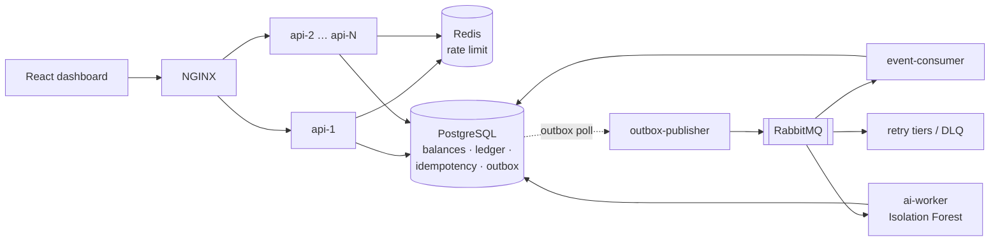

# LedgerFlow AI

A payments backend for virtual money, built to show distributed-systems guarantees
working under real load and real failures. It includes concurrency-safe double-entry
transfers, durable idempotency, stateless replicas behind NGINX, a global Redis rate
limit, reliable events through a transactional outbox, and asynchronous AI anomaly
detection. A React dashboard lets you run experiments against the live stack and watch
what happens.

Everything runs on one machine with Docker Compose. All money is simulated USD.


## Architecture



- **API replicas** are stateless FastAPI processes. Each transfer locks both accounts in
  id order, writes two ledger entries, records the idempotency outcome and inserts an
  outbox event, all in one PostgreSQL transaction.
- **Redis** holds only a Lua token bucket, so the rate limit is global across replicas.
  Writes fail closed if Redis is down.
- **Events** leave through a transactional outbox, so the API never depends on the
  broker. Consumers deduplicate by event id, which gives exactly-once effects on top of
  at-least-once delivery.
- **AI worker** scores each completed transfer after commit, so transfers never wait
  for it.

More detail: [high-level design](docs/architecture/hld.md) ·
[low-level design](docs/architecture/lld.md) · [database](docs/architecture/database.md) ·
[architecture decisions](docs/adr/README.md)

## Key results

| Guarantee | Evidence |
|---|---|
| No double spend | 100 concurrent $10 withdrawals from $100: exactly 10 succeed |
| One effect per idempotency key | 20 concurrent copies give 1 transfer; killing a replica mid-traffic gives 0 duplicates |
| Ledger always balances | Reconciliation passes after every test suite, demo and restore drill |
| Horizontal scaling | Read throughput 252 to 598 req/s from 1 to 4 replicas, 0% errors |
| No lost events | Transfers keep committing during a RabbitMQ outage, and events are delivered once it recovers |
| Anomaly detection | Hybrid detector: precision 0.97, recall 0.985 on held-out accounts |

Write-ups: [financial correctness](docs/case-studies/01-financial-correctness.md) ·
[event reliability](docs/case-studies/02-event-reliability.md) ·
[scaling and performance](docs/case-studies/03-scaling-performance.md)

## Tech stack

Python 3.12+, FastAPI, SQLAlchemy 2, Alembic · PostgreSQL 16 · Redis 7 · RabbitMQ 4 ·
NGINX · scikit-learn · React + TypeScript (Vite) · OpenTelemetry / Jaeger (optional) ·
Docker Compose · pytest, Vitest, Playwright, Locust

## Running it locally

**Prerequisites:** Docker Desktop. To run the tests or the dev frontend you also need
Python 3.12+ and Node 22.

```bash
git clone https://github.com/Raghav242/LedgerAI.git
cd LedgerAI
cp .env.example .env
# Set LAB_TRAFFIC_SECRET (required) and RABBITMQ_MONITOR_PASSWORD in .env. Generate each with:
python -c "import secrets; print(secrets.token_urlsafe(32))"

docker compose up -d --build --wait
```

Once the stack is up, these services are available on your machine:

| Service | Address |
|---|---|
| Dashboard | `http://127.0.0.1:3000` |
| API + Swagger docs | `http://127.0.0.1:8080/docs` |
| RabbitMQ management | `http://127.0.0.1:15672` |

**Failure lab and benchmarks.** To stop and restore Redis, RabbitMQ, workers or replicas
from the browser, run the dev frontend together with the local controller:

```bash
python -m labctl --enable-failures --enable-benchmarks
cd frontend && npm ci && npm run dev        # dashboard on port 5173
```

**Scale to 4 replicas:**

```bash
NGINX_UPSTREAMS=4 docker compose --profile scale4 up -d --wait
```

## Tests

```bash
pip install -e ".[dev]"
docker compose up -d --wait postgres redis rabbitmq

pytest                 # unit, integration, Redis and RabbitMQ tests
pytest -m stack        # end-to-end across replicas, in an isolated Compose project
ruff check .

cd frontend
npm test               # Vitest
npm run test:e2e       # Playwright against the running stack
```

Benchmarks run in their own isolated Compose project:
`python benchmarks/run_benchmarks.py --replicas 1 2 4`.

## Limitations

- **No authentication.** Every caller acts as one demo merchant, and the funding
  endpoint creates simulated money. Do not expose the stack publicly. It binds to
  loopback by default.
- **Single-node PostgreSQL, Redis and RabbitMQ.** A hot account is serialized by its row
  lock (about 105 req/s regardless of replica count).
- **The anomaly model is trained and evaluated on synthetic data only.**

See the [operations runbook](docs/operations.md) and
[security hardening notes](docs/phase-6a-hardening.md) for configuration, backups and
what a public deployment would still need.
