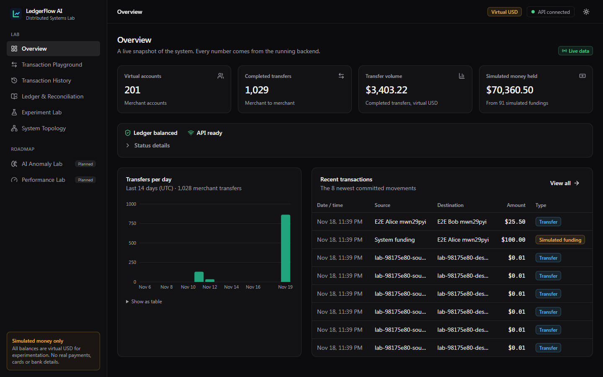
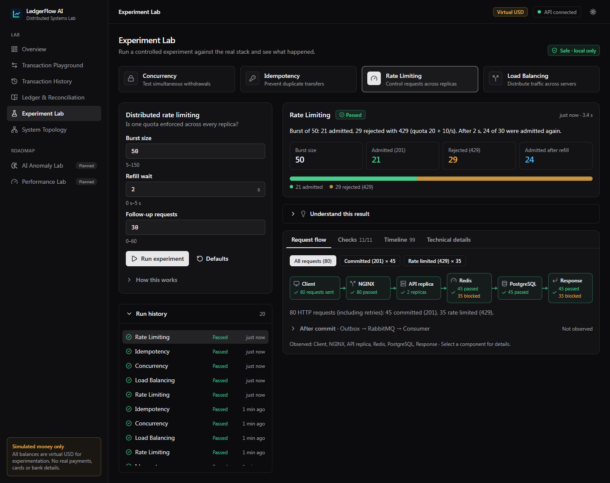
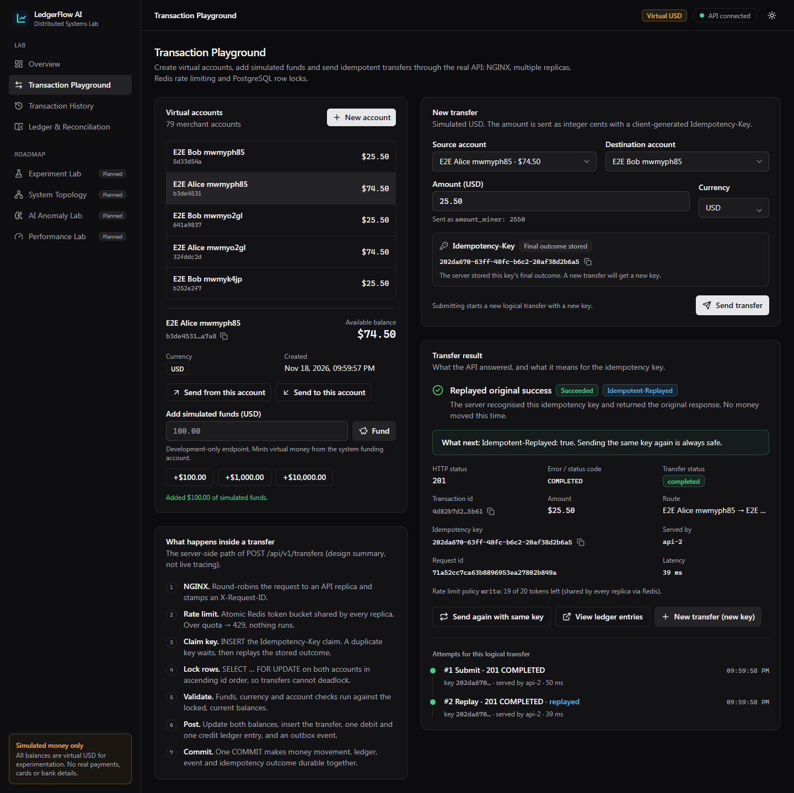

# LedgerFlow AI

A virtual-money payments backend that proves its distributed-systems guarantees with
tests, live experiments and measured benchmarks: concurrency-safe double-entry
transfers, durable idempotency, horizontal scaling behind NGINX, a global rate limit,
reliable events through a transactional outbox, and an asynchronous anomaly detector.
It runs entirely on one laptop with Docker Compose. All money is simulated virtual USD.



## What it demonstrates

| Area | Guarantee | How | Proof |
|---|---|---|---|
| Correctness | no double spend, no lost update | both accounts locked in id order in one PostgreSQL transaction | 100 concurrent $10 transfers from $100 → exactly 10 succeed |
| Retries | one effect per Idempotency-Key, across replicas and crashes | key claimed in the transfer's transaction; exact response replayed | 20 concurrent copies → 1 transfer; replica killed mid-traffic → 0 duplicates |
| Ledger | always balances, immutable | double-entry postings; deferred triggers; runtime DB role is INSERT-only on the ledger | reconciliation after every suite, demo and restore drill |
| Scaling | stateless replicas, one global quota | NGINX round robin (connect-retry only); Redis Lua token bucket, writes fail closed | stack test: exactly one bucket admitted across 2 replicas |
| Events | no lost or phantom events; exactly-once effects | transactional outbox, leased publisher with fencing, consumer receipts, per-consumer DLQs | broker outage, worker crash and poison-message tests on a real RabbitMQ |
| AI | asynchronous scoring, honest evaluation | per-family Isolation Forests + velocity features, model-OR-rules hybrid | burst recall 0.00 → 1.00 on unseen accounts; evaluated on fresh seeds and shifted worlds |
| Operations | reproducible and recoverable | isolated Compose projects for benchmarks and stack tests, verified backups, retention, CI | benchmark left dev data byte-identical; restore drill reconciles |

## Quick start

**Prerequisites:** Docker Desktop, Python 3.12+ and Node 22 (for the dev server and tests).

```powershell
git clone https://github.com/Raghav242/LedgerAI.git; cd LedgerAI
Copy-Item .env.example .env        # then set LAB_TRAFFIC_SECRET (required) and RABBITMQ_MONITOR_PASSWORD:
python -c "import secrets; print(secrets.token_urlsafe(32))"
docker compose up -d --build --wait  # API, workers, AI model, migrations + DB roles, frontend
```

| What | Where |
|---|---|
| Frontend (production build) | http://127.0.0.1:3000 |
| API + Swagger UI | http://127.0.0.1:8080/docs |
| Frontend with the experiment controller (failure lab, benchmarks) | `cd frontend; npm ci; npm run dev` → http://127.0.0.1:5173, plus `python -m labctl --enable-failures` |
| RabbitMQ management | http://127.0.0.1:15672 |

Details: [Getting started](#getting-started) · [operations runbook](docs/operations.md).

## Measured results

**Benchmarks** (isolated `ledgerflow-bench` project; Locust in a container on the same
laptop; 32 closed-loop users; 3 runs of 20 s after a 10 s warmup; mean ± std):

| Workload | 1 replica | 2 replicas | 4 replicas | p95 at 1 → 4 | Errors |
|---|---|---|---|---|---|
| Read-heavy | 252 ± 5 req/s | 361 ± 45 req/s (72%) | 598 ± 26 req/s (59%) | 213 → 133 ms | 0.00% |
| Mixed transfers | 68 ± 7 req/s | 118 ± 6 req/s (86%) | 205 ± 5 req/s (75%) | 740 → 443 ms | 0.00% |
| Hot account (contention) | 54 ± 11 req/s | 102 ± 1 req/s (93%) | 105 ± 4 req/s (48%) | 1333 → 1067 ms | 0.00% |

Reads and independent transfers scale sub-linearly (replica CPU on one shared laptop is
the first limit, PostgreSQL CPU the next for writes); a **hot account plateaus at ~105
req/s** because one row lock serializes it. Rate limit under load: 445 admitted vs a
quota of ~450. Analysis: [case study 3](docs/case-studies/03-scaling-performance.md).

**Anomaly detection** (synthetic data; thresholds chosen on validation; held-out accounts):

| Detector | Precision | Recall | F1 | False positives | Burst recall |
|---|---|---|---|---|---|
| v1 Isolation Forest | 0.766 | 0.689 | 0.725 | 0.33% | 0.000 |
| Rule baseline | 0.972 | 0.982 | 0.977 | 0.04% | 1.000 |
| v2 model alone | 0.497 | 0.759 | 0.601 | 1.21% | 1.000 |
| **v2 hybrid (deployed)** | 0.970 | 0.985 | 0.977 | 0.05% | 1.000 |

When bursts are slowed to 0.6–2 s apart, the fixed rule catches 30% of them and the v2
model 88%. Full analysis, including where the model is weaker: [Phase 6B–6D](docs/phase-6b-6d.md#6b-ai-anomaly-detection).

## Documentation

| | |
|---|---|
| Architecture | [HLD](docs/architecture/hld.md) · [LLD + sequence diagrams](docs/architecture/lld.md) · [database](docs/architecture/database.md) · [ADRs](docs/adr/README.md) |
| Case studies | [financial correctness](docs/case-studies/01-financial-correctness.md) · [event reliability](docs/case-studies/02-event-reliability.md) · [scaling and performance](docs/case-studies/03-scaling-performance.md) |
| Operations | [runbook](docs/operations.md) · [security hardening (6A)](docs/phase-6a-hardening.md) · [public demo design](docs/public-demo.md) |
| Phases | [1](docs/phase-1-design.md) · [2](docs/phase-2-design.md) · [3](docs/phase-3-design.md) · [4A](docs/phase-4a-design.md) · [5A](docs/phase-5a-design.md)–[5F](docs/phase-5f-design.md) · [6A](docs/phase-6a-hardening.md) · [6B–6D](docs/phase-6b-6d.md) |
| Interviews | [interview guide](docs/interview-guide.md) |

## Features

- **Virtual accounts:** create, look up and list merchant accounts with USD balances that start at zero.
- **Atomic transfers:** balance changes, the transfer record, its ledger entries and its idempotency outcome commit together in one PostgreSQL transaction, or roll back together on any failure.
- **Concurrency-safe:** accounts are row-locked (`SELECT … FOR UPDATE`) in a deterministic order before balances are checked, so concurrent transfers cannot overdraw an account, lose updates or deadlock each other.
- **Idempotent transfers:** every transfer needs an `Idempotency-Key`. Retries and duplicate concurrent requests return the original response and move money only once; reusing a key with a different body is rejected.
- **Double-entry ledger:** every movement writes one debit and one credit that sum to zero. Ledger entries and transfers are append-only, enforced by database triggers.
- **Reconciliation:** an endpoint compares every stored balance with its ledger-derived balance over one consistent snapshot.
- **Strict validation:** rejects non-positive or fractional amounts, transfers to the same account, unknown accounts, currency mismatches and insufficient funds.
- **Exact money handling:** all amounts are integer minor units (cents), never floating point.
- **Database safeguards:** CHECK constraints prevent negative balances and invalid transfers even if application logic fails.
- **Transfer history:** immutable records, newest first, filterable by account and kind (`transfer`, `dev_funding`, `legacy_opening_balance`).
- **Horizontally scalable:** stateless FastAPI replicas behind an NGINX round-robin load balancer. Any replica can serve any request, including idempotent retries, and a replica can die mid-traffic without corrupting state.
- **Distributed rate limiting:** an atomic Redis token bucket (Lua script, Redis server time, exact integer arithmetic) enforces one quota across all replicas. Writes fail closed (`503`) if Redis is unavailable, reads fail open, and a rate-limited request never opens a database session.
- **Reliable events:** every committed transfer and funding writes a versioned event (`transfer.completed`, `account.funded`) into a transactional outbox in the same PostgreSQL transaction. A publisher delivers it to RabbitMQ with publisher confirms, and an idempotent consumer applies it exactly once despite at-least-once delivery, with bounded retries and a dead-letter queue. The API never depends on the broker.
- **Distributed Systems Lab frontend:** React + TypeScript dashboard with a transaction playground (idempotency-key lifecycle, retry-with-same-key, replay, 429/503 handling), transaction history with ledger drill-down, and live reconciliation. See [Frontend](#frontend-distributed-systems-lab).
- **Experiment Lab:** four allow-listed, bounded experiments (concurrent withdrawals, idempotent retries, distributed rate limiting, load balancing) run in the background from the browser, with live progress, metrics, invariant checks, a timeline and a **Request Flow Visualizer** showing which components each request passed through. See [Experiment Lab](#experiment-lab).
- **Live observability (5C):** a topology of every component with its evidence (probe, heartbeat, derived, request) and freshness; stale reports are never shown as current. An event-pipeline page (outbox, publisher, RabbitMQ, consumers) and an eight-stage lifecycle explorer for any transfer. Optional OpenTelemetry tracing to Jaeger (Compose profile `observability`), propagated through the outbox row and AMQP headers. See [Phase 5C](docs/phase-5c-design.md).
- **Failure & recovery lab (5D):** Redis outage, RabbitMQ outage, worker crash (deterministic hooks) and replica failure, run from the browser through `labctl`, a separate loopback-only, allow-listed, journaled controller. The API can never stop anything. See [Phase 5D](docs/phase-5d-design.md).
- **AI anomaly detection (5E):** an `ai-worker` consumes `transfer.completed` events, computes features from the account's earlier transfers only, scores them with a versioned Isolation Forest trained on deterministic synthetic data, and stores exactly one result per event. Transfers never wait for it. Held-out evaluation and a rule baseline are reported honestly. See [Phase 5E](docs/phase-5e-design.md).
- **Performance lab (5E):** the recorded Locust results for 1/2/4 replicas, charted and explained from the numbers only. New bounded runs go through the controller on an isolated benchmark database.
- **Guided demo and reports (5F):** a seven-step walkthrough that shows the last *recorded* result of each scenario, and JSON export of any experiment run. See [Phase 5F](docs/phase-5f-design.md).
- **Health checks:** `/health/live` (process only) and `/health/ready` (PostgreSQL + Redis).
- **Consistent errors:** every error shares one JSON shape with a stable machine-readable code.
- **Interactive API docs:** OpenAPI/Swagger UI at `/docs`.

## Architecture

```
                 ┌─► api-1 ─┐        ┌─► Redis       (rate-limit buckets only)
client ─► NGINX ─┼─► api-2 ─┼────────┤
   :8080         └─► api-N ─┘        └─► PostgreSQL  (balances, ledger, idempotency, outbox)
                                                │
                    outbox-publisher ◄──────────┘ poll (SKIP LOCKED, lease)
                          │ confirms
                          ▼
                     RabbitMQ ──► event-consumer ──► PostgreSQL (receipt + effect, one txn)
                          ├─► ai-worker ──────► PostgreSQL (receipt + anomaly result, one txn)
                          └─► retry tiers / DLQ

workers ──heartbeats──► PostgreSQL ◄──read-only probes── /api/v1/observability (live topology)
optional: every process ──OTLP──► Jaeger (profile `observability`)
host only: labctl (127.0.0.1:8090) ──allow-listed docker compose stop/start──► 4 services

inside each replica:
FastAPI routes ──► rate limit ──► Services ──► Repositories ──► PostgreSQL
 (HTTP, schemas)   (Redis, before   (business rules,   (queries only,
                    any DB work)     transactions)      never commit)
```

- **API layer:** thin FastAPI routers. Pydantic schemas validate input. A single error handler maps domain errors to HTTP status codes.
- **Service layer:** holds all business logic and owns the transaction boundary. `TransferService` handles idempotency; a shared `LedgerPoster` performs every money movement (lock in ID order → validate → update balances → write transfer + two ledger entries). Validation rules are pure functions, unit-tested without a database.
- **Persistence:** repositories for accounts, transfers, ledger entries and idempotency records. They flush but never commit; one explicit transaction manager (`atomic()`) commits once per operation, applies a lock timeout and classifies concurrency failures. Typed SQLAlchemy 2.x models; schema managed by Alembic.
- **Money supply:** demo money is moved from a built-in system funding account, so all account balances together always sum to zero.
- **Scaling:** one Docker image runs every replica plus a one-shot `migrate` job (replicas never migrate). Only NGINX publishes an API port; replicas are reachable only on the internal network.
- **Rate limiting:** a small `RateLimiter` protocol with a Redis token bucket (production) and an in-memory fixed window (comparison and tests), applied as route dependencies with separate `read` and `write` policies.
- **Events:** `LedgerPoster` writes the outbox row next to the ledger entries. `outbox-publisher` and `event-consumer` are separate processes from the same image (`python -m app.events.publisher` / `python -m app.events.consumer`), using synchronous `pika` to match the synchronous codebase.
- **Configuration:** environment-based settings with no hardcoded credentials.

| Layer | Technology |
|---|---|
| Language | Python 3.12+ |
| API | FastAPI, Pydantic v2, Uvicorn |
| Database | PostgreSQL 16, SQLAlchemy 2.x, psycopg 3, Alembic |
| Scaling | NGINX 1.28, Redis 7.4 (redis-py), Docker Compose |
| Events | RabbitMQ 4.1 (quorum queues), pika |
| Observability | worker heartbeats in PostgreSQL, OpenTelemetry SDK, Jaeger 2.5 (optional) |
| AI | scikit-learn 1.9 Isolation Forest (separate `ai` image target), numpy |
| Config | pydantic-settings |
| Tooling | pytest, httpx, Ruff, Locust |

## Getting started

**Prerequisites:** Python 3.12+ and Docker Desktop.

```powershell
git clone https://github.com/Raghav242/LedgerAI.git
cd LedgerAI

# Create a virtual environment and install dependencies
py -3.13 -m venv .venv
.\.venv\Scripts\Activate.ps1          # macOS/Linux: source .venv/bin/activate
pip install -e ".[dev]"

# Configure (local, non-secret defaults)
Copy-Item .env.example .env           # macOS/Linux: cp .env.example .env

# Generate the two local secrets and paste them into .env (never commit .env):
#   LAB_TRAFFIC_SECRET         REQUIRED while ENABLE_DEV_ENDPOINTS=true (>= 32 chars)
#   RABBITMQ_MONITOR_PASSWORD  optional; enables the independent broker health probe
python -c "import secrets; print(secrets.token_urlsafe(32))"
```

Without `LAB_TRAFFIC_SECRET` the API refuses to start while the development endpoints are
enabled, and it says why. There is no fallback key. See
[docs/phase-6a-hardening.md](docs/phase-6a-hardening.md) for the security model.

### Option A: the full stack (NGINX + 2 replicas + Redis + PostgreSQL + RabbitMQ + workers)

```powershell
docker compose up -d --build --wait     # builds the image, migrates once, starts everything
docker compose ps                       # api-1, api-2, nginx, postgres, redis, rabbitmq,
                                        # outbox-publisher, event-consumer, ai-worker: healthy
                                        # migrate, rabbitmq-monitor-setup: exited (0)
```

The API is at **http://127.0.0.1:8080** (docs at `/docs`). Every response carries an
`X-Served-By` header naming the replica that handled it. The RabbitMQ management UI is at
**http://127.0.0.1:15672** (credentials from `.env`).

```powershell
$env:NGINX_UPSTREAMS="4"; docker compose --profile scale4 up -d --wait   # 4 replicas
Remove-Item Env:NGINX_UPSTREAMS; docker compose --profile scale4 rm -sf api-3 api-4; docker compose up -d --wait   # back to 2
docker compose stop api-2                      # run with a single replica
docker compose logs -f nginx api-1 api-2       # watch routing and requests
docker compose logs -f outbox-publisher event-consumer   # watch events flow
docker compose restart event-consumer          # each process restarts independently
docker compose down                            # stop everything; data stays in the volumes
```

`docker compose down -v` deletes the `pgdata` and `rabbitmqdata` volumes, which means
**all** development data. Stopping, restarting and rebuilding keep it.

### Option B: one local process for debugging

```powershell
docker compose up -d --wait postgres redis
alembic upgrade head
uvicorn app.main:create_app --factory --reload --host 127.0.0.1 --port 8000
```

The API is at **http://127.0.0.1:8000** and uses the stack's Redis through its loopback port.

## Frontend (Distributed Systems Lab)

**Prerequisites:** Node.js 20.19+ (22 LTS tested) and the backend stack running (Option A).

```powershell
docker compose up -d --build --wait     # backend: NGINX on 127.0.0.1:8080
cd frontend
npm install
npm run dev                             # http://127.0.0.1:5173
```

The dev server proxies `/api` and `/health` to NGINX at `127.0.0.1:8080` (override with
`LEDGERFLOW_API_PROXY_TARGET` in `frontend/.env.local`; see `frontend/.env.example`), so the
browser makes same-origin requests and the backend needs no CORS configuration. Adding
simulated funds requires `ENABLE_DEV_ENDPOINTS=true` (the default in `.env.example`).

| Page | Status | What it shows |
|---|---|---|
| Overview | live | account/transfer/volume totals, reconciliation and API status, 14-day activity, recent transactions |
| Transaction Playground | live | create and fund accounts; transfers with a visible Idempotency-Key, outcome classification, same-key retry and replay, serving replica, rate-limit headers, attempt timeline |
| Transaction History | live | filter by account/type, server-side pagination, detail drawer with the transfer's ledger entries |
| Ledger & Reconciliation | live | double-entry explainer (labelled example), live reconciliation invariants, paged ledger postings |
| Guided Demo | live | seven scenarios with safe defaults, expected behaviour and the last recorded result; never runs anything itself |
| Experiment Lab | live | correctness experiments (API) and failure & recovery experiments (local controller); JSON export ([below](#experiment-lab)) |
| System Topology | live | architecture graph with each component's observed status and evidence; details per node; illustrated flows |
| Event Pipeline | live | outbox, publication, queues, consumers; follow one event end to end |
| AI Anomaly Lab | live | four scenarios through the real transfer API; asynchronous model verdict, model card |
| Performance Lab | live (recorded) | 1/2/4-replica throughput and latency from recorded Locust runs; new bounded runs via the controller |

```powershell
npm run typecheck      # tsc, strict
npm run lint           # ESLint
npm test               # Vitest + React Testing Library (mocked HTTP)
npm run build          # production bundle in frontend/dist
npm run preview        # serve the build on http://127.0.0.1:4173 (same proxy)
npm run test:e2e       # Playwright against the REAL stack (uses installed Edge; PW_CHANNEL=chrome for Chrome)
npm run gen:api        # regenerate src/types/openapi.gen.ts from the running backend's OpenAPI
```

The end-to-end tests create uniquely named `E2E …` and `lab-…` accounts with simulated money
in the development database. Design notes: [docs/phase-5a-design.md](docs/phase-5a-design.md),
[docs/phase-5b-design.md](docs/phase-5b-design.md).

### Experiment Lab

Open <http://127.0.0.1:5173/experiments>, pick an experiment, adjust the bounded parameters
(or keep the defaults) and press **Run experiment**. The run executes in the background on
the backend; the page shows progress, then leads with the result (status, one sentence, key
numbers). Request flow, checks, timeline and technical details are tabs below it, and
"Understand this result" explains why. Click any component in the flow, or any request in
the timeline, for details. UX notes: [docs/phase-5b-ux-redesign.md](docs/phase-5b-ux-redesign.md).

| Experiment | Demonstrates | Expected with the defaults |
|---|---|---|
| Concurrent withdrawals | row locks and atomic transactions | 100 concurrent $10 transfers from $100: exactly 10 succeed, 90 get 409 INSUFFICIENT_FUNDS, balance never negative, ledger reconciles |
| Idempotent retries | idempotency keys | 20 concurrent copies with one key: one execution, 19 replays, one transfer; key reuse with another amount → 422 |
| Distributed rate limiting | a global Redis token bucket | burst of 50 against the real write quota (20 + 10/s): ~20 admitted, the rest 429 with Retry-After, spread over both replicas; refill after the wait |
| Load balancing | NGINX round robin | 40 reads split evenly across `api-1`/`api-2`, shown request by request |



Safety model: the lab exists only with `ENABLE_DEV_ENDPOINTS=true` (refused in production),
runs only allow-listed experiments with validated, bounded integer parameters, one run at
a time (enforced by PostgreSQL), each with its own `lab-<run>-…` accounts and its own
rate-limit bucket. The API itself never stops containers, injects failures or runs
commands.

**Failure & recovery experiments** (Redis outage, RabbitMQ outage, worker crash, replica
failure) run only through the separate local controller:

```powershell
python -m labctl --enable-failures --enable-benchmarks   # 127.0.0.1:8090 only; Ctrl+C to stop
```

It binds loopback only, needs a per-start token that the Vite dev server injects (the
browser never sees it), refuses foreign `Origin`/`Host`, can stop exactly four
allow-listed services, journals each disturbance before it happens, always restores
and verifies recovery, and reports `RECOVERY FAILED` explicitly if it cannot. The UI asks
for confirmation first. Details: [docs/phase-5d-design.md](docs/phase-5d-design.md).

The same **Request Flow Visualizer** shows the path of the latest transfer in the
Transaction Playground and the common flows on the System Topology page. Paths are derived
from response metadata (status, error code, `X-Served-By`, `Idempotent-Replayed`,
`X-RateLimit-*`), not from distributed tracing; each component is labelled Observed or Inferred.



> **Do not expose the frontend or the API publicly.** There is no authentication: every
> caller acts as the demo merchant, and the funding endpoint mints simulated money. Both
> servers bind to `127.0.0.1` by default.

## Interview demo (15-20 minutes)

```powershell
docker compose up -d --build --wait                       # stack incl. ai-worker
python -m labctl --enable-failures --enable-benchmarks    # optional: failure lab + new benchmarks
cd frontend; npm run dev                                  # http://127.0.0.1:5173/demo
```

1. **Overview → Start guided demo.** One page per scenario, with its last recorded result.
2. **Transfer** (Playground): send $25.50, open *Request path → Full lifecycle*. Point out
   what was observed (headers, persisted rows) versus derived, and the async boundary.
3. **Concurrency** and **idempotency** (Experiment Lab): 10 of 100 succeed; 1 execution, 19
   replays. Talking points: lock order, claim-and-complete in one transaction.
4. **Rate limiting**: about 20 admitted across two replicas; the Lua token bucket; fail-closed writes.
5. **RabbitMQ outage**: transfers commit, events wait in the outbox, then exactly-once
   delivery. Show *System Topology* turning RabbitMQ red, then green.
6. **AI Lab**: "Unusually large" is flagged; "Rapid burst" is *not* flagged by the model
   but is by the rule baseline. The model card explains why (bursts are single-feature
   anomalies). Talking points: async inference, no future leakage, held-out evaluation.
7. **Performance Lab**: 2.7-3.0x the throughput with 4 replicas, sub-linear on one machine,
   with the CPU numbers that explain it.

Deeper topics on request: heartbeats vs container state, trace context through the
outbox, the controller's safety model, and the Isolation Forest's limits.

## API

| Method | Endpoint | Description |
|---|---|---|
| `GET` | `/health` | Database connectivity |
| `GET` | `/health/live` | Liveness (process only) and replica id |
| `GET` | `/health/ready` | Readiness: PostgreSQL and Redis |
| `POST` | `/api/v1/accounts` | Create an account |
| `GET` | `/api/v1/accounts` | List accounts (`limit`, `offset`, `order=asc\|desc`) |
| `GET` | `/api/v1/accounts/{id}` | Get an account |
| `GET` | `/api/v1/accounts/{id}/balance` | Get an account balance |
| `POST` | `/api/v1/accounts/{id}/fund` | Add simulated funds (**development only**) |
| `POST` | `/api/v1/transfers` | Transfer funds between accounts (requires `Idempotency-Key`) |
| `GET` | `/api/v1/transfers` | Transfer history (`account_id`, `kind`, `limit`, `offset`) |
| `GET` | `/api/v1/transfers/{id}` | Get one transfer |
| `GET` | `/api/v1/transfers/{id}/ledger-entries` | The transfer's debit and credit postings |
| `GET` | `/api/v1/ledger/entries` | Ledger postings, newest first (`account_id`, `limit`, `offset`) |
| `GET` | `/api/v1/stats/summary` | Totals by transfer kind and daily activity (`activity_days`, one snapshot) |
| `GET` | `/api/v1/reconciliation` | Check balances against the ledger |
| `GET` | `/api/v1/lab/experiments` | Experiment Lab catalog with parameter bounds (**development only**) |
| `GET` | `/api/v1/lab/runs` | Recent experiment runs (**development only**) |
| `POST` | `/api/v1/lab/runs` | Start an allow-listed experiment in the background (**development only**) |
| `GET` | `/api/v1/lab/runs/{id}` | Run status, progress, metrics and invariant checks (**development only**) |
| `GET` | `/api/v1/lab/runs/{id}/events` | Run timeline, incrementally (`after`, `limit`) (**development only**) |
| `GET` | `/api/v1/observability/topology` | Live component health with evidence and freshness (**development only**) |
| `GET` | `/api/v1/observability/events/summary` | Outbox, publisher and consumer aggregates (**development only**) |
| `GET` | `/api/v1/observability/events` | Outbox events, newest first, keyset-paginated (`status`, `event_type`, `correlation_id`, `cursor`) (**development only**) |
| `GET` | `/api/v1/observability/events/{id}` | One event's lifecycle (**development only**) |
| `GET` | `/api/v1/observability/transfers/{id}/lifecycle` | A transfer's persisted asynchronous path (**development only**) |
| `GET` | `/api/v1/observability/traces/{trace_id}` | One trace from Jaeger, when tracing is on (**development only**) |
| `GET` | `/api/v1/ai/model` | Model card: version, threshold, held-out evaluation (**development only**) |
| `GET` | `/api/v1/ai/results` | Recent anomaly results (**development only**) |
| `GET` | `/api/v1/ai/results/{transfer_id}` | One transfer's result (404 until scored) (**development only**) |
| `GET` | `/api/v1/performance/benchmarks` | Recorded benchmark runs (**development only**) |

Amounts are integers in minor units, so `2550` means $25.50.

```powershell
$base = "http://127.0.0.1:8080/api/v1"   # NGINX (use :8000 for a local uvicorn)
$a = Invoke-RestMethod -Method Post "$base/accounts" -ContentType "application/json" -Body '{"name":"Alice Coffee"}'
$b = Invoke-RestMethod -Method Post "$base/accounts" -ContentType "application/json" -Body '{"name":"Bob Bakery"}'
Invoke-RestMethod -Method Post "$base/accounts/$($a.id)/fund" -ContentType "application/json" -Body '{"amount_minor":10000}'

$transfer = @{ source_account_id = $a.id; destination_account_id = $b.id; amount_minor = 2550; currency = "USD" } | ConvertTo-Json
$headers = @{ "Idempotency-Key" = [guid]::NewGuid().ToString() }
Invoke-RestMethod -Method Post "$base/transfers" -ContentType "application/json" -Body $transfer -Headers $headers
# Sending the same request again with the same $headers replays the original response
# (header Idempotent-Replayed: true) and moves no money.

Invoke-RestMethod "$base/reconciliation"   # ok: True
```

**Retrying transfers:** on `429 RATE_LIMITED` (wait `Retry-After`), `409 IDEMPOTENCY_REQUEST_IN_PROGRESS`,
`503 CONCURRENCY_CONFLICT`, `503 RATE_LIMITER_UNAVAILABLE`, `500 OUTCOME_UNKNOWN`, a `502`/`504`
from the load balancer or a network timeout, retry with the **same** `Idempotency-Key`; a new
key would be a new transfer. Business rejections (for example insufficient funds) are the
key's final outcome and are replayed as-is; use a new key for a new attempt.

**Rate limits:** POST routes share a `write` token bucket (default: bursts of 20, then 10/s)
and GET routes a `read` bucket (100, then 50/s), per merchant, across all replicas.
Responses carry `X-RateLimit-Policy`, `X-RateLimit-Limit` and `X-RateLimit-Remaining`;
429s add `Retry-After`. Every admitted request costs a token, including idempotent replays.

Errors use a consistent format:

```json
{ "error": { "code": "INSUFFICIENT_FUNDS", "message": "Source account has insufficient funds", "details": { "balance_minor": 7450, "requested_minor": 999999 } } }
```

## Testing and demos

With PostgreSQL, Redis and RabbitMQ running (`docker compose up -d --wait postgres redis rabbitmq`):

```powershell
pytest                    # unit + integration + Redis tests (stack tests excluded)
pytest tests/unit         # fast unit tests, no services needed
pytest -m integration     # PostgreSQL-backed tests
pytest -m redis           # real-Redis rate limiter tests (atomicity, shared quota, restarts)
pytest -m rabbitmq        # real-RabbitMQ delivery tests (dedup, crashes, retries, DLQ, outage)
pytest -m stack           # end-to-end through NGINX across replicas (redeploys the stack)
ruff check .; ruff format --check .
python -m app.ai.train    # retrain the anomaly model (deterministic; reproduces the committed artifact)

# Frontend browser tests that DISTURB the local stack are opt-in:
cd frontend
E2E_FAILURES=1 npx playwright test e2e/failure-lab.spec.ts      # needs: python -m labctl --enable-failures
E2E_BENCHMARK=1 npx playwright test e2e/ai-performance.spec.ts  # needs: python -m labctl --enable-benchmarks
```

- **Integration tests** run against a separate database (`ledgerflow_test`), created and
  migrated automatically. The suite refuses to run unless the name ends in `_test`.
  Concurrency tests use real PostgreSQL locks with up to 100 threads on separate connections.
- **Redis tests** use logical database 15 and a unique key prefix per test. Token-bucket
  timing is tested with an injected clock (no sleeps). One test starts and restarts its own
  throwaway Redis container.
- **RabbitMQ tests** give every test its own exchange/queue name prefix on the stack's
  broker and delete it afterwards. The broker-outage test starts and restarts its own
  throwaway RabbitMQ container. Crashes are simulated in-process (no ack, rollback) and,
  in the demos, with real process deaths.
- **Integration tests run the application as the least-privilege runtime role**, so a
  missing database grant fails a test; `test_db_roles.py` proves the forbidden operations
  (rewriting the ledger, TRUNCATE, DDL) are refused.
- **Stack tests** bring up the ISOLATED Compose project `ledgerflow-stacktest` (its own
  containers, network, volumes, ports and database) and remove it afterwards; the
  development stack keeps running. They verify that both replicas serve traffic, that the
  quota is global, that idempotent retries work across replicas, that state survives
  killing a replica mid-traffic, that committed money and idempotency records survive
  PostgreSQL, Redis and replica restarts, per-container secrets, per-consumer dead-letter
  routing, and a backup restored into a throwaway server.

Demo scripts run against the live API and create their own uniquely named accounts:

```powershell
# Through NGINX (full stack)
python scripts/demo_load_balancing.py   # round robin, stop a replica, recover
python scripts/demo_rate_limiting.py    # 50 concurrent writes vs a quota of 10, global; refill
python scripts/demo_redis_failure.py    # stop Redis: writes 503 fast, reads up, clean recovery
python scripts/demo_outbox_recovery.py  # stop RabbitMQ: transfers continue, events delivered later, once
python scripts/demo_event_deduplication.py  # one event delivered 7 times, applied once
python scripts/demo_worker_crash.py     # consumer really dies before/after commit; effect exactly once

# Phase 2 demos (default: a local uvicorn on :8000; add --base-url http://127.0.0.1:8080)
python scripts/demo_concurrency.py      # 100 concurrent $10 transfers from $100 → exactly 10
python scripts/demo_idempotency.py      # 20 concurrent copies of one request → one transfer
```

Each demo verifies its invariants (including ledger reconciliation) and exits with status 1
if one is violated. Demos that stop or reconfigure containers refuse to run against
anything except `127.0.0.1`/`localhost`, and restore what they stopped.

**Benchmarks** (Locust; read-heavy, mixed transfers and a hot-account contention workload,
each warmed up and repeated) run in a **separate Compose project**, `ledgerflow-bench`, built from
the same `docker-compose.yml`. It has its own containers, network (`172.29.0.0/24`), volumes
(so its own PostgreSQL server with database `ledgerflow_bench`), Redis, and loopback ports
(gateway `127.0.0.1:8180`). The development stack is never redeployed or read, and the
benchmark project is removed with its volumes afterwards. It runs only the gateway,
replicas, PostgreSQL and Redis (no broker or workers), so a laptop can run both stacks.
If memory is tight, stop the dev stack first with `docker compose stop` (its data is kept).

```powershell
python benchmarks/run_benchmarks.py --duration 20 --users 32 --replicas 1 2 4 --repeats 3 --warmup 10
python benchmarks/run_benchmarks.py --duration 10 --users 8 --replicas 1 --skip-quota-run --results-dir $env:TEMP\bench   # quick smoke run, results outside the repo
```

Measured results and their analysis: [case study 3](docs/case-studies/03-scaling-performance.md)
(earlier single-run results: [Phase 3](docs/phase-3-design.md#13-benchmarks)).

**Operations:** `python scripts/db_backup.py restore-drill` (verified backup into a
throwaway server), `docker compose --profile maintenance run --rm retention --dry-run`,
`python -m app.ai.train` / `python -m app.ai.evaluate` (reproducible model and its
evaluation report). See [docs/operations.md](docs/operations.md).

## Configuration

Settings are read from environment variables or a `.env` file. See [`.env.example`](.env.example).

| Variable | Default | Purpose |
|---|---|---|
| `POSTGRES_USER` / `POSTGRES_PASSWORD` | *required* | Schema-owning migration role (the `migrate` job, host tooling, tests) |
| `APP_DB_USER` / `APP_DB_PASSWORD` | `ledgerflow_app` / *required for the stack* | Least-privilege runtime role the replicas and workers connect as (created by the `migrate` job) |
| `POSTGRES_HOST` / `POSTGRES_PORT` | `127.0.0.1` / `5432` | Database location |
| `POSTGRES_DB` | `ledgerflow` | Development database |
| `POSTGRES_TEST_DB` | `ledgerflow_test` | Integration test database |
| `ENABLE_DEV_ENDPOINTS` | `false` | Enables the funding endpoint and the Experiment Lab. Refused when `APP_ENV=production` or when `NGINX_BIND` is not loopback |
| `LAB_TARGET_BASE_URL` | `http://127.0.0.1:8000` (stack: `http://nginx:8080`) | Where the lab runner sends measured traffic |
| `LAB_TRAFFIC_SECRET` | *required with dev endpoints* | Independent HMAC key (>= 32 chars) that marks lab traffic (own rate-limit and idempotency scope). Not user authentication; never derived from another credential |
| `RABBITMQ_MONITOR_USER` / `RABBITMQ_MONITOR_PASSWORD` | `ledgerflow_monitor` / unset | Least-privilege broker monitoring user (tag `monitoring`, `^$` permissions) for the topology's independent RabbitMQ probe; unset = no probe |
| `APP_ENV` | `development` | `development`, `test` or `production` (production refuses dev endpoints, `EXPOSE_REPLICA_HEADER`, `DB_ECHO`, the memory limiter and fault injection) |
| `LOG_LEVEL` | `INFO` | Application log level |
| `TRANSFER_LOCK_TIMEOUT_MS` | `3000` | Max wait for a row lock or an in-flight same-key request |
| `DB_POOL_SIZE` / `DB_MAX_OVERFLOW` | `10` / `20` | Pool for a locally run process (Compose replicas: `API_DB_POOL_SIZE` / `API_DB_MAX_OVERFLOW`, default `5` / `5`) |
| `DB_POOL_TIMEOUT_SECONDS` / `DB_POOL_RECYCLE_SECONDS` | `30` / `1800` | Wait for a pooled connection; recycle old connections |
| `RATE_LIMIT_BACKEND` | `redis` | `redis` (shared) or `memory` (per process; refused in production) |
| `REDIS_URL` | `redis://127.0.0.1:6379/0` | Redis for rate limiting (replicas use `redis:6379` internally) |
| `REDIS_CONNECT_TIMEOUT_MS` / `REDIS_SOCKET_TIMEOUT_MS` | `250` / `250` | Upper bound on any rate-limit check |
| `RATE_LIMIT_WRITE_*` / `RATE_LIMIT_READ_*` | `20,10,1000` / `100,50,1000` | `CAPACITY`, `REFILL_TOKENS`, `REFILL_INTERVAL_MS` of each token bucket |
| `EXPOSE_REPLICA_HEADER` | `false` (stack: `true`) | Add `X-Served-By` to responses |
| `NGINX_PORT` / `NGINX_BIND` | `8080` / `127.0.0.1` | Published load-balancer address (also passed to the replicas as `GATEWAY_BIND`) |
| `BACKEND_NET` | `172.28.0` | Internal `/24` network for fixed container addresses (change only on collision) |
| `NGINX_UPSTREAMS` | `2` | Which upstream list NGINX loads (`2` or `4`); must match the deployed replicas |
| `RABBITMQ_USER` / `RABBITMQ_PASSWORD` | `ledgerflow` / *required for the stack* | Broker credentials (publisher, consumer, broker) |
| `RABBITMQ_HOST` / `RABBITMQ_PORT` | `127.0.0.1` / `5672` | Broker for host-run tests/demos (workers use `rabbitmq:5672`) |
| `OUTBOX_BATCH_SIZE` / `OUTBOX_LEASE_SECONDS` | `100` / `30` | Publisher batch size and claim lease |
| `CONSUMER_PREFETCH` | `10` | Max unacknowledged messages per consumer |
| `CONSUMER_RETRY_DELAYS_MS` | `[1000, 5000, 25000]` | One retry tier per entry; after the last, the DLQ |
| `CONSUMER_DELIVERY_LIMIT` | `5` | Broker dead-letters a message redelivered more often than this |
| `OBSERVABILITY_UPSTREAM_COUNT` | `0` (stack: `NGINX_UPSTREAMS`) | Replicas the live topology probes (`api-1` … `api-N`); 0 = this process only |
| `OBSERVABILITY_EXPECTED_WORKERS` | publisher, consumer (stack: + `anomaly-detector`) | Workers whose missing heartbeat is `unknown` rather than `not_configured` |
| `HEARTBEAT_INTERVAL_SECONDS` | `5` | Worker self-report interval (stale after 3 intervals + announced back-off) |
| `OTEL_ENABLED` | `false` | Export OpenTelemetry spans (use with `--profile observability`) |
| `OTEL_EXPORTER_OTLP_ENDPOINT` / `JAEGER_QUERY_URL` | stack: `http://jaeger:4318` / `http://jaeger:16686` | Where spans go and where the UI reads traces back |
| `BENCHMARK_RESULTS_DIR` | `benchmarks/results` | Recorded benchmark JSON read by the Performance Lab (mounted read-only in the stack) |
| `RETENTION_LAB_RUN_DAYS` / `RETENTION_HEARTBEAT_DAYS` | `30` / `7` | Retention job: finished lab runs and stale heartbeat rows (never financial or audit data) |
| `FRONTEND_PORT` | `3000` | Published port of the containerized frontend |

## Notes and limitations

- **The funding endpoint creates money from nothing** and is meant for local development only. It is disabled by default, and the app refuses to start if it is enabled while `APP_ENV=production` or while the gateway is published on a non-loopback address.
- **Per-consumer DLQs depend on a broker policy** each consumer applies through the management API; without it, broker dead letters are kept in `ledgerflow.events.unrouted.dlq` (never dropped).
- **The deployed anomaly hybrid's threshold** was chosen on validation data, so it inherits only part of the model's robustness to slowed bursts (0.44 vs the model's 0.88).
- **No authentication yet: not deployable publicly.** All callers share one fixed demo identity, which is also the scope of every Idempotency-Key. The scope is set by the server, never by the caller. See [the Phase 6A hardening notes](docs/phase-6a-hardening.md#8-required-work-before-public-deployment) for what a public deployment still needs.
- **Idempotency keys are kept indefinitely**; there is no retention job yet.
- **Hot accounts serialize.** Transfers from the same account wait for each other's row lock, which bounds per-account throughput no matter how many replicas run.
- **Scaling is bounded by shared dependencies.** All replicas share one PostgreSQL primary and one Redis; on a single machine they also share its CPUs. See the measured benchmarks.
- **Redis restarts reset rate limits** (buckets start full): a bounded over-admission of at most one burst. Redis holds no financial data.
- **Replica count is explicit** (`api-1` … `api-4`), and NGINX's upstream file must list exactly the deployed replicas (`NGINX_UPSTREAMS`).
- **Events are at-least-once.** A broker or worker crash can deliver an event twice; consumers deduplicate by event id. There is no ordering guarantee across events.
- **RabbitMQ is a single node, not highly available.** It survives restarts (durable queues, persistent messages), but losing the node or its disk loses published-but-unconsumed messages. Unpublished events are always safe in the outbox.
- **Events start with migration `0003`.** Transfers committed before it have no events. Published outbox rows and receipts are kept indefinitely (no retention job yet).
- **Fixed container IPs are a local workaround.** They avoid two Docker Desktop DNS problems measured during development (slow lookups for stopped containers, stale upstream addresses after restarts). Production systems use dynamic addresses with service discovery and readiness-based load-balancer membership instead; see [the design notes](docs/phase-3-design.md#fixed-ips-are-a-local-workaround-not-a-production-pattern).
- **Phase 1 data:** migration `0002` backfills existing transfers exactly. Balances from unrecorded Phase 1 funding become one labelled `legacy_opening_balance` entry per account, and the migration aborts if a balance cannot be explained.
- **Observability is development-only and partly second-hand.** RabbitMQ health comes from an independent management-API probe when `RABBITMQ_MONITOR_PASSWORD` is set (otherwise from the workers' reports; the API never speaks AMQP); NGINX emits no spans; which replica served a historical transfer is not stored. See [the 5C limitations](docs/phase-5c-design.md#7-limitations).
- **The AI model is trained and evaluated on synthetic data only** (compressed clock, source-account history only), and its score is not a probability. iforest-v2 fixed v1's blind spot for rapid bursts; the rule baseline, which restates the synthetic generator, is still as strong in-distribution. See [Phase 6B–6D](docs/phase-6b-6d.md#6b-ai-anomaly-detection).
- **The experiment controller drives the local Compose stack only.** Benchmarks run in the separate `ledgerflow-bench` project and never touch the development stack; they still share this machine's CPUs, so one experiment or benchmark runs at a time.
- **Experiment Lab is development-only and single-run.** Runs execute inside the API replica that accepted them (sharing its CPU and pool), one at a time across the stack; the flow diagrams are derived from responses, not traced; `lab-…` accounts are never deleted. See [the design notes](docs/phase-5b-design.md#9-known-limitations).
- **Frontend lists are bounded.** The account picker shows the newest 100 accounts (no search endpoint), and list endpoints return no total counts, so history uses previous/next pagination.
- USD only.
- On Windows, use `POSTGRES_HOST=127.0.0.1` rather than `localhost`. `localhost` may try IPv6 first and hang against Docker Desktop's port binding.

Design notes: [transactions and data model](docs/phase-1-design.md),
[concurrency, idempotency and the ledger](docs/phase-2-design.md) and
[horizontal scaling and distributed rate limiting](docs/phase-3-design.md) and
[transactional outbox and reliable events](docs/phase-4a-design.md) and
[the frontend and transaction playground](docs/phase-5a-design.md) and
[the Experiment Lab](docs/phase-5b-design.md) and
[live observability](docs/phase-5c-design.md) and
[the failure lab](docs/phase-5d-design.md) and
[AI and performance](docs/phase-5e-design.md) and
[final UX and the guided demo](docs/phase-5f-design.md), with diagrams
and the trade-offs behind each decision.

To change runtime dependencies, edit `pyproject.toml` and regenerate the image's pinned
`requirements.lock` inside the same base image:

```powershell
docker run --rm -v "${PWD}:/src" python:3.13-slim sh -c "pip install -q /src && pip freeze --exclude ledgerflow-ai"
```
