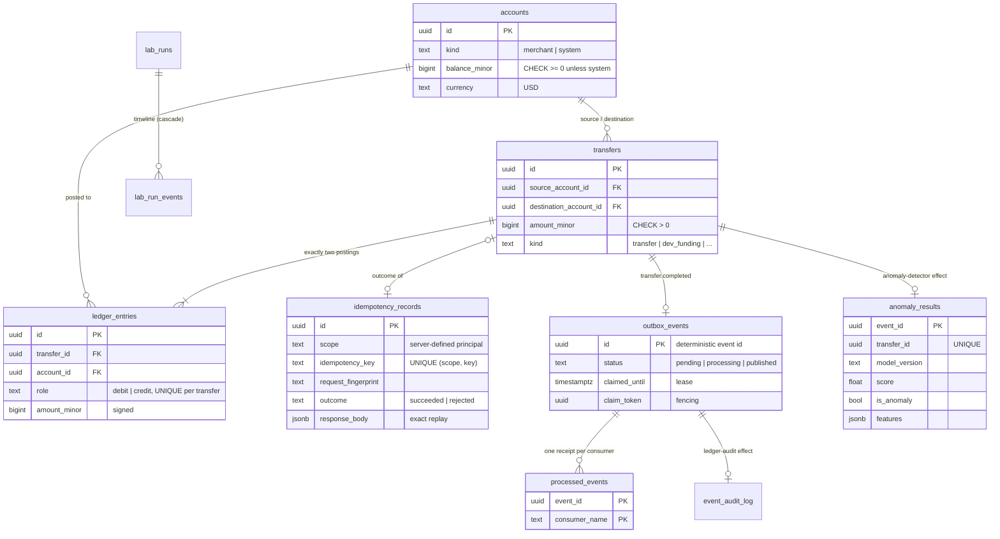

# Database Design

PostgreSQL 16, one primary, schema managed only by Alembic (`alembic/versions`, never edited
after release). Money is stored as integer minor units (`BIGINT` cents); there is no
floating point anywhere on the money path.

## 1. Entity relationships

Supporting tables: `worker_heartbeats` (one row per worker instance, upserted) and
`alembic_version`.

## 2. Integrity enforced by the database

| Rule | Constraint |
|---|---|
| Merchant balances never go negative | `ck_accounts_balance_non_negative` |
| Every transfer's postings balance | deferred constraint triggers `trg_transfers_balanced`, `trg_ledger_entries_balanced` |
| Postings and transfers are immutable | `ledger_reject_modification` row triggers |
| One debit and one credit per transfer | `uq_ledger_entries_transfer_id_role` |
| One outcome per Idempotency-Key per principal | `uq_idempotency_records_scope_key` |
| One effect per event per consumer | `pk_processed_events (event_id, consumer_name)` |
| One AI result per transfer | `anomaly_results.transfer_id UNIQUE` |
| One active lab run at a time | partial unique index on `lab_runs` WHERE status IN ('queued','running') |
| Outbox polling stays cheap | partial index on unpublished rows only |

## 3. Roles and privileges (Phase 6B)

| Role | Used by | Rights |
|---|---|---|
| `POSTGRES_USER` (migration role) | `migrate` job, backups, host tooling | owns the schema; DDL |
| `APP_DB_USER` (runtime role, default `ledgerflow_app`) | API replicas, workers, retention | LOGIN only; no superuser/createdb/createrole/bypassrls; exactly the table grants below |

| Table | Runtime grants |
|---|---|
| accounts | SELECT, INSERT, UPDATE |
| transfers, ledger_entries, processed_events, event_audit_log, anomaly_results | SELECT, INSERT (append-only) |
| idempotency_records, outbox_events | SELECT, INSERT, UPDATE |
| lab_runs, worker_heartbeats | SELECT, INSERT, UPDATE, DELETE |
| lab_run_events | SELECT, INSERT, DELETE |
| alembic_version | SELECT |

`python -m app.core.db_roles` (run by `migrate` after every upgrade) re-applies these,
verifies them with `has_table_privilege`, and **fails if any table lacks a policy**. The
integration suite runs the application as a test runtime role, so a missing grant fails a
test (tests/integration/test_db_roles.py proves the forbidden operations are refused).

## 4. Retention

`python -m app.maintenance.retention [--dry-run]` deletes, in bounded batches, finished lab
runs older than `RETENTION_LAB_RUN_DAYS` (30, timelines cascade) and worker heartbeat rows
older than `RETENTION_HEARTBEAT_DAYS` (7). Financial and audit tables are never pruned; the
runtime role it runs as could not delete them anyway.

## 5. Backup and restore

`python scripts/db_backup.py restore-drill` takes a `pg_dump --format=custom` inside a
REPEATABLE READ snapshot (row counts recorded from the same snapshot), restores it into a
throwaway PostgreSQL container and verifies row counts, ledger balance, account balances
and triggers. See [operations.md](../operations.md).

## 6. Connection budget

Per process pools: replicas 5 + 5 overflow (`API_DB_POOL_SIZE` / `API_DB_MAX_OVERFLOW`),
workers 2 + 2. Four replicas + three workers ≈ 52 connections, under `max_connections=100`.
Benchmarks record the observed maximum (`pg_connections_max`).
