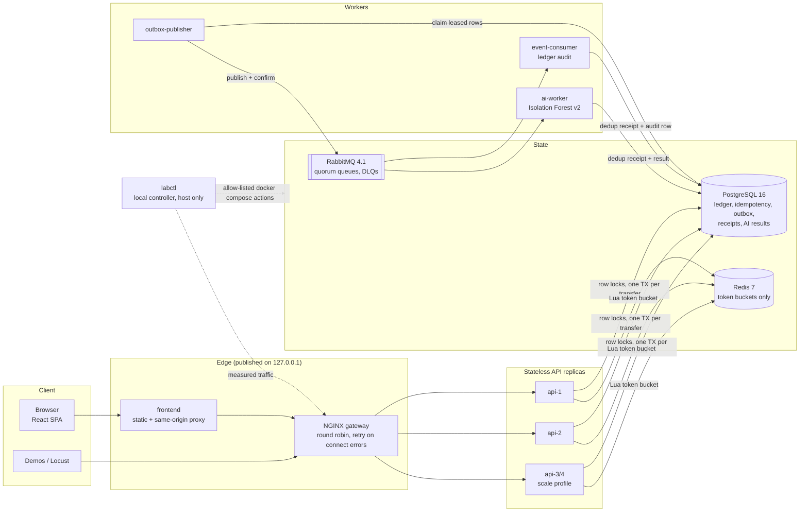

# High-Level Design

LedgerFlow AI is a virtual-money transaction platform built to demonstrate distributed-
systems correctness on a laptop: concurrency-safe double-entry transfers, durable
idempotency, horizontal scaling behind a load balancer, reliable asynchronous events, and
an asynchronous anomaly detector. Everything runs in one Docker Compose project.

## 1. Components

| Component | Responsibility | State | Scales by |
|---|---|---|---|
| NGINX | Only published API port; round robin; retries *connect* failures, never re-sends a POST | none | one instance (local) |
| API replicas | Validation, rate limiting, transfers in one PostgreSQL transaction, outbox insert | none | adding replicas (`api-1..4`) |
| PostgreSQL | Source of truth: accounts, transfers, ledger, idempotency records, outbox, receipts, AI results | durable volume | vertically (single primary) |
| Redis | Distributed token buckets; no financial data | ephemeral | single node |
| outbox-publisher | Moves committed outbox rows to RabbitMQ with leases, fencing tokens, publisher confirms | none | several (SKIP LOCKED) |
| event-consumer | Applies each event exactly once (dedup receipt + effect in one TX), retries, DLQ | none | competing consumers |
| ai-worker | Scores `transfer.completed` asynchronously; one result per event | model artifact (read-only) | competing consumers |
| frontend | SPA + same-origin proxy; no controller access | none | static |
| labctl | Local-only experiment controller (failure lab, benchmarks) | journal file | n/a (host process) |

## 2. Request and event flow

1. A client `POST /api/v1/transfers` with an `Idempotency-Key` reaches NGINX, which picks a
   replica.
2. The replica checks the shared write quota in Redis (fails **closed** if Redis is down).
3. One PostgreSQL transaction: claim the idempotency key, lock both accounts in id order,
   check funds, write the transfer, two ledger postings, both balances, the outbox event and
   the completed idempotency record, then COMMIT. Either all of it exists or none of it.
4. The response returns. Nothing asynchronous is on the request path.
5. The publisher claims the outbox row (lease), publishes with a confirm, marks it published.
6. The audit consumer and the AI worker each receive their copy, apply it exactly once
   (receipt + effect in one transaction), and acknowledge after COMMIT.

See [lld.md](lld.md) for sequence diagrams of each step.

## 3. Guarantees

| Guarantee | Mechanism | Evidence |
|---|---|---|
| No double spend, no lost update | `SELECT ... FOR UPDATE` on both accounts in ascending id order; balance check under the lock | 100-thread concurrency tests; Experiment Lab |
| Exactly-once *effect* per Idempotency-Key | unique (scope, key) claimed in the same transaction as the transfer; stored outcome replayed | idempotency tests across replicas |
| Ledger always balances | double-entry postings in the transfer's transaction; append-only triggers; runtime role has no UPDATE/DELETE on the ledger | reconciliation after every test suite and demo |
| No lost events | transactional outbox (same TX as the transfer) | broker-outage and crash-recovery tests |
| Exactly-once *effect* per event | per-consumer receipts (`processed_events`) in the effect's transaction; ack after COMMIT | duplicate-delivery and crash tests |
| Failures are isolated per consumer | per-consumer DLQ routing (Phase 6B) | real-broker routing tests |
| Bounded latency under failure | 250 ms Redis timeouts, 3 s lock timeout, 500 ms NGINX connect timeout, fixed container IPs | failure lab, stack tests |

## 4. Deployment views

| Profile | Command | Purpose |
|---|---|---|
| Development | `docker compose up -d --build --wait` | everything, dev surface on, loopback only |
| Scale | `NGINX_UPSTREAMS=4 docker compose --profile scale4 up -d` | 4 replicas |
| Observability | `OTEL_ENABLED=true docker compose --profile observability up -d` | Jaeger traces |
| Maintenance | `docker compose --profile maintenance run --rm retention` | retention job |
| Benchmark | `python benchmarks/run_benchmarks.py` | isolated project `ledgerflow-bench` |
| Stack tests | `pytest -m stack` | isolated project `ledgerflow-stacktest` |
| Public demo (design) | `-f docker-compose.yml -f docker-compose.demo.yml` | production mode, no dev surface ([public-demo.md](../public-demo.md)) |

## 5. Security boundaries

- Only NGINX and the frontend are published, on 127.0.0.1 by default. Data stores publish
  on loopback for host tooling (none in the demo profile).
- The development surface (funding, lab, observability, AI and performance routes) is
  refused in production and whenever the gateway binds a non-loopback address.
- API replicas connect as a least-privilege PostgreSQL role, hold no broker admin
  credentials, and trust `X-Forwarded-*` only from NGINX.
- Infrastructure control (stopping containers) exists only in the host-side `labctl`,
  allow-listed and token-protected. No API endpoint can run a command.

Details: [phase-6a-hardening.md](../phase-6a-hardening.md), [ADRs](../adr/).
