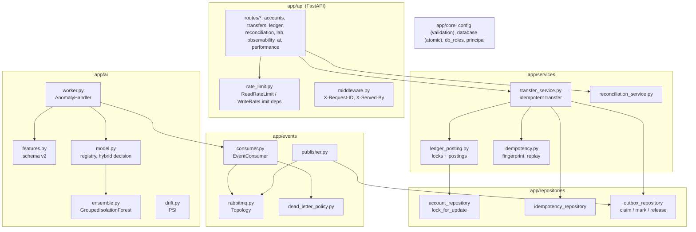

# Low-Level Design

Module map, the key sequences, and where each invariant is enforced. File paths are
relative to the repository root.

## 1. Modules



## 2. Transfer (the critical path)

```mermaid
sequenceDiagram
    autonumber
    participant C as Client
    participant N as NGINX
    participant A as API replica
    participant R as Redis
    participant DB as PostgreSQL
    C->>N: POST /transfers (Idempotency-Key K)
    N->>A: round robin (connect retry only)
    A->>R: EVALSHA token bucket (write policy)
    alt Redis down / over quota
        A-->>C: 503 RATE_LIMITER_UNAVAILABLE / 429 + Retry-After (no DB touched)
    end
    A->>DB: BEGIN; SET LOCAL lock_timeout = 3 s
    A->>DB: INSERT idempotency_records (scope, K, fingerprint) ON CONFLICT DO NOTHING
    alt key exists
        A->>DB: SELECT ... FOR UPDATE (waits for an in-flight twin)
        A-->>C: replay stored response / 422 KEY_REUSED / 409 IN_PROGRESS
    end
    A->>DB: SELECT accounts WHERE id IN (src, dst) ORDER BY id FOR UPDATE
    A->>DB: check funds under the lock
    A->>DB: INSERT transfer, 2 ledger_entries (debit, credit)
    A->>DB: UPDATE both balances
    A->>DB: INSERT outbox_events (transfer.completed)
    A->>DB: UPDATE idempotency_records SET outcome, response_body
    A->>DB: COMMIT
    A-->>C: 201 (the exact body later replays return)
```

- Lock order by account id makes two opposite transfers wait, not deadlock.
- A business rejection (insufficient funds) is stored under the key through a SAVEPOINT, so
  the key's outcome is final and replayable.
- `atomic()` (app/core/database.py) maps lock timeouts and deadlocks to 503
  `CONCURRENCY_CONFLICT` (nothing committed; retry the same key) and a connection lost
  during COMMIT to 500 `OUTCOME_UNKNOWN` (retry the same key to learn the truth).

## 3. Outbox publication

```mermaid
sequenceDiagram
    participant P as outbox-publisher
    participant DB as PostgreSQL
    participant MQ as RabbitMQ
    P->>DB: claim ≤100 due rows FOR UPDATE SKIP LOCKED;<br/>status=processing, claimed_until=now()+30 s, claim_token=T; COMMIT
    loop each claimed row
        P->>MQ: publish persistent, mandatory, wait for confirm
    end
    P->>DB: published WHERE claim_token=T (fencing); failed rows back to pending with jittered backoff
```

A crashed publisher's lease expires and another publisher re-claims: at-least-once, with
consumer deduplication downstream.

## 4. Consumption, retries and per-consumer dead letters (Phase 6B)

```mermaid
sequenceDiagram
    participant Q as <prefix>.<consumer> (quorum)
    participant W as EventConsumer
    participant DB as PostgreSQL
    participant RT as retry.N (TTL)
    participant DLQ as <consumer>.dlq
    Q->>W: deliver (manual ack, prefetch)
    W->>DB: BEGIN; INSERT processed_events (event_id, consumer) ON CONFLICT DO NOTHING
    alt duplicate
        W->>Q: ack (no second effect)
    else new
        W->>DB: effect (audit row / anomaly result); COMMIT
        W->>Q: ack after COMMIT
    end
    alt transient error, retries left
        W->>RT: publish copy (confirmed) then ack; TTL expiry dead-letters back to Q
    else permanent / invalid / retries exhausted
        W->>DLQ: publish to its OWN DLQ via the default exchange, then ack
    else consumer crashes on it every time
        Q->>DLQ: broker: delivery limit -> fanout DLX -> direct router<br/>(routing key = this DLQ, set by the consumer's policy)
    end
```

Topology per consumer: `ledgerflow.events` (topic) → `ledgerflow.<consumer>` (quorum,
`x-delivery-limit`, `x-dead-letter-exchange=ledgerflow.events.dlx`), retry tiers
`…retry.1..3`, DLQ `…dlq`. `ledgerflow.events.dlx` (fanout, kept because queue arguments
are immutable) → `ledgerflow.events.dlx.by-queue` (direct; alternate exchange →
`ledgerflow.events.unrouted.dlq`). Each consumer applies the policy
`ledgerflow-dead-letter-<consumer>` = `{"dead-letter-routing-key": "<queue>.dlq"}` at
start-up (app/events/dead_letter_policy.py). See ADR 0007.

## 5. AI scoring

```mermaid
sequenceDiagram
    participant Q as ledgerflow.anomaly-detector
    participant W as AnomalyHandler
    participant DB as PostgreSQL
    Q->>W: transfer.completed
    W->>DB: BEGIN; receipt (dedup)
    W->>DB: PriorStats from transfers strictly BEFORE occurred_at:<br/>count, median amount, last time, 60 s / 10 s counts, median gap
    W->>W: compute_features (schema v2) -> validate_features
    W->>W: GroupedIsolationForest score; hybrid = score >= t OR rule flags
    W->>DB: INSERT anomaly_results (score, threshold, verdict, features, rule flags); COMMIT
```

The same `compute_features` builds the training data (synthetic replay) and the live
features, so training and serving cannot diverge; an integration test asserts the SQL
`PriorStats` equals the in-memory replay. Invalid features raise `FeatureSchemaError`,
which dead-letters the event instead of scoring garbage. `/ai/drift` compares the latest
live feature vectors with the training deciles (PSI).

## 6. Configuration validation (fail at start-up, not in production)

`Settings` (app/core/config.py) refuses: development endpoints with `APP_ENV=production`,
with a non-loopback `GATEWAY_BIND`, or without an independent `LAB_TRAFFIC_SECRET`; the
replica header, SQL echo, the in-memory limiter and fault injection in production.
`python -m app.core.db_roles` refuses a table without a privilege policy.

## 7. Where each invariant lives

| Invariant | Application | Database |
|---|---|---|
| Balance never negative | check under row lock | `CHECK (balance_minor >= 0 OR kind = 'system')` |
| Postings sum to zero per transfer | `ledger_posting.py` writes both legs together | deferred constraint triggers `trg_transfers_balanced` / `trg_ledger_entries_balanced` (checked at COMMIT); `UNIQUE (transfer_id, role)` |
| Ledger is immutable | no code path updates or deletes postings | `ledger_reject_modification` triggers; runtime role: SELECT, INSERT only |
| One outcome per Idempotency-Key | claim + complete in one TX | `UNIQUE (scope, idempotency_key)` |
| One effect per event per consumer | receipt in the effect's TX | `PRIMARY KEY (event_id, consumer_name)` |
| One AI result per transfer | receipt in the result's TX | `UNIQUE (transfer_id)` |
| Retention never deletes money | policies name only lab/telemetry tables | runtime role has DELETE only there |
