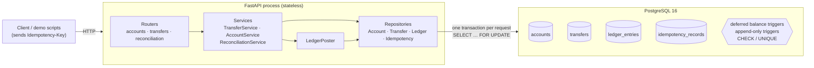
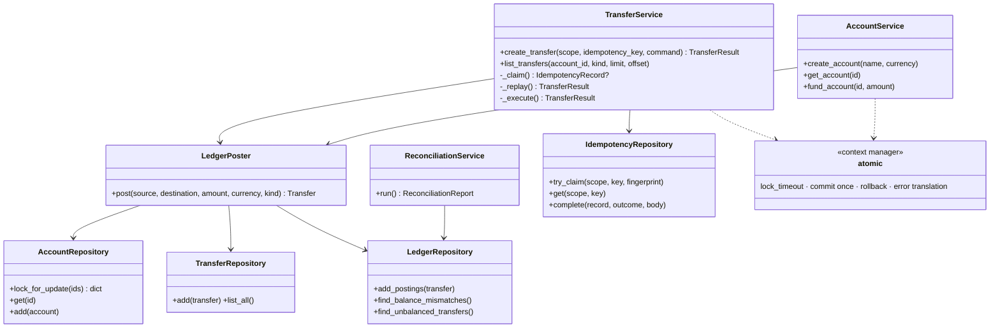
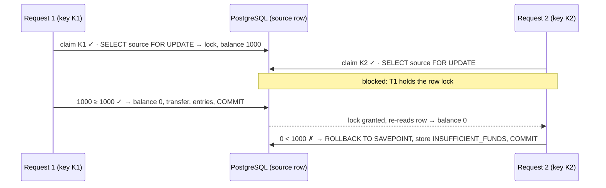

# Phase 2 Design: Concurrency, Idempotency & Double-Entry Ledger

Phase 1 made a transfer **atomic**: all of it commits or none of it does. Phase 2 makes it
**correct under concurrency** (row locks), **safe to retry** (durable idempotency) and
**auditable** (an immutable double-entry ledger that balances are reconciled against).

---

## 1. The original race condition

Phase 1's transfer was *read → check → write* with no locks:

```text
source = session.get(Account, source_id)   # plain SELECT, no lock
if source.balance_minor < amount: reject   # check against a value that may be stale
source.balance_minor -= amount             # ORM later sends: SET balance_minor = <absolute value>
```

Two concurrent $80 transfers from an account holding $100, under PostgreSQL's default
READ COMMITTED isolation:

```
T1: SELECT balance → 100                 T2: SELECT balance → 100
T1: 100 ≥ 80 ✓                           T2: 100 ≥ 80 ✓
T1: UPDATE … SET balance = 20            T2: UPDATE … SET balance = 20   (waits for T1's row lock)
T1: COMMIT                               T2: lock granted → writes 20, COMMIT
```

Both transfers are recorded and $160 left the account, but the balance only dropped by $80.
**T2 overwrote T1's update (a lost update) and money was created.** The CHECK
(`balance >= 0`) constraint didn't help, because 20 ≥ 0. UPDATE does take a row lock, but
only *after* both transactions had already made their decision on stale data.

### After: lock first, then decide

```
T1: SELECT … FOR UPDATE → 100 (lock)     T2: SELECT … FOR UPDATE → blocks on T1's lock
T1: 100 ≥ 80 ✓, SET balance = 20
T1: COMMIT (lock released)               T2: lock granted → re-reads the row → 20
                                         T2: 20 ≥ 80 ✗ → INSUFFICIENT_FUNDS, rollback
```

The check and the write now happen on the same, locked, current row. The
`test_insufficient_funds_under_contention_is_decided_on_locked_state` test proves it:
with 50 concurrent $3 transfers against $50, all 34 rejections report a balance of exactly
200 cents, the true final balance. A stale read would report more.

## 2. Why locking is necessary, and the isolation levels

| Level (PostgreSQL) | Each statement sees | Relevant anomaly for us |
|---|---|---|
| READ UNCOMMITTED | treated as READ COMMITTED in PostgreSQL | n/a |
| **READ COMMITTED** (default) | a fresh snapshot per *statement* | lost update in read-check-write, as above |
| REPEATABLE READ | one snapshot per *transaction* | concurrent update of the same row → error `40001`, retry needed |
| SERIALIZABLE | one snapshot + SSI predicate tracking | any non-serializable interleaving → `40001`, retry needed |

**Choice: READ COMMITTED + explicit row locks (`SELECT … FOR UPDATE`).** All the state a
transfer's decision depends on is two account rows, and we lock exactly those before
reading them. That is *pessimistic* concurrency control: conflicting transactions queue
instead of failing and retrying. With hot accounts (many transfers from one merchant),
queueing behaves much better than SERIALIZABLE's abort-and-retry storms.

**When stronger isolation would become necessary:**
- **Decisions based on rows that can't be locked**, especially rows that don't exist yet.
  "Reject if the merchant's transfers in the last hour exceed $X" reads a range, and a
  concurrent INSERT is a *phantom* that `FOR UPDATE` can't block. Use SERIALIZABLE, or lock
  a parent row (for example a per-merchant limits row) that every such transfer must lock.
- **Multi-row read-only reports** that must be internally consistent. This already applies
  here: reconciliation runs in a **REPEATABLE READ, read-only** transaction so all its
  queries see one snapshot. Otherwise a transfer committing between two of its queries would
  show up as a false mismatch.
- **Cross-table invariants** checked in application code without a common lock.

## 3. Row-level locking behaviour

- `SELECT … FOR UPDATE` takes a row lock that conflicts with other `FOR UPDATE`, `UPDATE`
  and `DELETE` on that row, and is held **until the transaction ends**.
- Plain `SELECT`s (MVCC reads) are **never blocked**. `GET /accounts/{id}` keeps working
  during heavy transfer traffic and simply sees the last committed balance.
- Under READ COMMITTED, when a blocked `FOR UPDATE` is granted, PostgreSQL **re-reads the
  latest committed row version**. That is why the funds check sees the up-to-date balance.
- **ORM pitfall:** the SQLAlchemy session has an identity map. If an `Account` was already
  loaded in the session, a later locked SELECT returns the *cached* object unchanged.
  `AccountRepository.lock_for_update` uses `execution_options(populate_existing=True)` so
  the locked row's values always overwrite the cache.
- **Bounded waiting:** each transfer transaction runs `SET LOCAL lock_timeout`
  (`TRANSFER_LOCK_TIMEOUT_MS`, default 3000 ms). If a lock can't be acquired in time,
  PostgreSQL raises `55P03` and the whole transaction rolls back. `atomic()` translates that
  (and `40P01` deadlock, `40001` serialization failure) into `ConcurrencyConflictError` →
  **503 `CONCURRENCY_CONFLICT`** with `Retry-After`, and the client retries **with the same key**.
- **No network I/O while locks are held.** The transaction does only SQL; logging happens
  after COMMIT. Phase 3's event publishing will use a transactional outbox for the same reason.

## 4. Lock ordering and deadlocks

If T1 locks A then B while T2 locks B then A, each waits for the other forever. PostgreSQL
detects the cycle after `deadlock_timeout` (1 s) and aborts one transaction (`40P01`).

**Prevention:** every movement locks its accounts **one statement at a time, in ascending
UUID order** (`lock_for_update(sorted(ids))`). A→B and B→A both lock `min(A, B)` first, so
the second transaction waits on the *first* lock, before it holds anything. A cycle can't
form. Locking each row in its own statement makes the order explicit, rather than relying
on how the executor processes `WHERE id IN (…) ORDER BY id FOR UPDATE`.

`test_opposite_direction_transfers_do_not_deadlock` runs 100 concurrent A↔B transfers
with zero conflicts. `test_inconsistent_lock_order_deadlocks_and_is_reported_as_conflict`
deliberately locks in opposite orders and shows that PostgreSQL kills exactly one victim.

**Hot rows:** all dev fundings lock the single system funding account, so they are
serialised. That's acceptable for a dev-only endpoint. At scale you'd shard the issuance
account or not keep a running balance on it.

## 5. Idempotency vs. concurrency control

They solve different problems, and you need both:

| | Concurrency control (row locks) | Idempotency (keys) |
|---|---|---|
| Question | Two **different** operations touch the same data at once: is the result still correct? | Is the **same** operation, sent twice (retry, double click, proxy resend), executed only once? |
| Without it | Lost updates, overdrafts | Duplicate transfers, which are each individually "correct" |
| Mechanism | `SELECT … FOR UPDATE`, lock ordering | Unique `(scope, key)`, stored outcome, replay |

Locks alone would happily execute a retried transfer twice. Idempotency alone would not
stop two *different* transfers from overdrawing an account.

## 6. Durable idempotency: design

`POST /api/v1/transfers` requires an `Idempotency-Key` header (1–255 visible ASCII chars;
a UUID is recommended).

### Scope

Keys are unique per **scope**. Until authentication exists, the scope is the fixed demo
principal `demo-merchant` (`core/principal.py`), set by the server in
`get_current_principal()`. It is **never** read from a header or body, because a client
could otherwise read or collide with another merchant's keys by claiming their ID. When
auth arrives, only that dependency changes.

### Request fingerprint

`SHA-256(canonical JSON of {"operation": "transfers.create", "payload": …})`, with sorted
keys and no whitespace. The payload is built from the *validated* model, so UUIDs are
lowercase canonical strings and amounts are integers. The same transfer sent with
upper-case UUIDs or reordered JSON keys has the same fingerprint, and any field change gives
a different one. A matching key with a different fingerprint returns
**422 `IDEMPOTENCY_KEY_REUSED`**.

### Single-transaction claim-and-complete

```
BEGIN
  SET LOCAL lock_timeout
  INSERT INTO idempotency_records (scope, key, fingerprint)          ← the claim
       ON CONFLICT (scope, key) DO NOTHING RETURNING id
  ├─ no row returned (key exists, committed) → load it:
  │     fingerprint differs → 422 IDEMPOTENCY_KEY_REUSED
  │     else → replay the stored response (+ Idempotent-Replayed: true)
  └─ row returned (we own the key) →
        SAVEPOINT
          lock accounts in ID order, validate, update balances,
          INSERT transfer, INSERT 2 ledger entries
        on business rejection → ROLLBACK TO SAVEPOINT
        UPDATE claim SET outcome, response_body, transfer_id
COMMIT          ← money movement and idempotency outcome become durable together
```

**Why the unique index gives mutual exclusion:** if request A has inserted key K but not
committed, request B's `INSERT … ON CONFLICT` for K **waits** on A's uncommitted index
entry. When A commits, B sees the conflict and replays A's response. If A rolls back, B's
insert succeeds and B executes. Two same-key requests can never both execute, and there's
no "check, then insert" race window.

**No orphaned IN_PROGRESS rows:** the claim only exists inside A's open transaction. If the
process crashes, the connection drops, and PostgreSQL aborts the transaction and the claim
disappears with it. The `outcome IS NULL` state is never visible to anyone else, so there's
nothing to expire or recover.

### Defined behaviour per outcome

| Situation | Stored under the key? | Response | Client should |
|---|---|---|---|
| Success | yes, `succeeded` + exact response body | 201 | done |
| Business rejection (insufficient funds, unknown/system account, same account, currency) | yes, `rejected` + error body (via SAVEPOINT) | 404/409/422; replays are identical | use a **new** key for a new attempt |
| Request validation error (bad body or header) | no, never reached the service | 422 `VALIDATION_ERROR` | fix the request; the key is still unused |
| Same key, different body | no | 422 `IDEMPOTENCY_KEY_REUSED` | use a new key |
| Same key still being processed past `lock_timeout` | no | 409 `IDEMPOTENCY_REQUEST_IN_PROGRESS` | retry **same key** later |
| Lock timeout / deadlock on accounts | no, everything rolled back | 503 `CONCURRENCY_CONFLICT` + `Retry-After` | retry **same key** |
| Database error before COMMIT, process crash | no, the transaction was aborted | 500, or no response | retry **same key** |
| Connection lost **during** COMMIT | **unknown** | 500 `OUTCOME_UNKNOWN` | retry **same key**; this reveals the truth |

The stored rejection is a deliberate choice: an Idempotency-Key names one attempt, and its
outcome is final. Retrying a key that failed for insufficient funds after topping up the
account does **not** silently succeed later.

### Ambiguous outcomes

The only truly ambiguous case is a failure *while COMMIT is in flight*. The server may have
committed before the reply was lost. `atomic()` detects it
(`DBAPIError.connection_invalidated` raised from `commit()`) and raises
`CommitOutcomeUnknownError`. The service can't know the answer and says so. The key makes
the retry safe: if the transfer committed, the retry replays it; if not, the retry executes
it once. **Never retry an ambiguous transfer with a new key**, because that's exactly how
duplicates happen. The demo scripts' retry loops reuse the same key.

### Stable replay serialization

The response body is stored at completion as the exact JSON dict that was returned. The
column is `json`, not `jsonb`, on purpose: PostgreSQL stores `json` text verbatim, while
`jsonb` normalises and reorders object keys. Replays are byte-for-byte identical to the
original (tested), and they don't depend on the current state of the transfer or account.

## 7. Double-entry ledger

```
ledger_entries
  id            UUID PK
  transfer_id   UUID FK → transfers   (RESTRICT)
  account_id    UUID FK → accounts    (RESTRICT, indexed)
  role          'debit' | 'credit'
  amount_minor  BIGINT  (signed)
  currency      'USD'
  created_at    timestamptz
  UNIQUE (transfer_id, role)
  CHECK  (role='debit' AND amount<0) OR (role='credit' AND amount>0)
```

### Invariants, and who enforces them

| Invariant | Enforced by |
|---|---|
| Every transfer has exactly one debit (source, −amount) and one credit (destination, +amount) → they sum to 0 | `LedgerRepository.add_postings`; **deferred constraint triggers** on `transfers` and `ledger_entries` re-check the pair against the transfer row at COMMIT |
| No duplicate posting for a transfer/role | `UNIQUE (transfer_id, role)` |
| Sign matches role | row CHECK |
| Entries, balances and the transfer row commit together | one transaction (`atomic()`) |
| Ledger and transfers are immutable | no update/delete code paths + `BEFORE UPDATE OR DELETE` triggers that raise |
| `accounts.balance == Σ ledger entries` per account; Σ all entries = 0; Σ all balances = 0 | `GET /api/v1/reconciliation` / `ReconciliationService` (detective control) |
| Merchant balance ≥ 0 | CHECK constraint (defense in depth behind the locked funds check) |

The deferred trigger is *deferred* because, at the moment the first entry is inserted, the
second doesn't exist yet. Checking at COMMIT verifies the complete posting.

### How demo money enters the system

A fixed **system funding account** (`00000000-0000-0000-0000-000000000001`,
`kind = 'system'`) is created by the migration. `POST /accounts/{id}/fund` (dev only) is a
normal locked double-entry movement of kind `dev_funding`: debit the system account, credit
the merchant. The system account's balance is therefore **minus all money ever issued**,
and **all balances together always sum to zero**. This is why the non-negative CHECK now
reads `balance_minor >= 0 OR kind = 'system'`: the issuance account is the only account
allowed below zero, and merchants can neither send to it nor spend from it.

### Phase 1 historical data: migration 0002

Before choosing a strategy I inspected the dev database: 3 accounts, 1 transfer, and
balances that included unrecorded dev funding.

1. **Transfers are backfilled exactly.** They are immutable records of real movements, so
   each one gets its debit/credit pair, stamped with the transfer's original `created_at`.
2. **Unrecorded funding is not fabricated.** Phase 1 funding left no records, so we can't
   know how many fundings there were, of what size, or when. For each account,
   `residual = balance − incoming + outgoing` is booked as **one** movement of kind
   `legacy_opening_balance` from the system account, timestamped at migration time. Its
   kind says exactly what it is.
3. **Unexplainable data aborts the migration.** Phase 1 funding could only add money, so a
   negative residual can't be explained. The migration raises with the offending account IDs
   and changes nothing (transactional DDL).
4. **Limitation:** a Phase 1 lost update that *reduced* a balance is indistinguishable from
   less funding and is absorbed into a smaller opening balance.
5. **Downgrade** drops the ledger and idempotency tables and removes the system account and
   its movements, leaving every merchant balance unchanged.

Result on the real dev data: Acme Store got a $100.00 opening balance and Raghav $10.50, and
Acme→Bob $25.50 was backfilled exactly. All balances were unchanged and reconciliation is clean.

## 8. Atomic commit and rollback

One request means one session and one transaction. `atomic()` is the explicit transaction
manager: commit once at the end, roll back on any exception, translate contention errors,
and detect an unknown commit outcome. Repositories only `flush()`.

The SAVEPOINT (`session.begin_nested()`) lets a business rejection undo the financial work
while *keeping* the idempotency claim, so the rejection can be stored as the key's outcome.
Any other exception escapes the savepoint and rolls back the whole transaction, claim
included. Tests inject failures at each step (transfer insert, ledger insert, idempotency
completion, CHECK violation, unbalanced posting, missing posting, duplicate posting) and
assert that nothing survives and that the same key then executes once.

## 9. Diagrams

### HLD



All state lives in PostgreSQL. Nothing is kept in process memory, so any API instance
can serve any retry. Phase 3 can therefore run several API instances without changing
these mechanisms.

### LLD class diagram



### Transfer sequence

```mermaid
sequenceDiagram
    participant C as Client
    participant R as Router
    participant S as TransferService
    participant P as LedgerPoster
    participant DB as PostgreSQL
    C->>R: POST /transfers (Idempotency-Key: K)
    R->>S: create_transfer(scope, K, command)
    S->>DB: BEGIN; SET LOCAL lock_timeout
    S->>DB: INSERT idempotency (scope,K,fp) ON CONFLICT DO NOTHING
    DB-->>S: id (claimed)
    S->>DB: SAVEPOINT
    S->>P: post(...)
    P->>DB: SELECT min(A,B) FOR UPDATE
    P->>DB: SELECT max(A,B) FOR UPDATE
    P->>P: validate kinds, currency, funds (locked rows)
    P->>DB: UPDATE balances; INSERT transfer; INSERT debit + credit
    S->>DB: RELEASE SAVEPOINT; UPDATE idempotency SET outcome, response
    S->>DB: COMMIT (deferred ledger triggers run here)
    S-->>R: TransferResult(succeeded, body)
    R-->>C: 201 body
```

### Concurrent transfers: same source, different keys



And with the **same key**, the second request blocks one step earlier, on the unique-index
entry for K. When the first commits, it gets `ON CONFLICT`, loads the stored response and
replays it without ever touching the accounts.

## 10. Design alternatives and trade-offs

| Decision | Alternative | Why this one |
|---|---|---|
| READ COMMITTED + `FOR UPDATE` | SERIALIZABLE + retry loop | Our invariant lives in two lockable rows; queueing beats abort storms on hot accounts; no retry loop needed in the service |
| `FOR UPDATE` then read-modify-write | Conditional atomic update `UPDATE … SET balance = balance - :x WHERE id = :id AND balance >= :x` | Equally safe for a single account and avoids an extra round trip, but it gets awkward for two accounts plus validation that needs both rows. Locking reads keep all business rules in Python and testable |
| Optimistic locking (version column) | — | Turns every contended transfer into a retry; worse under hot-account load |
| Claim-and-complete in **one** transaction | Two-phase: commit IN_PROGRESS, do work, commit COMPLETED | Two-phase needs leases/expiry and recovery for crashed IN_PROGRESS rows, and the work and outcome can disagree. One transaction makes them atomic and leaves no orphans; the cost is that same-key waiters hold a connection while waiting |
| Store rejections as final outcomes | Only store successes | Same request → same response is the idempotency contract; it also keeps clients from accidentally turning "retry" into "new attempt" |
| `json` response snapshot | Rebuild the response from the transfer row | The snapshot survives schema and serializer changes and costs no extra queries |
| Mutable `accounts.balance_minor` + ledger | Derive balances only from `SUM(ledger)` | O(1) balance reads and a lockable row for concurrency control; the ledger is the audit source and reconciliation catches drift |
| System funding account (negative balance) | Funding entries with no counter-account | Keeps every movement double-entry and lets "Σ all balances = 0" be checked |
| DB triggers for balance and immutability | App-only enforcement | Defense in depth: protects against bugs, ad-hoc SQL and future services. The cost is a little SQL in migrations |

## 11. Interview questions

**Q1. Why isn't wrapping the transfer in a transaction enough to prevent overdrafts?**
Atomicity only guarantees all-or-nothing. Under READ COMMITTED, two transactions can read
the same balance, both pass the check, and both write. The second write overwrites the
first (a lost update). You need isolation for the *read that the decision is based on*:
`SELECT … FOR UPDATE` serialises the read-check-write per account. Alternatives are a
conditional `UPDATE … WHERE balance >= x`, or SERIALIZABLE with retries.

**Q2. How do you prevent deadlocks when a transfer must lock two accounts?**
Acquire locks in a global total order, such as ascending account ID, so no cycle of waiters
can form. A→B and B→A both lock `min(A,B)` first, and the second transaction blocks before
holding anything. Keep a `lock_timeout`, and treat `40P01` as retryable for cases outside
your control.

**Q3. Two requests with the same Idempotency-Key arrive at the same time. What prevents a duplicate transfer?**
A unique constraint on `(scope, key)`, with the claim inserted at the start of the *same*
transaction that moves the money. The second `INSERT … ON CONFLICT DO NOTHING` blocks on the
first's uncommitted index entry. When the first commits, the second sees the conflict and
replays the stored response. A "SELECT then INSERT" check would have a race window; the
unique index does not.

**Q4. A client times out on a transfer. What should it do, and why must it not generate a new key?**
Retry with the same key and the same body. The outcome is unknown: the server may have
committed. With the same key, the retry either replays the committed result or executes for
the first time. A new key is a new operation, so if the first attempt committed, the client
has now paid twice.

**Q5. What does the double-entry ledger give you if you already store balances?**
An immutable, append-only history where every movement is two entries that sum to zero. You
can rebuild any balance, audit how it was reached, and *detect* corruption by reconciling
`balance == Σ entries` per account (and Σ entries = 0 globally). The balance column is an
optimisation; the ledger is the source of truth.

**Q6. Why does the reconciliation query run under REPEATABLE READ when transfers run under READ COMMITTED?**
Reconciliation issues several queries and compares their results. Under READ COMMITTED each
statement gets a new snapshot, so a transfer committing in between would look like a
mismatch. REPEATABLE READ gives one snapshot for the whole transaction. Transfers don't need
it, because everything they depend on is locked.

**Q7. Why use a deferred constraint trigger for "entries sum to zero" instead of a CHECK?**
A CHECK sees one row. The invariant spans two rows that are inserted one after another, so
the transaction is legitimately unbalanced between the two inserts. A deferred trigger runs
at COMMIT, when the posting is complete, and aborts the transaction if it isn't balanced.

**Q8. What happens if the API process crashes halfway through a transfer?**
The connection closes, PostgreSQL rolls back the open transaction, and all row locks, balance
changes, ledger rows *and the idempotency claim* disappear. The client's retry with the same
key executes normally. Because the claim never outlives its transaction, there are no stuck
IN_PROGRESS records to time out (tested with `pg_terminate_backend`).

## 12. Not solved yet

- No authentication: a single fixed idempotency scope, and anyone who can reach the API can move money.
- Idempotency records are kept forever. A retention job (for example 24–72 h, like Stripe) will need to delete old keys.
- Same-key waiters and lock waiters hold a pooled connection while waiting, so the pool size
  bounds concurrency. Rate limiting (Phase 3) should reject floods before they reach the database.
- A single hot merchant account serialises its own transfers (throughput is roughly 1/lock-hold-time).
  That's inherent to strict per-account balances; sharding or escrow-style designs trade strictness for throughput.
- Reconciliation is on demand, not scheduled or alerting.
- USD only.
