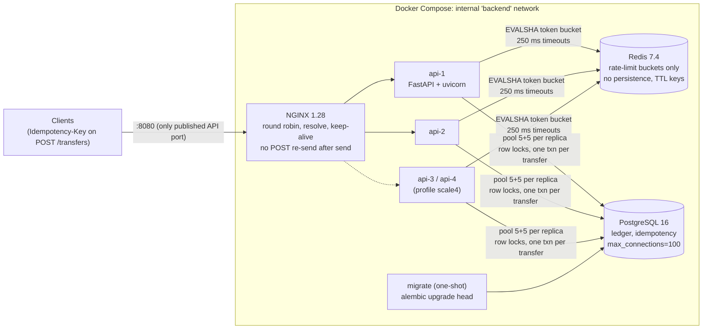
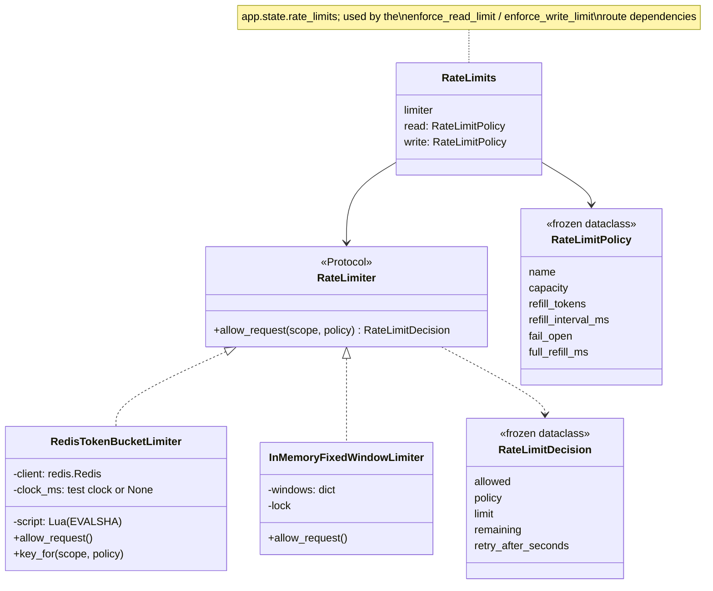
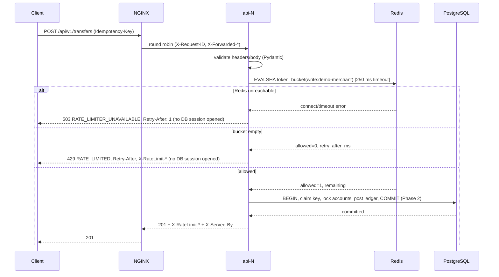

# Phase 3 Design: Horizontal Scaling and Distributed Rate Limiting

Phase 2 made money movement correct under concurrency and retries *inside one process*.
Phase 3 runs **several identical API processes behind a load balancer** and adds a
**rate limiter whose quota is shared by all of them**, without weakening any Phase 2
guarantee. PostgreSQL stays the only source of financial truth; Redis holds only
disposable rate-limit counters.

---

## 1. Horizontal vs. vertical scaling

| | Vertical (scale up) | Horizontal (scale out) |
|---|---|---|
| How | Bigger machine: more cores, more RAM | More copies of the service |
| Limit | The largest machine you can buy; one failure domain | Shared dependencies (database, cache, locks) |
| Requires | Nothing from the code | **Statelessness**: any replica must be able to serve any request |
| Failure | The box dies, the service dies | One replica dies, the others keep serving |

A Python process runs Python code on one core at a time (the GIL), so for this API
"scale out" is also how you use a multi-core machine. Scaling out moves the bottleneck to
whatever the replicas **share**: the PostgreSQL primary, hot account rows, and Redis.

## 2. Stateless application architecture

Each replica holds nothing that another replica would need:

| State | Where it lives | Why that makes replicas interchangeable |
|---|---|---|
| Balances, transfers, ledger | PostgreSQL | One copy, one set of row locks for every replica |
| Idempotency outcomes | PostgreSQL (`idempotency_records`) | A retry can land on a different replica and still replay (tested) |
| Rate-limit buckets | Redis | One quota per merchant, not one per replica |
| Sessions / caches | none | No sticky sessions needed |

That is why NGINX uses plain round robin with **no sticky sessions**, and why killing a
replica mid-traffic loses nothing: in-flight transactions roll back in PostgreSQL and
clients retry with the same Idempotency-Key (`tests/stack/test_multi_replica.py`).

## 3. HLD



- **One image, many containers.** `api-N` services share an image and configuration and
  differ only in `REPLICA_ID`. A one-shot `migrate` service runs Alembic once; replicas
  start only after it succeeds (`service_completed_successfully`), so replicas never race
  on migrations.
- **Network exposure.** Only NGINX publishes an API port. PostgreSQL and Redis publish
  loopback-only ports for the host's test suite and local debugging; replicas publish none.
- **Fixed addresses, by experiment.** Every long-lived container has a fixed IP on the
  backend network: Redis .10, PostgreSQL .11, NGINX .12 and `api-1..4` .21–.24. Docker
  allocates dynamic addresses only from the upper half (`ip_range .128/25`), so no other
  container can take a reserved address while its owner is stopped. Two measured
  problems led here:
  1. *Slow negative DNS.* When a container stops, Docker DNS stops resolving its name,
     and `getaddrinfo()` then took **7.2 s** (forwarded to the host's resolvers): longer
     than any socket timeout. The replicas therefore get `redis`/`postgres` from
     `/etc/hosts` (`extra_hosts`). A dead Redis is now a TCP connect failure bounded by the
     250 ms connect timeout, and a financial write fails closed in **~255 ms** instead of
     ~4–7 s (`demo_redis_failure.py`).
  2. *Stale upstream IPs.* A recreated replica used to get a *new* IP. While its name was
     briefly unresolvable, NGINX's re-resolution timed out and it kept the old address. A
     stopped container's IP doesn't refuse connections, it black-holes them, so requests
     waited out the connect timeout on both stale peers and got 504s for 8+ s after
     redeploys (seen in the NGINX log). With fixed IPs a restarted replica comes back at
     the same address: 0 upstream failures in the 10 s after each of two forced recreates
     (about 3,000 requests each).

### Fixed IPs are a local workaround, not a production pattern

Hand-assigned addresses suit this setup: one host, a handful of named containers, and a
single Docker bridge whose DNS behaves badly for stopped containers. Production systems
generally do the opposite. Instances get **dynamic addresses** and are found through
**service discovery**, because instances are created, moved and replaced continuously and
nobody should be allocating IPs by hand.

| Concern | This project (local Compose) | Typical production |
|---|---|---|
| Finding replicas | Fixed IPs `.21–.24` + an NGINX upstream list | A registry updated automatically as instances start and stop: Kubernetes Services/EndpointSlices, Consul, AWS Cloud Map, ECS service discovery |
| Load balancer membership | Static `server` lines; `max_fails` passive checks | The LB watches the registry (Kubernetes Service / kube-proxy, an Ingress or Gateway controller, Envoy via xDS, cloud load balancer target groups) |
| Removing a dead instance | NGINX notices failed connects, then `fail_timeout` | **Readiness probes** take an instance out of rotation *before* traffic fails; deregistration happens on shutdown |
| Restarts / rollouts | Same IP comes back | New IP every time; rolling updates with connection draining (`preStop` hooks, graceful termination) |
| Reaching Redis / PostgreSQL | `/etc/hosts` pins via `extra_hosts` | A stable virtual name or IP in front of changing backends: a Kubernetes Service ClusterIP, a managed endpoint (RDS/ElastiCache/Cloud SQL), Consul DNS |
| DNS timeouts for missing names | Avoided by not using DNS for these lookups | Resolver tuning (`ndots`, timeouts, NodeLocal DNSCache) and stable service names that always resolve |

Two problems justified fixed IPs here, and neither is fixed by hardcoding addresses in
production:

1. **Slow negative DNS lookups.** In Kubernetes, a Service name keeps resolving to a stable
   virtual IP even while its pods are being replaced, so "the name vanished" doesn't happen.
   Application code should still **bound every dependency call with timeouts** and treat
   resolution failures as dependency failures. Those are the 250 ms connect timeout and the
   fail-closed rule from this phase, and they carry over unchanged.
2. **Stale upstream addresses.** A discovery-aware load balancer gets endpoint changes
   *pushed* to it (watch / xDS) instead of polling DNS. Readiness probes remove an instance
   before it stops, and connection draining lets in-flight requests finish.

**What carries over unchanged:**
- stateless replicas
- liveness vs. readiness health checks (`/health/live`, `/health/ready`)
- no load-balancer retries of a POST that was already sent
- strict dependency timeouts
- fail-closed financial writes
- state kept only in PostgreSQL and Redis

**What would change in a Kubernetes deployment:**
- `api` becomes one Deployment with N replicas behind a Service, with no per-replica names
  and no IPs. Readiness and liveness probes point at the existing endpoints.
- NGINX is replaced by an Ingress or Gateway controller.
- Redis and PostgreSQL become managed services or StatefulSets reached through Services.
- `migrate` becomes a Job (or pre-deploy hook) that must finish before the rollout.
- The fixed addresses, `extra_hosts` and the explicit `api-1..4` list are **removed
  entirely**.

### Replica count

Two replicas are explicit services (`api-1`, `api-2`); `api-3` and `api-4` exist under the
`scale4` profile. The NGINX upstream lists all four by name with `resolve`. A name that doesn't
resolve (container not created) contributes no addresses, so the *same* config serves 1, 2
or 4 replicas.

- 4 replicas: `docker compose --profile scale4 up -d --wait`
- 1 replica: `docker compose stop api-2`
- More than 4: add `api-5` (copy a service block, next fixed IP) and one
  `server api-5:8000 resolve` line.

**Why not `docker compose up --scale api=N`?** With a scaled service NGINX would have to
resolve one name to N addresses. Open-source NGINX's `resolve` does support that, but
explicit names give stable replica IDs (`X-Served-By: api-2`), a deterministic topology
for tests, and the ability to stop *one specific* replica in failure experiments. The
trade-off: adding a fifth replica is a config edit, not a flag.

## 4. NGINX load balancing

```nginx
resolver 127.0.0.11 valid=5s;            # Docker DNS, re-resolved every 5 s
upstream ledgerflow_api {
    zone ledgerflow_api 64k;
    server api-1:8000 resolve max_fails=1 fail_timeout=2s;
    ...
    keepalive 64;
}
proxy_next_upstream error timeout;       # connect failures only
proxy_next_upstream_tries 2;
proxy_connect_timeout 500ms; proxy_read_timeout 30s;
```

- **Restarts must not strand NGINX on an old address.** Classic NGINX resolves upstream
  names once at startup. `resolve` (open-source since 1.27.3) re-resolves at run time, but
  re-resolution of a briefly missing name can time out. Fixed replica IPs make the answer
  irrelevant: the address never changes (see §3).
- **Failure marking.** `max_fails=1 fail_timeout=2s` skips a replica for 2 s after a failed
  connect, and `proxy_connect_timeout 500ms` bounds a connect to a stopped replica's
  (black-holed) address. If *every* replica fails at once, as in an all-at-once redeploy,
  NGINX answers 502 "no live upstreams" until `fail_timeout` expires. That was measured as
  ~6 s of 502s after a simultaneous recreate with the old 5 s setting. Rolling restarts
  (one replica at a time) avoid it, and the tooling's `deploy()` only returns once NGINX
  routes to every running replica.
- **Retries are safe by construction.** NGINX re-sends a request to another replica only
  when it could not *connect* (`error`), or on `timeout`, and never for a POST that was
  already sent (we deliberately don't enable `non_idempotent`). A replica that dies
  mid-request produces a 502 to the client, which retries with the same Idempotency-Key.
  An automatic NGINX re-send would be safe *for transfers* (thanks to idempotency) but not
  for, say, dev funding, and the proxy can't know the difference.
- **Forwarding headers:** `Host`, `X-Real-IP`, `X-Forwarded-For`, `X-Forwarded-Proto`, and a
  generated `X-Request-ID` (also returned to the client and logged with `$upstream_addr`).
- **Which replica served me?** Every response carries `X-Served-By: api-N` when
  `EXPOSE_REPLICA_HEADER=true` (on in the dev stack, off by default in code), and
  `/health/live` returns the replica ID.

### Round robin vs. least connections

| | Round robin | Least connections |
|---|---|---|
| Picks | Next server in turn | Server with fewest active requests |
| Good when | Requests cost about the same; replicas are identical | Request cost varies a lot (a slow transfer waiting on a lock vs. a 2 ms read) |
| Weakness | A replica stuck on slow requests still gets its full share | Needs accurate in-flight counts; with several NGINX workers each counts its own (the shared `zone` mitigates this) |

Round robin is the right first policy here: identical replicas and mostly uniform
requests. `least_conn` is a one-line change worth benchmarking once some routes are much
slower than others (Phase 4's async processing will create that skew).

### When one replica becomes unavailable

| Event | What happens | Client impact |
|---|---|---|
| `docker compose stop api-2` (graceful) | Uvicorn finishes in-flight requests; DNS drops the name; NGINX stops routing within ~5 s | None (measured: 20/20 requests served by api-1, 0 errors) |
| Replica crashes / `docker kill` | In-flight requests are cut; their DB transactions roll back | In-flight POSTs get 502; retry with the same key → executes exactly once (tested with 40 concurrent transfers) |
| Connection refused to a dead IP | `proxy_next_upstream error` sends the request to the next replica | None (safe: the request never reached the dead replica) |
| Replica comes back | Same fixed IP; NGINX retries it after `fail_timeout` (2 s) | Traffic spreads again |
| All replicas recreated at once | NGINX may mark every replica failed: 502 "no live upstreams" for up to `fail_timeout` | A few seconds of 502s; use rolling restarts |

Note: `restart: unless-stopped` restarts a process that exits on its own, but Docker
treats `docker kill` as a manual stop and does not restart it.

## 5. Redis as shared distributed state, and why only for rate limits

Rate-limit counters are a perfect fit for Redis: small, hot, short-lived, written on every
request, and **safe to lose**. Losing them resets every bucket to full, which is a bounded
over-admission of at most one burst per scope. Balances are the opposite: losing one
write is unacceptable. So Redis runs with no persistence (`--save ""`, no AOF) and
`maxmemory-policy volatile-ttl`, and **nothing financial ever touches it**.

## 6. Token bucket and its alternatives

| Algorithm | State per key | Burst behaviour | Precision | Cost |
|---|---|---|---|---|
| **Fixed window** (`InMemoryFixedWindowLimiter`) | counter + window index | Up to **2× limit** across a window boundary (end of one + start of next; unit-tested) | Coarse | Cheapest |
| **Sliding window log** | one timestamp per request | Exact | Exact | O(limit) memory per key |
| **Sliding window counter** | two counters | Approximates; no 2× edge spike | ~Good | Cheap |
| **Token bucket** (`RedisTokenBucketLimiter`) | tokens + last refill time | Explicit, configurable **burst = capacity**, then a smooth sustained rate | Exact (here) | Cheap, O(1) |

**Token bucket semantics.** A bucket holds up to `capacity` tokens. Each request takes one.
Tokens are added continuously at `refill_tokens / refill_interval`. A client idle long
enough can burst `capacity` requests at once; a client sending continuously is held to
the refill rate. That matches API reality: allow short bursts (a page load firing ten
requests) while bounding sustained load. The defaults are writes: burst 20, 10/s sustained;
reads: burst 100, 50/s sustained.

### Redis token bucket pseudocode (`TOKEN_BUCKET_LUA`)

```text
inputs: key, capacity_units, rate, cost, ttl_ms, [test_now]
  # integer units: 1 ms adds `rate` units; 1 request costs `cost` units
  #   rate = refill_tokens, cost = refill_interval_ms, capacity_units = capacity * cost

now    = test_now or redis TIME (ms)            # ONE clock for every replica
tokens, stamp = HMGET key tokens ts
if missing: tokens = capacity_units; stamp = now          # absent bucket == full bucket
else:
    tokens = clamp(tokens, 0, capacity_units)
    if now > stamp:                                        # backwards clock: no refill
        deficit = capacity_units - tokens
        elapsed = now - stamp
        if elapsed >= ceil(deficit / rate): tokens = capacity_units
        else:                               tokens += elapsed * rate   # exact integer
        stamp = now
if tokens >= cost: tokens -= cost; allowed = 1             # never below zero
else:              retry_after_ms = ceil((cost - tokens) / rate)
HSET key tokens stamp ; PEXPIRE key ttl_ms                 # ttl = time-to-full + 1 s
return allowed, tokens, retry_after_ms
```

Design points, each covered by a test:

- **Atomic.** Redis executes a Lua script to completion before serving any other command,
  so read → refill → decide → write can't interleave between replicas. 200 concurrent
  requests against capacity 50 admit exactly 50, and each sees a distinct "remaining" value.
- **One clock.** Redis `TIME`, not each replica's clock: replicas with skewed clocks can't
  mint tokens. A clock that goes backwards never refills. Tests inject a clock through an
  extra script argument that production never passes.
- **No floating point, no drift.** Lua numbers are doubles. A naive
  `tokens += elapsed_s * rate` with `floor()` loses the fractional part on every call; under
  1 ms polling with a slow refill such a bucket **never** refills. Here 1 ms adds exactly
  `refill_tokens` units and a request costs exactly `refill_interval_ms` units, so the
  arithmetic is integer-exact (`test_frequent_polling_does_not_lose_fractional_refill`).
  Policy bounds keep every value below 3.6e11, far under 2^53.
- **Bounded keys.** Every write sets `PEXPIRE` to time-to-full + 1 s. A bucket that has been
  idle that long would be full anyway, so letting Redis delete it is semantically
  invisible. Keys exist only for recently active scopes.
- **Namespaced keys:** `ledgerflow:rl:tb:<policy>:<capacity>-<refill>-<interval>:<scope>`.
  Changing a policy starts a fresh bucket instead of reinterpreting old state.
- **Script cache loss.** A Redis restart empties the script cache. redis-py's `Script`
  object catches `NOSCRIPT` and reloads (tested with `SCRIPT FLUSH` and a real container restart).

### Race conditions in distributed counters

The naive implementation, `GET count` → `if count < limit` → `SET count+1`, run from two
replicas at once, has both read 9 and both write 10: the lost update from Phase 2, now
across processes and over a network. `INCR` alone is atomic but can't express refill or
"reject without consuming". `WATCH/MULTI/EXEC` works but retries under contention. A Lua
script makes the whole decision one atomic server-side step with a single round trip.
Per-replica in-memory counters aren't a race at all; they're simply **N separate quotas**.
The demo shows 2 replicas would admit 20 of 50 requests under a quota of 10.

## 7. RateLimiter LLD



- **Protocol, not a base class.** The two implementations share no code, only a call shape,
  and tests pass simple fakes (`RejectingLimiter`, `UnavailableLimiter`) without inheriting anything.
- **Selection by dependency injection.** `create_app(settings, rate_limiter=...)` takes an
  explicit limiter (tests), otherwise `RATE_LIMIT_BACKEND` picks one. `memory` is refused
  when `APP_ENV=production`. There's no factory class.
- **Policies are values.** They are validated in `__post_init__`, so impossible
  configurations fail at startup, not inside Lua.

## 8. FastAPI integration and request flow

The limiter runs as a **route-level dependency** (`dependencies=[WriteRateLimit]`). FastAPI
resolves route dependencies before endpoint parameters, so the check runs *before* the
database-session dependency is created. A unit test replaces the session factory with one
that fails the test if called, and every 429/503 path passes it. An integration test
counts sessions opened and `TransferService` calls: both equal the number of admitted
requests.



**Policies:** `write` covers every POST (create account, dev funding, transfers) and
**fails closed**. `read` covers business GETs (accounts, transfers, reconciliation) and
**fails open**. `/health*` is never limited.

**Scope:** the server-defined demo principal (`demo-merchant`), never a client-supplied ID.

**Headers:** `Retry-After` (RFC 9110, whole seconds, rounded up) on 429, plus
`X-RateLimit-Policy`, `X-RateLimit-Limit` (burst capacity) and `X-RateLimit-Remaining` on
every limited response. These are the widely used de-facto headers. The IETF `RateLimit`
header draft has changed format repeatedly, so I'd rather emit fewer, accurate fields
than a half-implemented draft.

**Request validation comes first.** FastAPI validates the body and headers before route
dependencies. A request with a malformed body gets a 422 and consumes no token. A valid
request that is then rate-limited never reaches the service.

## 9. Fail-open vs. fail-closed

| | Fail open (let traffic through) | Fail closed (reject) |
|---|---|---|
| Optimises for | Availability | Protection / correctness |
| Risk | Abuse or overload while the limiter is down | Self-inflicted outage when only the limiter is down |
| Used here for | **Reads** (no money moves; logged as `FAIL-OPEN`) | **Financial mutations** → 503 `RATE_LIMITER_UNAVAILABLE` |

There is deliberately **no fallback to per-replica in-memory counters** for writes. That
would quietly turn one quota into N quotas and look healthy while doing it.

**Health split:**
- `/health/live` checks nothing external. It's used by Docker and NGINX, so a Redis
  outage never makes replicas look dead or get restarted.
- `/health/ready` reports PostgreSQL and Redis separately and returns 503 if either is down.
- `/health` (Phase 1) is unchanged for compatibility.

## 10. Rate limiting and idempotency

| Case | Behaviour |
|---|---|
| Request rejected with 429 | Never reached the service: no idempotency claim. Retrying the same key later executes normally |
| Admitted replay of a completed key | **Costs a token**, like any admitted request. A retry storm on one key is still a storm, and the limiter protects the servers, not the ledger |
| Replay arriving when the bucket is empty | 429. The client retries after `Retry-After` and gets the original response |
| 503 limiter unavailable | Nothing executed; retry the same key |

Idempotency keeps money correct under retries; rate limiting keeps the system up under
load. They are layered, so neither depends on the other being perfect.

## 11. Database connection pools across replicas

| Setting | Local uvicorn | Each Compose replica |
|---|---|---|
| `pool_size` | 10 | 5 (`API_DB_POOL_SIZE`) |
| `max_overflow` | 20 | 5 (`API_DB_MAX_OVERFLOW`) |
| `pool_timeout` | 30 s | 10 s |
| `pool_recycle` | 1800 s | 1800 s |
| Max connections | 30 | 10 per replica |

**Worst case:** 4 replicas × 10 = 40, plus migrate (1), the test suite and `psql` sessions,
against `max_connections = 100` (set explicitly in Compose). Keeping Phase 2's 10 + 20 per
replica would allow 4 × 30 = 120 > 100: under load, new replicas would get `FATAL: too many
connections` while old ones sat on idle pooled connections.

**Why more replicas can mean *more* contention, not more throughput:**
- Every replica adds connections, and each PostgreSQL backend is a process with its own
  memory, so past a point context switching and lock management cost more than they buy.
- Transfers that touch the same account serialise on its row lock regardless of how many
  replicas send them (Phase 2). More replicas just queue more transactions on that lock,
  each holding a pooled connection while it waits.
- Every request also makes one Redis call. Redis is single-threaded and very fast, but it is shared.

**When PgBouncer becomes useful:** once replicas × pool size approaches `max_connections`,
or connection churn is high (serverless or autoscaling). PgBouncer in **transaction
pooling** mode multiplexes many client connections onto a few server connections. Our
transactions are short and everything happens inside one explicit transaction, so that
mode fits, with one caveat: session state like `SET` must be transaction-scoped. We already
use `SET LOCAL lock_timeout`, which is.

## 12. Failure scenarios and expected behaviour

| Scenario | Expected behaviour | Verified by |
|---|---|---|
| Redis stopped | Writes: 503 `RATE_LIMITER_UNAVAILABLE` in ~255 ms, no DB session, no idempotency record. Reads: served (fail open). `/health/live` 200, `/health/ready` 503 | `demo_redis_failure.py`, `test_rate_limit_api.py`, `test_rate_limit_http.py` |
| Redis restarted | Script cache reloaded automatically; buckets start full (bounded over-admission) | `test_limiter_recovers_after_a_real_redis_restart`, demo |
| Redis connection killed | Next call reconnects | `test_dropped_connections_reconnect` |
| Redis slow | Each call bounded by 250 ms socket timeout, no retries | `test_unreachable_redis_fails_fast` |
| Replica stopped gracefully | No errors; NGINX routes around it | `demo_load_balancing.py`, `test_requests_keep_working_with_one_replica_stopped` |
| Replica SIGKILLed under load | In-flight POSTs → 502 → same-key retry → exactly one transfer per key; reconciliation OK | `test_killing_a_replica_mid_traffic_does_not_corrupt_state` |
| Retry lands on another replica | Byte-identical replay | `test_idempotency_holds_when_retries_land_on_different_replicas` |
| Quota exhausted | 429 + Retry-After; nothing executed | stack + integration tests, rate-limit demo |
| Replica restarted / recreated | Comes back at its fixed IP; no stale addresses. Before fixed IPs: 504s from black-holed stale addresses (§13) | Forced-recreate probe: 0 failures in ~6,000 requests |
| NGINX resolving absent `api-3`/`api-4` | Background re-resolution times out and is logged every few seconds; request handling is unaffected | NGINX error log (expected noise) |
| PostgreSQL down | `/health/ready` 503; writes fail (500/503), nothing partially committed (Phase 2 atomicity) | Phase 2 tests; readiness logic |
| Pool exhausted | Requests wait up to `pool_timeout`, then 500; no partial writes | Pool sizing above |

## 13. Benchmarks

Measured on one developer machine on 2026-11-11, final image, run `20261111-130734`. Raw
CSV/JSON are in `benchmarks/results/`. Reproduce with `python benchmarks/run_benchmarks.py`.

**Setup.**
- **Machine:** Docker Desktop VM with 12 CPUs and 8 GB, shared by *everything*: NGINX,
  1–4 API replicas (one uvicorn process each), PostgreSQL, Redis, and the load generator.
- **Load generator:** Locust 2.47 in a container on the stack network, 4 worker processes,
  64 closed-loop users (no think time), 30 s per run.
- **Clean window:** accounts were created and funded *before* the measured window, and the
  quotas were raised to 100k/s so rate limiting doesn't shape the scaling numbers.
- **Isolation:** a separate `ledgerflow_bench` database.
- **Pool:** 5 + 5 connections per replica.
- **Workloads:**
  - A (read-heavy): `GET /accounts/{id}`, `GET /accounts/{id}/balance`, `GET /accounts?limit=20`
    and `GET /health/live`, in a 3:3:1:1 ratio.
  - B (mixed): 75% `POST /transfers` and 25% balance reads. Each user only moves money
    between its own two accounts, so no two users contend on a row.

### Scaling: workload A (read-heavy)

| Replicas | Req/s | vs 1 | p50 ms | p95 ms | p99 ms | Errors | PG conns max/mean | CPU % per replica | PostgreSQL CPU % |
|---|---|---|---|---|---|---|---|---|---|
| 1 | 307 | 1.00× | 230 | 340 | 440 | 0 | 10 / 9.2 | 121 | 12 |
| 2 | 492 | 1.60× | 26 | 380 | 500 | 0 | 20 / 13.9 | 123, 96 | 24 |
| 4 | 837 | 2.73× | 74 | 150 | 210 | 0 | 39 / 30.9 | 119, 120, 116, 119 | 98 |

### Scaling: workload B (mixed transfers)

| Replicas | Req/s | vs 1 | Transfers/s | p50 ms | p95 ms | p99 ms | Errors | PG conns max/mean | CPU % per replica | PostgreSQL CPU % |
|---|---|---|---|---|---|---|---|---|---|---|
| 1 | 100 | 1.00× | 73 | 620 | 940 | 1100 | 0 | 10 / 9.5 | 146 | 30 |
| 2 | 168 | 1.68× | 126 | 370 | 660 | 910 | 0 | 20 / 18.7 | 127, 128 | 60 |
| 4 | 297 | 2.97× | 223 | 210 | 510 | 710 | 0 | 38 / 31.8 | 128, 129, 128, 93 | 121 |

### Rate limiting under load (2 replicas, workload B, write quota: burst 50, 20 tokens/s)

| Req/s handled | Transfer attempts/s | Admitted transfers in 30 s | Theoretical max (50 + 20/s × 30 s) | 429s | Other errors |
|---|---|---|---|---|---|
| 734 | 545 | **642** | 650 | 15,690 | 0 |

- 0 rate-limit rejections and 0 errors occurred in any scaling run.
- CPU % is a single `docker stats` sample half-way through each run; 100% = one core. Treat
  individual values as noisy.
- **Earlier run (`20261111-124755`).** Same setup but before fixed replica IPs: 2 of ~60,000
  requests got 504s. NGINX logs showed connect timeouts (2 × 2.0 s) to stale addresses of
  replicas recreated seconds before. This led to fixed replica IPs and `proxy_connect_timeout
  500ms` (§3, §4). Its throughput was within about 10% of the final run.
- **Methodology fix.** An even earlier attempt created and funded accounts inside the measured
  window. Every funding locks the single system funding account, so that run partly measured
  that hot row: requests waiting on its lock held pooled connections and starved the
  transfers (setup p95 2.5 s). It was discarded. Pre-provisioning fixed it.

## 14. Bottlenecks and scaling limitations

What the numbers say, and what they don't:

1. **Each replica is CPU-bound on Python.** Every replica sat at about 1.2–1.5 cores in every
   run. That is the GIL-bound uvicorn process plus some GIL-free C work (psycopg, uvloop). Per
   request that is roughly 4 ms of CPU for a read and 15 ms or more for a transfer:
   FastAPI/Pydantic validation, the Redis round trip, the SQLAlchemy ORM, about 8 SQL
   statements, a savepoint, and building the JSON snapshot. This is why adding replicas helps
   at all: the bottleneck is per-process CPU, and scaling out adds processes.
2. **Scaling is real but sub-linear:** 2.73× (reads) and 2.97× (transfers) for 4× the
   replicas, a per-replica efficiency of 0.68–0.74. Contributors visible in the data:
   - **One shared host.** 4 replicas at about 1.2 cores each, plus PostgreSQL (up to 1.2
     cores), the 4-process load generator, NGINX and Redis, all share 12 vCPUs. The
     experiment can't separate "the design doesn't scale" from "the laptop ran out".
   - **PostgreSQL work grows with throughput:** 30% → 60% → 121% CPU for 73 → 126 → 223
     transfers/s, about 0.5% of a core per transfer/s. Every replica writes to the same
     primary, and every commit flushes WAL.
   - **The per-replica pool is saturated.** Peak connections were 10 × replicas. Requests
     queue for a connection inside the replica (up to `pool_timeout`), not in PostgreSQL.
     Bigger pools would only help if the replicas had spare CPU, and they didn't.
3. **Latency is queueing, not service time.** With 64 closed-loop users, p50 ≈ users /
   throughput (Little's law): 64 / 100 req/s ≈ 640 ms (measured 620), and 64 / 297 ≈ 215 ms
   (measured 210). Adding replicas cuts latency mainly by draining the queue faster.
4. **Tails are wide** (for example 2 replicas, workload A: p50 26 ms, p95 380 ms). Round robin
   ignores how busy a replica is, and the two replicas were unevenly loaded at the sample
   (123% vs 96% CPU). A 40-thread pool contending for one GIL also produces convoys. I did not
   isolate these causes. `least_conn` and fewer threads per replica are the obvious next
   experiments.
5. **The rate limiter is exact under load and cheap to reject.** 642 admitted transfers
   against a theoretical ceiling of 650, while the requests were spread over two replicas by
   round robin. While rejecting, the two replicas processed 545 transfer attempts/s, versus
   126/s when each one executed, because a 429 never opens a database session or claims an
   idempotency key.
6. **Not linear, and not a production estimate.** These are relative numbers from one machine
   with the load generator on the same host. They show the *shape* (CPU-bound replicas,
   growing database cost, an exact global quota), not capacity planning figures.

**Where this design stops scaling:**
- **One PostgreSQL primary** for all writes. Next steps would be read replicas for read
  traffic (with the stale-read caveat), and ultimately sharding accounts by merchant.
- **Hot accounts:** a single busy merchant account serialises on its row lock whatever the
  replica count (Phase 2); the benchmark deliberately avoided that.
- **Connections:** replicas × pool must stay below `max_connections`; PgBouncer is the next step.
- **Redis:** one single-threaded instance with one round trip per request. That is
  comfortable here (≤ 12% CPU), and it can be sharded by key, since buckets are independent.
- **Python CPU per request:** async drivers or less ORM on the hot path would raise
  per-replica throughput. Measure before optimising.

## 15. Interview questions

**Q1. Why can't each replica just keep its own in-memory rate-limit counter?**
Behind a round-robin load balancer, each of N replicas sees about 1/N of a client's
traffic and enforces the full limit on it, so the effective limit becomes N × limit. It
also changes whenever you scale. The demo shows exactly this: 2 replicas admit 20 of 50
requests under a quota of 10. A shared store (Redis) gives one counter per client.
Alternatives are sticky routing (fragile, uneven load) or dividing the limit by N
(wrong whenever traffic is uneven).

**Q2. Your token bucket runs in Lua. What would go wrong with GET/compute/SET from Python?**
Two replicas can read the same token count, both decide "allowed", and both write
`tokens - 1`: a lost update that admits more than capacity. Each step is atomic on its own;
the *sequence* isn't. A Lua script runs atomically on the Redis server (no other command
interleaves) and costs one round trip. `WATCH/MULTI/EXEC` would also work, but retries
under contention, which is exactly when you need the limiter to be fast.

**Q3. Why use Redis server time instead of each API server's clock?**
Replica clocks drift and can jump (NTP corrections). If each replica supplied "now", a
replica whose clock runs ahead would compute extra refill and mint tokens, and a backwards
jump could produce negative elapsed time. One clock, Redis `TIME`, makes all replicas
agree, and the script also refuses to refill when time goes backwards.

**Q4. Redis goes down. Should rate limiting fail open or closed?**
It depends on what the limit protects. For money-moving writes we fail closed (503): an
outage of a protective component must not silently remove the protection, and the client
can safely retry with the same Idempotency-Key. For reads we fail open: they're cheap and
side-effect-free, and taking the whole read API down because a counter store is down is a
worse outcome. Either way the decision must be explicit, logged and fast. That's why the
timeouts are 250 ms and DNS is taken out of the failure path.

**Q5. A request times out at the load balancer after reaching a replica. Should NGINX retry it on another replica?**
Not for non-idempotent methods. The first replica may have committed the transfer, and
NGINX can't know. NGINX by default (and in our config) only re-sends when the connection
couldn't be established, which is safe because the request never arrived. The safe retry
lives at the client, *with the same Idempotency-Key*, so the server can recognise it and
replay the outcome.

**Q6. You doubled the replicas and throughput didn't double. Where do you look?**
At what the replicas share and at the load generator.
- **Database:** CPU, connection count vs. `max_connections`, lock waits (`pg_stat_activity`
  `wait_event_type = 'Lock'`), and pool wait time.
- **Hot rows:** transfers on the same account serialise no matter how many replicas send them.
- **Redis:** single-threaded, but it rarely bottlenecks first.
- **The host:** all replicas share it, so they compete for CPU.
- **The client:** a single-process load generator saturates long before a real fleet.

Measure per-component CPU and latency before concluding anything. Our benchmark records
per-container CPU for exactly this reason.

**Q7. How does a token bucket differ from a fixed window, and when would you prefer a sliding window?**
A fixed window counts requests per calendar window, so a client can send `limit` at the end
of one window and `limit` again at the start of the next: 2× the limit in a moment
(unit-tested). A token bucket bounds bursts to `capacity` and smooths sustained traffic to
the refill rate. A sliding window log is exact ("at most N in any rolling 60 s") but
stores a timestamp per request. Prefer it when the contract is literally "N per rolling
window", for example billing quotas, and the volume is modest.

**Q8. Why does every Redis key here have a TTL, and why is that safe?**
Without expiry, every scope (merchant, IP, API key) ever seen keeps a key forever:
unbounded memory. The TTL is the time an empty bucket needs to become full again, plus a
margin. After that, a missing bucket and a full bucket behave identically, so deletion
changes no decision. Memory is proportional to *recently active* scopes.
