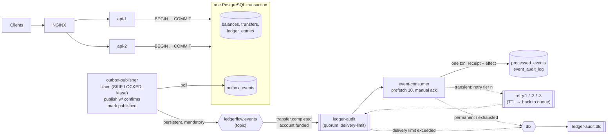

# Phase 4A Design: Transactional Outbox and Reliable Event Processing

Phases 1–3 made money movement correct, idempotent and horizontally scalable. Phase 4A
lets other components **react** to money movement (fraud scoring, notifications,
analytics) without weakening any of that. Every committed transfer or funding produces
exactly one event, the event reaches consumers **at least once**, and each consumer applies
its effect **exactly once**.

---

## 1. The dual-write problem

The naive implementation commits the transfer, then publishes to the broker:

```text
BEGIN; ...move money...; COMMIT        ✓
channel.basic_publish("transfer.completed")   ✗ broker down / process killed here
```

Two systems, two writes, no shared transaction. Every ordering fails somewhere:

| Order | Failure between the two writes | Result |
|---|---|---|
| commit, then publish | crash or broker outage after COMMIT | money moved, **event lost forever** |
| publish, then commit | commit fails (constraint, deadlock, crash) | event says money moved; **it didn't** |
| publish inside the transaction | broker slow while row locks are held | every transfer on those accounts waits on the network |

Distributed transactions (2PC/XA) aren't supported by RabbitMQ, and they would make the
broker part of the critical path for moving money anyway.

## 2. The transactional outbox

Write the event **into the same database, in the same transaction** as the change it
describes. A separate process moves it to the broker later.

```text
BEGIN
  lock accounts, validate, update balances
  INSERT transfers, INSERT ledger_entries ×2
  INSERT outbox_events (id = uuid5(type, transfer_id), payload, status='pending')   ← new
  UPDATE idempotency_records (outcome, response)
COMMIT          ← money and event become durable together, or not at all
```

Implemented in `LedgerPoster.post()`, the single code path for every money movement:
- **Business rejection:** the transfer's SAVEPOINT rolls back, and the event row with it.
- **Any other failure:** the whole transaction rolls back.
- **Idempotent replay:** never reaches `post()`, so no new event.

All three cases are tested (`tests/integration/test_outbox.py`).

The API never talks to RabbitMQ, and no network call happens while row locks are held.
Measured in `demo_outbox_recovery.py`: with the broker stopped, transfers keep succeeding,
their events wait as `pending`, and they are delivered about 10 s after the broker returns.

**Event identity.** `id = uuid5(namespace, "<event_type>:<transfer_id>")` is
deterministic. One movement can only ever produce one outbox row (primary key), and anyone
holding a transfer id can compute its event id.

**Events** (envelope version 1; payload schemas in `app/events/schemas.py`):

| Type | Aggregate | Payload |
|---|---|---|
| `transfer.completed` | transfer id | transfer_id, source/destination account, amount_minor, currency, occurred_at |
| `account.funded` | account id | transfer_id, account_id, amount_minor, currency, occurred_at |

The envelope also carries `event_id`, `event_type`, `event_version`, `aggregate_id`,
`occurred_at`, and a `correlation_id` (NGINX's `X-Request-ID`, so an event can be traced
to the request that caused it).

## 3. HLD



`outbox-publisher` and `event-consumer` are separate Compose services built from the same
image as the API, with different commands. Each can be restarted on its own, and each runs
on the internal network only. RabbitMQ publishes AMQP and management on loopback only.

## 4. Publisher: claims, leases, confirms

```mermaid
sequenceDiagram
    participant P as outbox-publisher
    participant DB as PostgreSQL
    participant MQ as RabbitMQ
    P->>DB: BEGIN; WITH c AS (SELECT ... FOR UPDATE SKIP LOCKED LIMIT 100)<br/>UPDATE SET status='processing', claimed_until=now()+30s,<br/>claim_token=T, attempts+=1; COMMIT
    Note over P,DB: no database transaction is open from here on
    loop each claimed event
        P->>MQ: basic_publish(persistent, mandatory=True)
        MQ-->>P: Basic.Ack (publisher confirm) / Basic.Return (unroutable) / Nack
    end
    P->>DB: BEGIN; UPDATE status='published' WHERE id IN (acked) AND claim_token=T;<br/>UPDATE status='pending', available_at=now()+backoff WHERE id IN (failed) AND claim_token=T; COMMIT
```

- **Claim.** One statement selects due rows with `FOR UPDATE SKIP LOCKED`, so concurrent
  publishers never block each other or claim the same row (tested with 4 parallel
  claimers). It also includes `processing` rows whose `claimed_until` has passed: a crashed
  publisher's claim simply expires, and nothing stays stuck.
- **No transaction across the network.** The claim commits *before* publishing, so locks
  and connections aren't held while waiting on the broker.
- **Fencing token.** `mark_published` and `release` only touch rows still holding *this*
  claim's token. A publisher that stalled past its lease (GC pause, network partition)
  can't overwrite a newer claim (tested).
- **Confirms and mandatory.** `confirm_delivery()` makes `basic_publish` return only after
  the broker has taken responsibility for the message (persisted for persistent messages
  on durable queues). `mandatory=True` turns "no queue bound for this routing key" into an
  `UnroutableError` instead of a silent drop. Unroutable and nacked events go back to
  `pending` with backoff and `last_error`.
- **Backoff.** Per row, computed in SQL: `min(cap, base × 2^(attempts−1)) × (0.5 + random/2)`
  ("equal jitter"). Connection-level failures back off with the same formula in Python, and
  the publisher doesn't claim rows while it can't reach the broker. It reconnects on its own
  (tested against a real broker that is stopped and restarted).
- **Partial index.** `ix_outbox_events_unpublished (available_at) WHERE status <> 'published'`
  keeps polling cost proportional to the *backlog*, not to all history.

**Publishing is at-least-once, never exactly-once.** If the process dies after the broker
acked but before step 3, or a confirm is lost with the connection, the lease expires and
the event is published again. Both cases are tested
(`test_crash_after_broker_confirm_before_outbox_update_republishes_safely`). Exactly-once
delivery across two independent systems isn't achievable without a shared transaction.
What we guarantee instead is **no loss** (outbox) and **no double effect** (consumer dedup).

## 5. Consumer: dedup, ack after commit, retries, DLQ

```mermaid
sequenceDiagram
    participant MQ as RabbitMQ
    participant W as event-consumer
    participant DB as PostgreSQL
    MQ->>W: deliver (prefetch ≤ 10 unacked)
    W->>W: parse + validate envelope / payload / version
    alt invalid (permanent)
        W->>MQ: publish to DLX with x-ledgerflow-error (confirmed), then ack
    else valid
        W->>DB: BEGIN; INSERT processed_events ON CONFLICT DO NOTHING
        alt receipt already existed
            W->>DB: COMMIT (no effect)
            W->>MQ: ack   (duplicate)
        else new
            W->>DB: INSERT event_audit_log; COMMIT
            W->>MQ: ack   (only AFTER the commit)
        end
    end
    opt transient failure (DB down, lock conflict, unknown)
        W->>MQ: publish copy to retry.<n> (x-ledgerflow-retry=n), then ack original
        Note over MQ: TTL expires → dead-lettered back into the main queue
    end
```

- **Exactly-once effect.** The `processed_events` receipt (PK `event_id, consumer_name`) and
  the durable effect commit in **one** transaction.
  - Crash *before* COMMIT: both roll back, and the unacked message is redelivered.
  - Crash *after* COMMIT but before ack: the redelivery finds the receipt and is acked as a
    duplicate.

  Both are tested in-process and demonstrated with real process deaths in
  `demo_worker_crash.py`. The effect table, `event_audit_log`, deliberately has **no**
  unique constraint, so a deduplication bug would be visible as duplicate rows.
- **Concurrent duplicates.** Two workers handling the same event at once serialize on the
  receipt's primary key (`INSERT ... ON CONFLICT` waits for the other transaction), so only
  one applies the effect.
- **Classification.**
  - Malformed JSON, invalid envelope or payload, unsupported type/version, and
    constraint violations are **permanent**: straight to the DLQ.
  - Database/connection errors, lock conflicts and unknown errors are **transient**:
    retried.
- **Bounded retries with backoff and no hot loop.** A transient failure republishes the
  message to retry tier *n* (TTL 1 s / 5 s / 25 s; 50/100/150 ms in tests), then acks the
  original. The tier's TTL dead-letters it back into the main queue. After the last tier,
  the message goes to the DLQ with `retries exhausted after N retries: <error>`. Using
  `nack(requeue=True)` for retries would redeliver immediately, a busy loop that hammers a
  struggling dependency.
- **Publish before ack.** For both retries and dead letters, the confirmed publish happens
  before the original is acked. A crash in between causes a duplicate, never a loss.
- **Poison messages that crash the process.** The consumer never gets to retry or
  dead-letter a message that kills it. The quorum queue's `x-delivery-limit` (5) makes the
  *broker* dead-letter such a message after 5 redeliveries. This happened for real: a demo
  run against a stale image crashed on every delivery, and the message was dead-lettered
  with `x-first-death-reason = delivery_limit`, `x-delivery-count = 6`.
- **Backpressure via prefetch.** `basic_qos(prefetch_count=10)` caps unacked messages per
  consumer (tested: with prefetch 2 the broker stops at 2). A slow consumer therefore
  buffers in the broker, not in process memory, and work spreads across consumers. Higher
  prefetch means more throughput but larger redelivery bursts after a crash, and more
  uneven distribution.
- **Graceful shutdown.** SIGTERM sets a flag; the loop stops consuming, finishes the current
  delivery and closes. Unacked deliveries are requeued by the broker. Reconnects use backoff.

## 6. At-least-once delivery, idempotent consumers

| Where a duplicate can come from | Why | Handled by |
|---|---|---|
| Publisher crash after confirm, before `published` | lease expires → re-publish | consumer receipt |
| Lost confirm (connection drops after the broker stored the message) | ambiguous → retried | consumer receipt |
| Consumer crash after commit, before ack | broker redelivers | consumer receipt |
| Retry/DLQ publish then crash before ack | original redelivered | consumer receipt |
| Operator replays a DLQ message | intentional | consumer receipt |

Deduplication is per **consumer**: a future `fraud-scoring` consumer gets its own receipts
and its own queue.

## 7. Message ordering

There is **no global or per-account ordering guarantee**:
- several publishers can interleave batches;
- retries move a message *behind* later ones;
- prefetch with several consumers processes messages in parallel;
- a redelivery after a crash arrives later than its successors.

Consumers must therefore be order-independent (the audit log is), or detect staleness
themselves. Payloads carry `occurred_at` and the transfer id for that. Per-key ordering
would need partitioning by aggregate (one queue/partition per key range, single active
consumer, no parallel retries), which costs throughput and availability.

## 8. Outbox polling vs. CDC

| | Polling publisher (here) | Change data capture (Debezium etc.) |
|---|---|---|
| How | Query unpublished rows every 0.5 s | Tail the database's WAL / logical replication |
| Latency | ≈ poll interval (+ backoff) | sub-second, push |
| DB load | Indexed poll query + 2 small updates per batch | Replication slot; no extra queries |
| Moving parts | One small Python process | Kafka Connect / Debezium cluster, slot management |
| Failure modes | Clear and testable (leases, tokens) | Slot lag can bloat WAL; schema-change handling |
| Fits when | Moderate volume, simplicity matters | High volume, many tables, a Kafka-centric platform |

Polling is the right first step here: correct, observable, a few hundred lines, and it can
be replaced by CDC later without changing the outbox table or the consumers.

## 9. RabbitMQ deployment and its limits

- **Exchanges:** `ledgerflow.events` (topic, durable) and `ledgerflow.events.dlx` (fanout).
- **Queues:**
  - the main queue is a **quorum** queue, because quorum queues support delivery limits
    and are RabbitMQ's recommended durable queue type;
  - retry tiers are classic durable queues with a per-queue TTL;
  - the DLQ is a quorum queue.
- **Messages:** persistent. Topology is declared idempotently by both processes.
- **A single node is NOT highly available.** Durable queues and persistent messages survive
  a broker *restart*, but if the node or its disk is lost, every in-flight message is gone,
  and while it is down nothing is delivered. The outbox limits the damage: unpublished
  events are safe in PostgreSQL, and delivery resumes when the broker returns. Messages
  already published and acked by the broker, but not yet consumed, are lost with the node.
  Production would run a 3-node cluster with quorum queues (Raft replication), so a single
  node loss neither loses acked messages nor stops delivery.

## 10. Failure scenarios

| Scenario | Behaviour | Verified by |
|---|---|---|
| RabbitMQ down | Transfers succeed; events wait as `pending`; publisher backs off; delivered after restart, once each | `test_broker_outage.py`, `demo_outbox_recovery.py` |
| Publisher crash before publish | Claim lease expires → re-claimed | `test_expired_claims_are_reclaimed` |
| Publisher crash after confirm, before update | Re-published (duplicate) → dedup | `test_crash_after_broker_confirm_…` |
| Stale publisher wakes up after its lease | Its updates match 0 rows (fencing token) | `test_expired_claims_are_reclaimed` |
| Two publishers | Disjoint claims (SKIP LOCKED) | `test_concurrent_publishers_claim_disjoint_batches` |
| Unroutable event type | `UnroutableError` → pending + backoff + `last_error` | `test_unroutable_events_are_retried_later_not_lost` |
| Consumer crash before commit | Rolled back; redelivered; processed once | test + `demo_worker_crash.py` (real `os._exit`) |
| Consumer crash after commit, before ack | Redelivered; duplicate → acked; effect once | test + demo |
| Duplicate publications (×6) | One effect, all acked | test + `demo_event_deduplication.py` |
| Malformed / unsupported events | DLQ immediately with reason; no receipt | `test_malformed_events_go_straight_to_the_dlq` |
| Transient failures | Tiered retries; success on attempt 3 | `test_transient_failures_are_retried_…` |
| Retries exhausted | DLQ with reason after exactly N+1 attempts | `test_retry_exhaustion_routes_to_the_dlq` |
| Permanent processing error (constraint) | DLQ without retries | `test_permanent_processing_errors_…` |
| Message that crashes the worker every time | Broker delivery limit → DLQ | `test_poison_message_…`, observed in a real run |
| Ledger + outbox atomicity | Failure anywhere → neither exists | `test_ledger_and_outbox_roll_back_together` |
| Single-node broker lost with its disk | Published-but-unconsumed messages lost; unpublished events safe | Not HA by design (§9) |

## 11. LLD decisions

| Decision | Alternative | Why |
|---|---|---|
| Write the event in `LedgerPoster` | Separate service call after posting | One place for every movement; the transaction boundary is the caller's, so it can't be forgotten |
| Deterministic `uuid5` event ids | Random uuid4 | One movement → one event, even if a code path ran twice; consumers and demos can compute ids |
| Sync `pika` | `aio-pika` | The whole codebase is synchronous SQLAlchemy; async AMQP would force a thread bridge for every DB call. Workers are I/O-light single loops |
| Claim with lease + fencing token | `SELECT FOR UPDATE` held during publish | A transaction across network calls holds locks/connections indefinitely when the broker is slow |
| Commit-then-ack | ack-then-commit | ack-then-commit loses the event on a crash; commit-then-ack only duplicates, and duplicates are deduplicated |
| Receipt + effect in one transaction | Receipt in Redis / separate commit | Two commits re-create the dual-write problem on the consumer side |
| TTL retry tiers | `nack(requeue=True)` | Requeue is immediate (busy loop); TTL tiers give real, bounded backoff without consumer sleeps |
| Explicit DLQ publish with reason | `nack(requeue=False)` via DLX | Carries the failure reason and consumer name; the broker DLX still catches what code can't (delivery limit) |
| Heartbeat-file health check for workers | HTTP endpoint in workers | Workers serve no HTTP; liveness = "the main loop is still turning" |
| Fault injection keyed to an event id, first delivery only | Random crashes | Deterministic, demonstrable, and can't turn into a crash loop; refused when `APP_ENV=production` |

## 12. Interview questions

**Q1. What is the dual-write problem and how does the outbox solve it?**
Updating a database and publishing to a broker are two independent writes. A crash between
them either loses the event or announces something that never committed. The outbox puts
the event in the same database transaction as the business change, so they're atomic. A
relay process then publishes from the table, retrying until it succeeds. Atomicity comes
from the database; delivery becomes at-least-once.

**Q2. Why can't the publisher guarantee exactly-once delivery?**
Publishing and recording "published" are two steps in two systems. If the broker confirms
and the publisher dies before updating the outbox, or the confirm is lost with the
connection, the publisher can't distinguish "sent" from "not sent". The only safe choice is
to send again. Exactly-once *effects* come from idempotent consumers, not from the transport.

**Q3. Why ack only after the database commit?**
If you ack first and crash before committing, the broker has deleted the message and the
effect never happened: data loss. If you commit first and crash before acking, the message
is redelivered and the receipt turns it into a no-op. Choose the order whose failure mode
you can repair, and a duplicate is repairable.

**Q4. How do you avoid infinite retry loops for a bad message?**
- **Classify errors:** permanent errors (schema, constraints) go straight to a DLQ.
- **Bound transient retries:** use delayed retry queues (TTL + dead-lettering), not
  immediate requeue, and send the message to the DLQ after N attempts.
- **Broker-level cap:** for messages that crash the consumer before it can decide anything,
  rely on a broker-side delivery limit (quorum queue `x-delivery-limit`).

**Q5. Why `FOR UPDATE SKIP LOCKED` for the outbox poller, and why a lease?**
`SKIP LOCKED` lets several publishers claim disjoint batches without waiting for each
other's locks. The lease (`claimed_until`) commits the claim *before* the slow network
work, so no lock is held during publishing, and a crashed publisher's rows become claimable
again when the lease expires. A fencing token stops a publisher that resumes late from
overwriting the new claim.

**Q6. What does prefetch control, and how do you pick it?**
The maximum number of unacknowledged messages the broker pushes to a consumer. Too low (1)
and the consumer waits a round trip between messages. Too high and one consumer hoards
work, redelivers a large burst after a crash, and buffers in memory. A common start is
roughly throughput × processing latency, tuned by measurement. Here it is 10 per consumer.

**Q7. Does RabbitMQ preserve order? What if you need per-account ordering?**
A single queue with a single consumer and no requeues delivers in order. Retries, multiple
consumers, prefetch and redeliveries all break that. For per-key ordering you partition by
key (consistent-hash exchange or Kafka partitions) with one active consumer per partition,
and make retries block the partition or reject out-of-order events using a version or
sequence number. Otherwise, design consumers to be order-independent.

**Q8. Polling outbox or CDC?**
Polling is simple, transparent and easy to test, but adds poll latency and some query load.
CDC (Debezium reading the WAL) gives push latency and no polling queries, but brings a
connector platform, replication slots and their WAL-retention risk. Start with polling, and
move to CDC when volume or latency requires it. The outbox table and consumers stay the same.

## 13. What remains for Phase 4B

- A real consumer with business logic, the anomaly-detection pipeline: feature extraction
  from `transfer.completed` and a scikit-learn model.
- **Webhooks and other external side effects**, which need their own outbox and idempotency
  keys towards third parties.
- **Operational tooling:** a DLQ inspection/replay tool, outbox lag metrics and alerts,
  and a retention job for published outbox rows and old receipts.
- **Event history:** backfill events for pre-0003 transfers if a consumer needs it.
- **HA broker:** a 3-node RabbitMQ cluster, plus partitioned, ordered consumption if a
  consumer requires per-account ordering.
