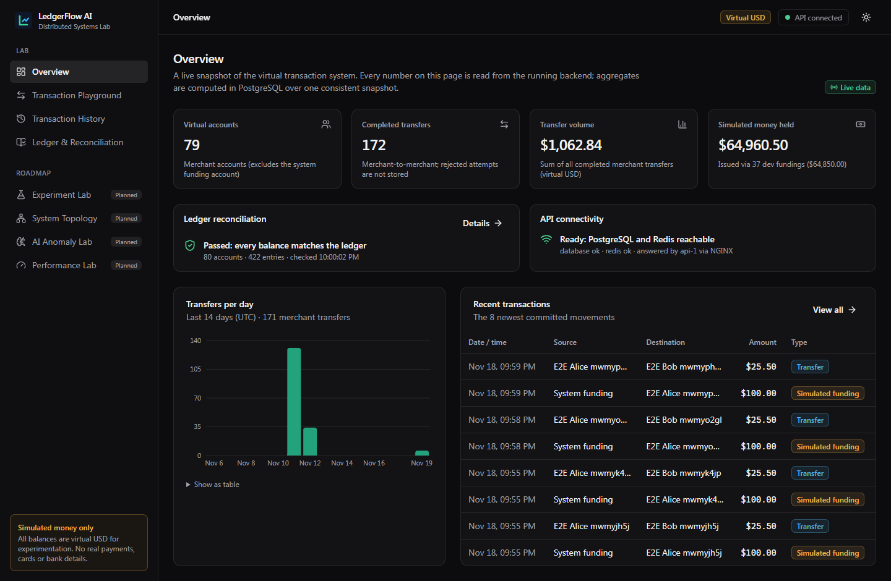

# Phase 5A Design: Frontend Foundation and Transaction Playground

Phases 1–4A built a backend whose interesting behaviour is invisible from the outside:
row locks, idempotency keys, a global token bucket, a double-entry ledger, an outbox.
Phase 5A adds a browser frontend that makes that behaviour **observable** and lays the
foundation for the interactive Distributed Systems Lab (experiments, live topology,
anomaly detection and benchmarks in later phases).

Scope of 5A: Overview, Transaction Playground, Transaction History, Ledger &
Reconciliation, plus clearly labelled roadmap pages. No experiment execution, no
infrastructure control, no fault injection from the browser.



---

## 1. Frontend architecture

```text
Browser (http://127.0.0.1:5173)
  │  same-origin requests: /api/v1/*, /health/*
  ▼
Vite dev server ── proxy ──► NGINX :8080 ──► api-1 / api-2 ──► PostgreSQL, Redis
```

| Concern | Choice | Why |
|---|---|---|
| Build | Vite 8, React 19, TypeScript 5.9 (strict, `noUncheckedIndexedAccess`) | Fast dev loop; TS 7 is not yet supported by typescript-eslint or openapi-typescript |
| Styling | Tailwind CSS v4 + shadcn/ui-style components on Radix primitives | Owned source (no component-library lock-in), accessible primitives, token-based theming |
| Routing | React Router 7 (data router) | URL-addressable state (filters, open transfer) |
| Server state | TanStack Query 5 | Caching, invalidation, request cancellation, loading/error states |
| Forms | React Hook Form + Zod | Declarative validation that mirrors the backend's Pydantic rules |
| Charts | Recharts (lazy-loaded) | Only the Overview needs it; loaded on demand (118 KB gzip chunk) |
| HTTP | A typed `fetch` wrapper (no Axios) | One small module owns timeouts, errors and header parsing |
| Contract | `openapi-typescript` generates `src/types/openapi.gen.ts` | Backend schema changes become TypeScript errors |

**Same-origin proxying instead of CORS.** The browser only talks to its own origin and Vite
forwards `/api` and `/health` to NGINX. The backend needed no CORS configuration, and every
request still passes through the gateway (request ids, load balancing, rate limits). The
target is configurable (`LEDGERFLOW_API_PROXY_TARGET`) and read only by `vite.config.ts`.

### Directory structure

```text
frontend/
  src/
    api/          client.ts (fetch wrapper, ApiError), accounts/transfers/ledger/health, queryKeys
    app/          routes, query client defaults, providers, navigation test
    components/
      ui/         shadcn-style primitives (button, card, badge, dialog/sheet, table, native-select, …)
      layout/     AppShell (sidebar + header), ConnectionStatus, nav config
      common/     PageHeader, Money, IdText, StatCard, empty/error/loading states, FormField
      lab/        InvariantCheckList, Timeline  (reusable for Phase 5B experiments)
    features/
      overview/      OverviewPage, ActivityChart
      accounts/      AccountsPanel, CreateAccountForm, FundAccountForm, schema
      transfers/     PlaygroundPage, TransferForm, TransferResultPanel,
                     transferOutcome.ts (classifier), transferAttempt.ts (key lifecycle reducer)
      history/       HistoryPage, TransferTable, TransferDetailSheet
      ledger/        LedgerPage, LedgerExplainer, ReconciliationPanel, LedgerEntriesCard
      planned/       Experiment Lab, System Topology, AI Anomaly Lab, Performance Lab
    hooks/        TanStack Query hooks, account directory, theme, countdown
    lib/          money (integer cents), format, ids, errors, a11y helpers
    types/        api.ts (domain aliases) + openapi.gen.ts (generated)
    test/         setup, fetch mock + fixtures, render helpers
  e2e/            Playwright flow against the real backend
  scripts/        vitest.mjs (Windows path normalization, see §10)
```

## 2. Component hierarchy

```text
App
└─ AppProviders (QueryClientProvider, TooltipProvider)
   └─ RouterProvider
      └─ AppShell ─ sidebar (Brand, SidebarNav, SimulatedMoneyNote) · header (ConnectionStatus, theme)
         ├─ OverviewPage ─ StatCard×4 · HealthCard×2 · ActivityChart (lazy) · TransferTable(compact)
         ├─ PlaygroundPage
         │   ├─ AccountsPanel ─ account list · CreateAccountForm (dialog) · FundAccountForm
         │   ├─ TransferForm ─ IdempotencyKeyInspector
         │   └─ TransferResultPanel ─ OutcomeSummary · Timeline (attempt log)
         ├─ HistoryPage ─ filters · TransferTable · TransferDetailSheet ─ LedgerPair
         ├─ LedgerPage ─ LedgerExplainer · ReconciliationPanel ─ InvariantCheckList · LedgerEntriesCard
         └─ Planned pages (static, labelled)
```

## 3. Navigation structure

Two sidebar groups. **Lab** (functional): Overview, Transaction Playground, Transaction
History, Ledger & Reconciliation. **Roadmap** (each item carries a `Planned` badge and the
header shows its phase): Experiment Lab (5B), System Topology (5C), AI Anomaly Lab (4B),
Performance Lab (5D). Planned pages describe what is coming and point to what exists today
(CLI demo scripts, benchmark results); none has a button that pretends to run anything.

On screens below `lg` the sidebar becomes a slide-in sheet behind a menu button.

## 4. State management

- **Server state → TanStack Query.** One hook per endpoint in `hooks/queries.ts`, keys from a
  hierarchical factory (`["transfers", "list", params]`) so a single invalidation refreshes a
  whole family.
- **Local UI state → React state.** Form drafts, selected account, dialog open state.
- **Shareable UI state → the URL.** History filters, page, page size and the open transfer
  (`/history?kind=transfer&transfer=<id>`); the playground links straight to a transfer.
- **The transfer attempt → a reducer** (`transferAttempt.ts`), because the idempotency-key
  lifecycle has real invariants worth testing in isolation (§6).

Query defaults are tuned for a rate-limited API: one retry only for network errors,
timeouts and 5xx other than 503 (never 4xx, never 429); no refetch on window focus; 5 s
staleness. Mutations never retry automatically. Transfers and ledger entries are immutable,
so their detail queries use `staleTime: Infinity`. Reconciliation always re-runs on mount so a
stale "passed" is never presented as current.

**Invalidation after money movement.** After a *confirmed* success (transfer or funding),
accounts, transfers, ledger entries, reconciliation and the summary are invalidated. A
rejection or uncertain outcome invalidates nothing: nothing is known to have changed.

## 5. API integration

`src/api/client.ts` is the only place that calls `fetch`:

- Base URL from `VITE_API_BASE_URL` (default: same origin). No hardcoded hosts in UI code.
- Timeout via `AbortController` (`VITE_API_TIMEOUT_MS`, default 10 s), combined with the
  caller's signal so TanStack Query can cancel requests; a timeout and a cancellation are
  reported differently.
- Every failure becomes an `ApiError` with a `kind` (`http`, `network`, `timeout`, `aborted`),
  the HTTP status, the backend's stable error `code`, `details`, and parsed response metadata.
  Non-JSON gateway errors (an NGINX 502 HTML page) get synthetic codes like `HTTP_502`.
- `ResponseMeta` exposes the headers the lab cares about: `X-Served-By` (replica),
  `X-Request-ID`, `X-RateLimit-*`, `Retry-After`, `Idempotent-Replayed`, plus latency.
- `/health/ready` returns 503 *with a body* when degraded; the health module returns that as
  a report rather than throwing.

### Backend endpoints added (read-only)

The UI needed data the API did not expose. Rather than download unbounded history into the
browser, four narrowly scoped, read-only endpoints were added, each behind the existing
`read` rate-limit policy and built on the existing repository/service layering:

| Endpoint | Purpose | Implementation |
|---|---|---|
| `GET /api/v1/transfers/{id}` | Detail drawer, deep links | `TransferService.get_transfer`; 404 `TRANSFER_NOT_FOUND` |
| `GET /api/v1/transfers/{id}/ledger-entries` | The transfer's debit/credit pair | Existing `LedgerRepository.entries_for_transfer` |
| `GET /api/v1/ledger/entries` | Paged postings, optional `account_id` | New `LedgerRepository.list_entries` |
| `GET /api/v1/stats/summary` | Overview totals + per-day activity | `InsightsService`: one REPEATABLE READ read-only snapshot |

`GET /api/v1/accounts` also gained an optional `order=asc|desc` (default `asc`, unchanged).
The UI requests the newest 100 accounts so a just-created account is always in the picker.

No financial logic, migration, constraint or rate limit changed. 16 integration tests cover
the new reads (`tests/integration/test_read_endpoints.py`), including one proving the reads
leave reconciliation unchanged.

## 6. Transfer and idempotency UX

The hardest UX problem in this phase: a user must never be nudged into paying twice.

**Outcome classification** (`transferOutcome.ts`) maps each response to one of five
categories that decide what may happen to the key next:

| Category | Examples | Executed? | Next step |
|---|---|---|---|
| `succeeded` | 201, 201 + `Idempotent-Replayed` | yes | key consumed; new transfer → new key |
| `rejected` | 409 `INSUFFICIENT_FUNDS`, 404 `ACCOUNT_NOT_FOUND`, 422 `SAME_ACCOUNT_TRANSFER` | no, final | stored under the key; a new attempt needs a new key |
| `invalid` | 422 `IDEMPOTENCY_KEY_REUSED`, 422 `VALIDATION_ERROR` | no | fix input (schema errors leave the key unused) |
| `retryable` | 429 `RATE_LIMITED`, 503 `RATE_LIMITER_UNAVAILABLE`, 503 `CONCURRENCY_CONFLICT`, 409 `IDEMPOTENCY_REQUEST_IN_PROGRESS` | definitely not | retry with the **same** key |
| `ambiguous` | timeout, network loss, 500 `OUTCOME_UNKNOWN`, 502/504 | **maybe** | retry with the **same** key; never a new one |

**Key lifecycle** (`transferAttempt.ts`, a pure reducer):

```text
fresh ──submit──► succeeded / rejected / key reused ──► consumed ──submit──► (new key) fresh…
  │                                                          ▲
  └──► retryable / ambiguous ──► pinned ──retry (same key, same body)──┘
                                   └── startNew (explicit, with a warning) ──► fresh
```

Invariants (all unit-tested):

1. A key is generated only when the user starts a new logical transfer: on load,
   on **New transfer**, or on submitting after a *final* outcome. No outcome ever rotates it.
2. While `pinned`, the form is disabled and the request body frozen. Sending it again is only
   possible through **Retry with same key**, which resends the identical body (a changed body
   under the same key would be rejected as `IDEMPOTENCY_KEY_REUSED`).
3. Abandoning a pinned *ambiguous* attempt is allowed but explicit, with a warning that the
   first attempt may already have committed.
4. Double clicks are ignored (reducer guard plus a synchronous ref).

For 429 the panel shows `Retry-After` and disables the retry button with a live countdown.
After a final outcome, **Send again with same key** demonstrates idempotency on demand:
the server answers with `Idempotent-Replayed: true` and balances do not move.

Advanced users can copy, regenerate or hand-edit the key while it is unused, for example to
reuse an earlier key with a different body and observe the 422.

Every attempt for the current logical transfer is shown in a timeline (mode, status, key
prefix, serving replica, latency), which makes cross-replica retries visible.

**Money input.** `parseUsdToMinor` parses the decimal *string* into integer cents (no
`parseFloat`, so `0.29` is 29, not 28.999…). `formatMinor` formats integers with integer
arithmetic. The form shows the exact `amount_minor` that will be sent. Balances shown are
always the server's values; the UI never computes an authoritative balance. Client
validation mirrors the backend (positive, ≤ $1B, two decimals, distinct existing accounts,
supported currency) but deliberately does **not** block an amount above the displayed
balance: it warns, and lets the server's locked check decide, which is the point of the lab.

## 7. Error handling

- Pages render four explicit states: loading (skeletons with `role=status`), empty (with
  the next action), error (title, message, backend code, *Try again*), and data.
- `describeError` turns an `ApiError` into user language: "API unreachable", "Rate limited —
  retry in 3 s", "Request failed (500)".
- The header connection indicator polls `/health/ready` every 15 s and shows database,
  Redis and the answering replica exactly as reported.
- Funding against a backend without `ENABLE_DEV_ENDPOINTS=true` explains how to enable it.
- When a refresh fails after earlier data loaded (e.g. reconciliation), the error is shown
  above the last result, which is labelled as the last successful run.

## 8. Ledger and reconciliation visualization

- **Explainer** — a static $25.00 example (−$25.00 / +$25.00 / net $0.00) tagged
  *Illustrative example* with a dashed border. Every live panel carries a *Live data* tag, so
  examples can never be mistaken for system data.
- **Reconciliation** — renders `GET /api/v1/reconciliation` verbatim. The verdict is the
  backend's `ok` field, nothing else. The four invariants (balances match ledger, ledger sums
  to zero, balances sum to zero, every transfer has two balanced entries) are derived
  one-to-one from response fields and listed with pass/fail. Mismatches and unbalanced
  transfer ids are tabulated. Manual re-run and last-run time are shown.
- **Postings** — paged, newest first, with each transfer's debit and credit adjacent;
  filterable by account including the system funding account. Rows link to the transfer.
- **Transfer drawer** — the two entries, their net, and an explicit balanced/unbalanced line.

## 9. Future Experiment Lab architecture

Phase 5A builds the pieces 5B will compose, and uses them today:

| Component | Used now | Phase 5B use |
|---|---|---|
| `InvariantCheckList` | reconciliation invariants | per-experiment pass/fail checks ("exactly 10 succeed") |
| `Timeline` | transfer attempt log | experiment event stream (fan-out, outage, recovery) |
| `StatCard`, `DataSourceTag` | overview | result summary cards; live vs illustrative |
| `transferOutcome` classifier | playground | aggregating N concurrent responses by category |
| `ApiError` / `ResponseMeta` | everywhere | per-request replica, latency and quota capture |

The experiment runner itself must live in the backend, restricted to local development, with a
fixed allow-list of experiments (no arbitrary commands, no Docker socket in the browser path).
The landing page lists the nine planned experiments, the invariant each checks, and the CLI
demo that already implements it.

## 10. Frontend testing approach

| Layer | Tool | What |
|---|---|---|
| Pure logic | Vitest | money parsing/formatting (incl. float traps), outcome classification, key lifecycle reducer |
| API client | Vitest + stubbed `fetch` | envelopes, headers, 502 HTML, network error, timeout vs cancel, Retry-After |
| Components | React Testing Library + a ~60-line fetch router (`test/mockApi.ts`) | navigation, account creation, funding, transfer validation, success, 409, 429, 503, ambiguous → same-key retry, replay, reconciliation pass/fail/error, loading and empty states |
| End to end | Playwright (installed Edge, no download) against the real stack | create → fund → transfer → replay → insufficient funds → history drawer → reconciliation; phone-width overflow check; zero console errors |

Results at the end of this phase: 103 Vitest tests, 2 Playwright tests, typecheck, lint and
production build all pass; the backend suite passes with 239 tests (223 before this phase
plus 16 for the new read endpoints; the 7 opt-in `stack` tests were not re-run).

**Windows note.** With a lowercase drive letter in the working directory (`d:\…`, common in
VS Code terminals) Vitest loads its own module twice and setup-file hooks fail. `npm test`
runs through `scripts/vitest.mjs`, which re-launches from the canonical path. Vite's
`resolve.dedupe` covers the equivalent "two copies of React" problem in the dev server.

## 11. Known limitations

- **No authentication.** Every caller acts as the demo merchant, and the funding endpoint
  mints simulated money. Do not deploy this frontend (or the backend) publicly with
  unrestricted mutation or funding access; both are bound to `127.0.0.1` by default.
- **Account picker is bounded** to the newest 100 accounts; there is no search endpoint.
- **No total counts.** List endpoints return pages without totals, so history pagination is
  previous/next and "next" is enabled when a page is full. Column sorting re-orders only the
  current page (server order is newest first).
- **Shared rate limits.** The UI uses the same per-merchant read/write buckets as scripts and
  benchmarks, so running a load test makes the UI receive 429s (shown, not hidden).
- **Activity chart** counts merchant transfers per UTC day; local time zones are not applied.
- **No live tracing.** "What happens inside a transfer" describes the code path; it is not a
  per-request trace. Live topology and service status are Phase 5C.
- **AI anomaly detection does not exist in the backend yet**; its page is a design preview.
- **Bundle size.** The main chunk is ~227 KB gzipped (Vite warns above 500 KB minified);
  route-level code splitting is a cheap follow-up if it matters.
- **Local development only.** No production frontend container or cloud deployment yet;
  `npm run build` produces static files that any static server plus an `/api` reverse proxy
  can serve.
