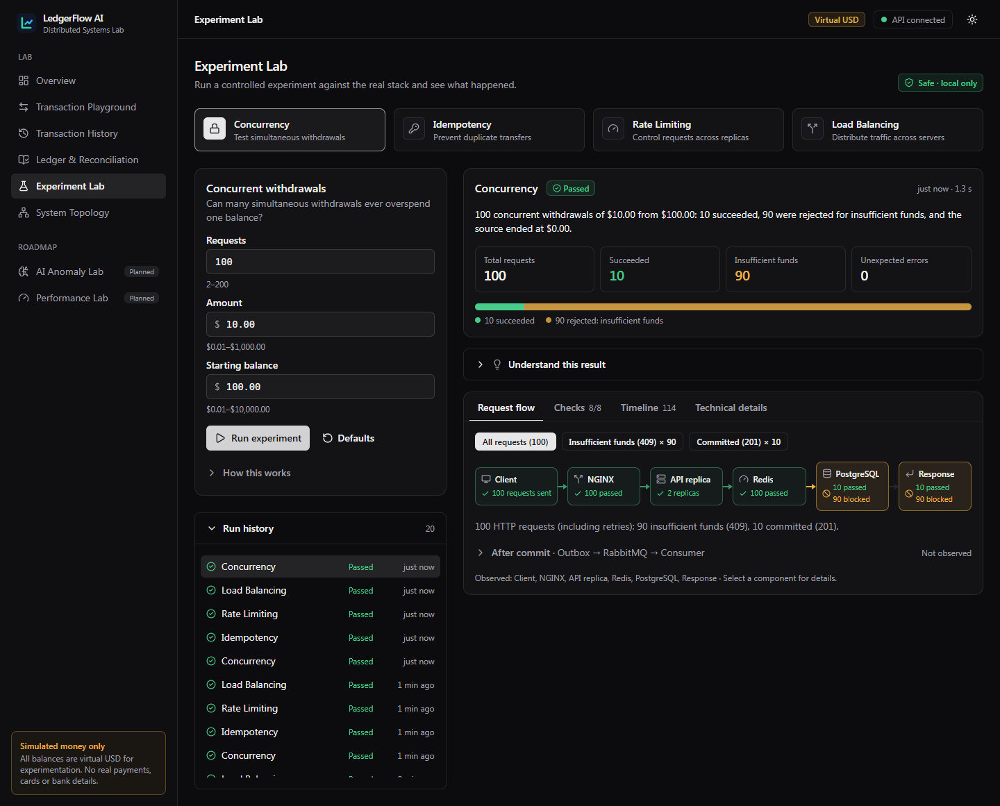

# Phase 5B Design: Experiment Lab and Request Flow Visualizer

Phase 5A made the backend observable one request at a time. Phase 5B lets a user run
**controlled experiments** from the browser (many requests, deliberately racing, retrying or
exhausting a quota) and see what the system did. That includes the path each request took
through NGINX, a replica, Redis and PostgreSQL, and whether every invariant still held. No
terminal output is needed to understand the result.

Scope: four allow-listed experiments (concurrency, idempotency, distributed rate limiting,
load balancing), a safe background runner, a reusable Request Flow Visualizer, and a static
System Topology page. Not in scope: outage or failure injection, container control, the AI
anomaly lab and the Performance Lab.



---

## 1. Experiment Lab architecture

```text
Browser ── POST /api/v1/lab/runs ──► NGINX ──► api-1 (say)
                                                 │ validate against the allow-list
                                                 │ INSERT lab_runs (one active run, DB-enforced)
                                                 │ start runner thread ──► 202 {run}
                                                 ▼
                                       runner thread (own asyncio loop)
                                         setup:   AccountService (in-process) ─► PostgreSQL
                                         measure: httpx ─► http://nginx:8080 ─► api-1 / api-2
                                                  (signed X-Lab-Traffic: per-run scope)
                                         verify:  balances, ReconciliationService (in-process)
                                         record:  events + progress ─► lab_run_events / lab_runs
Browser ── GET /lab/runs/{id}, /events?after=N (polling) ──► any replica ──► PostgreSQL
```

| Module | Responsibility |
|---|---|
| `app/lab/schemas.py` | Contract: experiment ids, bounded parameter models, run/event/check/metric schemas |
| `app/lab/catalog.py` | The descriptions shown in the UI; parameter specs derived from the same Pydantic models |
| `app/lab/experiments/` | `EXPERIMENTS`: the allow-list (`concurrency`, `idempotency`, `rate_limiting`, `load_balancing`) |
| `app/lab/runner.py` | Background execution, timeouts, status transitions, shutdown |
| `app/lab/context.py` | What an experiment may do: create/fund *its own* accounts, read balances, reconcile, send HTTP |
| `app/lab/traffic.py` | One HTTP exchange becomes an `Observation` (status, code, replica, replay flag, quota headers, latency) |
| `app/lab/recorder.py` | Buffers the timeline and progress, flushes them to the store every 300 ms |
| `app/lab/store.py` | `lab_runs` / `lab_run_events` persistence, single-active-run rule, stale-run expiry, pruning |
| `app/lab/signing.py` | HMAC token marking lab traffic, so it gets its own rate-limit and idempotency scope |
| `app/api/routes/lab.py` | Four endpoints, mounted only with `ENABLE_DEV_ENDPOINTS=true` |

### Endpoints

| Method | Endpoint | Rate limit | Purpose |
|---|---|---|---|
| `GET` | `/api/v1/lab/experiments` | read | Catalog: title, concept, expected behaviour, risk, parameter bounds |
| `GET` | `/api/v1/lab/runs?limit=` | read | Recent runs (newest first) with check counts |
| `POST` | `/api/v1/lab/runs` | write | Start a run: `{"experiment": id, "params": {...}}` → `202` |
| `GET` | `/api/v1/lab/runs/{id}` | read | Status, progress, result, metrics, checks, error |
| `GET` | `/api/v1/lab/runs/{id}/events?after=&limit=` | read | Timeline, incrementally by sequence number |

Errors use the standard envelope: `422 VALIDATION_ERROR` (unknown experiment, unknown or
out-of-range parameter), `409 LAB_RUN_IN_PROGRESS` (with the active run's id), and
`404 LAB_RUN_NOT_FOUND`. The suggested `POST /lab/experiments` became `POST /lab/runs`:
the client creates a *run*, it does not create experiments.

### Where runs live: PostgreSQL, not memory

The POST lands on whichever replica NGINX picks and the polls land on any replica, so an
in-memory registry would answer "not found" half the time. Runs are therefore stored in two
small tables (migration `0004`, lab bookkeeping only, no financial data):

- `lab_runs`: one row per run: status, params, progress, result and checks (JSONB),
  runner replica, timestamps and `heartbeat_at`.
- `lab_run_events`: an append-only timeline keyed by `(run_id, seq)`.

The tradeoff is a migration and a few small writes per run. That buys correctness across
replicas and survival across restarts (a reload or a replica restart keeps history). Only
the newest 50 runs are kept.

## 2. Request Flow Visualizer design

> The visual design was revised after this section was written: six display nodes (the
> three PostgreSQL stages grouped), click-for-details, Observed/Inferred labels and a
> collapsed after-commit lane. See [phase-5b-ux-redesign.md](phase-5b-ux-redesign.md#4-request-flow-visualizer-changes).
> The derivation rules below are unchanged.

`src/components/lab/flow/` holds a pure model (`flowModel.ts`), a renderer
(`RequestFlowDiagram.tsx`) and a fan-out chart (`ReplicaDistribution.tsx`).

**Nodes.** The synchronous lane is Client → NGINX → Replicas → Redis → Idempotency →
PostgreSQL → Ledger → Response. Below it, an asynchronous lane (Outbox → RabbitMQ →
Consumer) is shown only for writes, labelled "after COMMIT", because it really runs later.
All three async components exist (Phase 4A).

**States.** `idle`, `pending`, `active`, `success`, `blocked`, `failed`, `skipped`,
`replayed`. Each state has its own colour *and* glyph (not colour alone), and every node has
an accessible name such as "Redis: Blocked, bucket empty".

**Derivation, not tracing.** The path comes from facts every response reports (status,
error code, `X-Served-By`, `Idempotent-Replayed`, `X-RateLimit-*`). These are combined with
the server's documented order of operations: the rate limit before any database session,
then the key claim, then row locks, then posting. The UI says this explicitly
("Not distributed tracing"). The paths per outcome:

| Outcome | Path |
|---|---|
| committed (201) | all green through Ledger; Outbox written; RabbitMQ/Consumer *pending* |
| replayed (201 + header) | Idempotency **replayed** → Response replayed; PostgreSQL/Ledger skipped |
| rate_limited (429) | Redis **blocked**; everything after skipped |
| insufficient_funds (409) | key claimed; PostgreSQL **blocked** after locking; Ledger skipped |
| in_progress (409) / key_reused (422) | Idempotency **blocked** |
| conflict (503) | PostgreSQL **failed** (lock wait timeout, rolled back) |
| read_ok (200) | Redis (read quota) → PostgreSQL → Response; no key, no ledger |
| transport error / 5xx | failed where known; everything unknown stays **idle**, never "skipped" |

**Two modes.** *One request*: the path of a single request. It "travels" one component at a
time (150 ms per step, skipped for `prefers-reduced-motion`) and highlights the replica that
served it. *Aggregate*: every observed request of a run folded into one diagram. Each node
shows counts ("10 passed · 90 blocked") and is coloured by the majority of the requests
that reached it. Each replica shows how many requests it served.

**Reuse.** The same component appears in three places:
- **Experiment Lab:** aggregate view, or one example per outcome, or any request clicked in
  the timeline.
- **Transaction Playground:** the latest attempt, built from its `ResponseMeta`.
- **System Topology:** static presets (transfer, replay, rate-limit rejection, insufficient
  funds, load balancing), labelled *Illustrative example*.

The lane wraps onto a second row in narrow columns instead of hiding nodes behind horizontal
scroll, and stacks vertically on phones.

## 3. Background run execution model

1. `POST /lab/runs` validates the discriminated union (`experiment` + its own `params`
   model, `extra="forbid"`, strict integers, `ge`/`le` bounds).
2. `LabRunStore.create` expires stale runs, then inserts `status=queued`. A **partial unique
   index** `ON lab_runs ((true)) WHERE status IN ('queued','running')` makes "at most one
   active run" a database guarantee across replicas. A concurrent second start gets a
   unique violation, which becomes `409 LAB_RUN_IN_PROGRESS`.
3. A daemon thread runs `asyncio.run(...)`. Experiment traffic (up to 200 concurrent
   requests) therefore never competes with the API's own event loop or its 40-thread pool,
   and the POST returns immediately.
4. The experiment runs under `asyncio.wait_for(…, 120 s)`. Every HTTP request has a 20 s
   timeout and every retry loop is capped (20 attempts).
5. The recorder flushes events and progress every 300 ms through `asyncio.to_thread`, so
   database writes never stall in-flight requests. Each flush also updates `heartbeat_at`.
6. The run ends as one of three statuses:
   - `passed`: every applicable check holds.
   - `failed`: the run completed but an invariant was violated.
   - `error`: the run could not complete (timeout, crash, cancellation).
7. **Runner death.** If a replica restarts mid-run, the heartbeat goes stale. After 30 s,
   any start or poll marks the run `error` ("runner stopped responding"), which frees the
   slot. On a graceful shutdown the lifespan cancels the active run, which is then recorded
   as `error` rather than left `running`.

**Run statuses vs check statuses.** A check can be `pass`, `fail` or `skipped`. `skipped`
means "does not apply here", for example "traffic reached several replicas" when the target
is a single local process. The UI shows it as *Not applicable*, never as a pass, and it is
excluded from "N of M checks".

### Why lab traffic is signed

Every caller is the same demo merchant (there is no authentication), so lab traffic would
share the browser's write quota (20 burst, 10/s). That has two consequences:

- 100 "concurrent" withdrawals would mostly become 429s.
- A running experiment would throttle the user's own playground.

The fix must not let a browser escape its quota. The runner therefore sends
`X-Lab-Traffic: v1.<run>.<mode>.<HMAC>`. The HMAC key is `LAB_TRAFFIC_SECRET`, or else a key
derived from `POSTGRES_PASSWORD`, which every replica already shares. The receiving replica
verifies the token and uses principal scope `lab:<run>`:

- **Rate limiting:** the run gets its own bucket.
  - `mode=standard` (rate-limit experiment): the *real* write policy.
  - `mode=burst` (other experiments): a 1,000-token lab policy that still goes through the
    real limiter and keeps fail-closed writes.
- **Idempotency:** the run gets its own key namespace.

A missing, malformed or forged token is ignored and the request is the ordinary demo
merchant. Tests cover a tampered MAC, a changed mode, a wrong secret, a disabled lab, and a
forged header on a real transfer.

## 4. Safety constraints

| Constraint | How it is enforced |
|---|---|
| Local development only | Routes and runner exist only with `ENABLE_DEV_ENDPOINTS=true`, which the app refuses when `APP_ENV=production`; NGINX binds to `127.0.0.1` |
| No arbitrary execution | The `EXPERIMENTS` dict is the allow-list; request schema is a closed discriminated union; no field names a command, host, path, script or file |
| No subprocess, Docker or shell | The lab imports none of `scripts/stack_control.py`; it never calls `subprocess`, Docker or the file system |
| Target is configuration, not input | `LAB_TARGET_BASE_URL` comes from the environment (Compose: `http://nginx:8080`), validated as `http(s)://host[:port]` |
| Bounded load | Max 200 requests (concurrency), 100 duplicates, 150 + 60 (rate limiting), 200 reads with ≤ 20 in flight; per-request and per-run timeouts; capped retries; ≤ 800 stored events per run |
| No overlapping runs | Partial unique index (database-wide), stale-run expiry |
| Isolated demo data | Each run creates `lab-<run8>-…` accounts and moves money only between them; funding comes from the system account, as all simulated funding does; tests assert a bystander account is untouched |
| No destructive cleanup | Nothing financial is ever deleted (ledger and transfers are append-only); pruning deletes only old `lab_runs`/`lab_run_events` rows |
| Browser cannot escape quotas | Lab scope only with a valid server-side HMAC |

## 5. Supported experiments

| Experiment | Parameters (default, bounds) | What it checks |
|---|---|---|
| **Concurrent withdrawals** | requests 100 (2–200), amount $10 (1¢–$1,000), funding $100 (1¢–$10,000) | exactly ⌊funding/amount⌋ succeed, the rest 409 INSUFFICIENT_FUNDS, no unexpected errors, no overdraft, money conserved, destination exact, lab accounts match the ledger, global reconciliation |
| **Idempotent retries** | duplicates 20 (2–100), amount $10 | every duplicate 201, exactly one execution, all others replayed, one transfer id, byte-identical bodies, one row in PostgreSQL, debited and credited once, key reuse with a different amount → 422 and no money moves, a fresh key → a new transfer, reconciliation |
| **Distributed rate limiting** | burst 50 (5–150), refill wait 2 s (0–5), probe 30 (0–60) | only 201/429; `capacity ≤ admitted ≤ capacity + refill during the burst`; excess rejected; every 429 has Retry-After; money only for admitted; admitted on several replicas; per-replica counters would over-admit; refill within bounds; limiter is Redis; reconciliation |
| **Load balancing** | requests 40 (2–200), in flight 1 (1–20) | all 200, every response names its replica, more than one replica, spread ≤ max(2, 25% of fair share) |

Measured on the local stack (two replicas), all four experiments `passed`:

| Experiment | Observed |
|---|---|
| Concurrency | 10 committed / 90 insufficient funds, 50 requests on each replica, source $0.00 |
| Idempotency | 1 executed, 19 replayed, 1 transfer row, reuse → 422 |
| Rate limiting | 20 admitted / 30 × 429 in 429 ms (Retry-After 1 s); admitted split api-1 12 / api-2 8; per-replica counters would have admitted 40; after a 2 s wait, 25 of 30 admitted (cap 20 plus tokens refilled during the second burst) |
| Load balancing | api-1 21 / api-2 19, near-perfect 1-2-1-2 alternation |

**Why the rate-limit experiment differs from the CLI demo.** `scripts/demo_rate_limiting.py`
redeploys the stack with a quota of 10. The lab may not control infrastructure. It instead
uses the API's real write policy (20 burst, 10/s) on a fresh bucket of its own: same
limiter, same Lua script, same policy, only the bucket key differs.

**Why load balancing has no replica stop.** Stopping `api-2` is failure injection, so it
stays a CLI demo (`scripts/demo_load_balancing.py`). The lab shows the distribution only.

## 6. Reuse of existing demo logic

The demo scripts are synchronous, print-and-exit programs and some drive Docker, so they
were not moved wholesale. The genuinely shared pieces were extracted and the scripts now
import them:

- `RETRYABLE_CODES` and `transfer_body` → `app/lab/traffic.py`
  (`scripts/demo_common.py` imports them).
- The per-replica counterfactual (independent `InMemoryFixedWindowLimiter`s) →
  `app/lab/experiments/rate_limiting.py::per_replica_counterfactual`
  (`scripts/demo_rate_limiting.py` delegates to it).

The experiments follow the same algorithms and invariants as the scripts: a gate releasing
all requests at once, retry with the *same* key only on retryable answers, and the same
checks. Setup and verification call the services in-process instead of over HTTP, so setup
never spends the run's quota.

## 7. UI architecture

```text
features/lab/
  ExperimentLabPage   URL state ?experiment=&run= ; catalog + detail + run panel + recent runs
  ExperimentCard      selectable catalog entry (concept, ~duration, "Safe · local only")
  ExperimentDetail    expected behaviour, what the run does, bounded parameter form
  params.ts           client validation from ParamSpec (backend re-validates)
  RunPanel            status, progress bar, metadata, error/violation alerts, summary
    MetricsGrid       backend-reported metrics
    RunFlowCard       aggregate / per-outcome / selected-request flow
    InvariantCheckList (components/lab) pass · fail · not applicable
    ResultViews       per-experiment details (per-replica table, token strip, distribution)
    RunTimeline       phases, notes, checks, clickable request rows
  RecentRuns, RunStatusBadge, hooks.ts (TanStack Query)
components/lab/flow/  flowModel.ts, RequestFlowDiagram.tsx, ReplicaDistribution.tsx
features/topology/    TopologyPage (static flows + component descriptions)
features/transfers/   TransferFlowCard (playground request path)
```

The Experiment Lab and System Topology nav items are now *live*. AI Anomaly Lab and
Performance Lab stay *planned*.

## 8. Data flow between frontend and backend

- **Catalog:** fetched once (`staleTime: Infinity`).
- **Start:** a mutation. The response (a `queued` run) seeds the run cache, and the URL gets
  `?run=<id>`.
- **Run:** `GET /lab/runs/{id}` every 800 ms while `queued`/`running`; polling stops on a
  terminal status.
- **Events:** incremental. The query keeps `{events, after}` in the cache and asks for
  `?after=<last seq>`, so each poll transfers only new events. A backlog (opening an old
  run) is drained 500 at a time. Polling stops once the run is terminal and all events are
  loaded.
- **Side effects:** when a run turns terminal, the recent-runs list and every money-related
  query (accounts, transfers, ledger, reconciliation, summary) are invalidated, because the
  run created accounts and moved simulated money.
- **Recent runs:** polled every 2 s only while some run is active. The Run button is disabled
  while another run is active, and a 409 shows a link to the active run.

## 9. Known limitations

- **Flows are derived, not traced.** They show what responses prove plus the documented
  server order, not spans.
- **The runner lives in an API replica.** A heavy experiment shares that replica's CPU and
  database pool (5 + 5 per replica in Compose). Latencies measured during a run include that
  contention. Under 100 concurrent withdrawals the median was ~1.8 s, mostly row-lock
  queueing on one hot account, which is the point of the experiment.
- **One run at a time, globally.** That is deliberate, but it means two people sharing a
  stack wait for each other.
- **Lab accounts accumulate.** They are append-only ledger participants and are never
  deleted. They are clearly named `lab-<run>-…` and appear in account lists like `demo-…`
  and `E2E …` accounts.
- **Timing-sensitive bounds.** The rate-limit refill check uses deliberately conservative
  ranges. Load-balancing spread tolerates other clients' requests interleaving, and NGINX
  keeps round-robin state per worker process.
- **Single-process targets.** With a local uvicorn as the target, the replica-dependent
  checks report *Not applicable*.
- **Stored events are capped** at 800 per run; any further request events are counted, not
  stored.
- **The Topology page is static.** It shows no live health.

## 10. Next steps for Phase 5C

- **Live topology:** poll `/health/ready` per replica (via a replica-addressed endpoint or
  NGINX status), show up/down and per-replica request rates, and reuse the flow diagram's
  states for live service status.
- **Live request stream:** server-sent events for lab runs and recent API traffic, replacing
  polling.
- **Request-level tracing:** correlate `X-Request-ID` with server-side spans (OpenTelemetry
  is already a transitive dependency) so flows can be shown as observed, not just derived.
- **Event pipeline view:** outbox depth, publish lag and consumer receipts for a run's
  transfers, closing the loop on the async lane.
- **Failure experiments**, carefully gated (separate opt-in, local-only, automatic restore):
  Redis outage, broker outage, replica loss, porting the remaining CLI demos.
