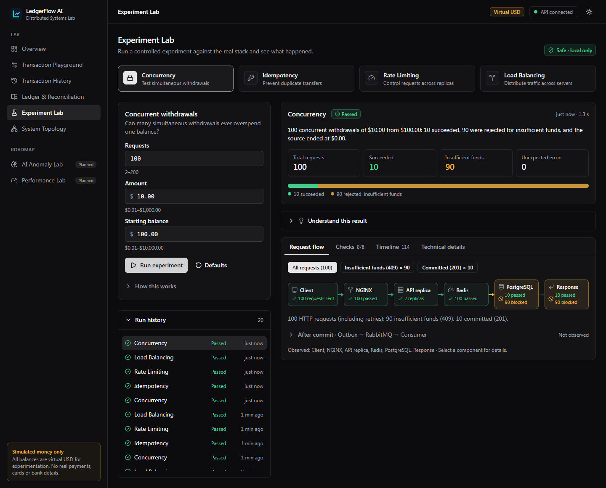

# Phase 5B UX Redesign: Reducing Cognitive Load

The Phase 5B frontend worked, but it presented everything at once. A first-time user saw
dense experiment cards, an eight-node flow diagram full of sentences, and a dozen response
fields after every transfer. This pass reorganises the UI around one rule:

> **Show what happened first. Explain why and how only when the user wants to explore.**

No functionality, backend contract or data source changed. Every piece of information that
was visible before is still reachable; most of it is now one click away.

---

## 1. Initial UX problems

| Area | Problem |
|---|---|
| Experiment Lab: selection | Large cards repeated the title, concept, duration and a safety badge; the four of them filled the left column before the user had chosen anything. |
| Experiment Lab: configuration | Expected behaviour, steps, the concept, every parameter description and the risk note were shown together with the form. Money was entered in cents ("1000"). |
| Experiment Lab: results | Six full cards stacked at once (summary + 8 metrics, flow, invariants with descriptions, explanation, details, a timeline of 100+ rows). |
| Experiment Lab: history | Each history row was a two-line card with a badge and a check count. |
| Request flow | Eight nodes, each with icon, label, glyph, a detail sentence and counts; the async lane was always open; edges animated forever. Nothing said which states were observed and which were inferred. |
| Playground | The result panel showed about 11 metadata fields, the guidance, the rate-limit line and the attempt log together; the pipeline explainer was always expanded. |
| Ledger | A teaching block came before the live verdict; all four invariants showed descriptions and observed values even when everything passed. |
| Topology | Ten component cards with paragraph descriptions were always visible, plus the step list. |
| Overview | Every stat carried a two-line caption; two separate health cards each had a sentence and a metadata line. |

## 2. New information hierarchy

Each page now has one primary message, then secondary detail on demand.

| Page | First thing you see | On demand |
|---|---|---|
| Experiment Lab | Four compact cards (name + one line) → title, one question, 2–3 inputs, **Run experiment** | "How this works"; safety note (click the "Safe · local only" chip) |
| Run result | Status, one-sentence summary, **4 key numbers**, one small picture | "Understand this result"; tabs: Request flow · Checks · Timeline · Technical details |
| Playground | Pick source → destination → amount → **Send transfer**; result = outcome, amount, route, confirmed balances, what next | "Request details" (status, code, ids, key, replica, latency, quota, error body); "Attempts"; "Request path"; "What happens inside a transfer" |
| Ledger | "Ledger balanced — all checks passed" (or "Reconciliation failed — discrepancies detected") | Invariants; discrepancies (open automatically on failure); "How double-entry works"; postings |
| Topology | The flow diagram for the selected flow | Component details (click a node), "Step by step", "All components" |
| Overview | Four numbers, one status strip ("Ledger balanced · API ready"), chart, recent activity | "Status details" (accounts and entries checked, database/Redis/replica) |

## 3. Progressive disclosure decisions

- **Closed by default, open on failure.** Invariant lists, discrepancies and the guided
  explanation open on their own when something failed, because that is when the detail
  matters. A violated invariant row starts expanded.
- **Summaries on the toggle itself.** Collapsed sections say what they hide: "Request
  details · HTTP 201 · api-1", "Invariants · 4 of 4 hold", "Checks 8/8", "Timeline 114",
  "Run history 20", "Request path · Committed (201) · api-2". You often don't need to open
  them.
- **Choices persist where they should.** The Playground's request-path section stays open
  across new transfers once opened. Run history starts open on wide screens and closed on
  narrow ones.
- **No hover-only information.** The Lab's safety note is a click toggle, not a tooltip.
  Node details are a panel opened by click or keyboard.
- **Content is not rendered while closed**, which keeps long pages fast. Nothing is
  fetched differently: the data is already loaded.

## 4. Request Flow Visualizer changes

| Before | After |
|---|---|
| 8 nodes (idempotency, row locks, ledger separate) | 6 nodes: Client → NGINX → API replica → Redis → PostgreSQL → Response. The three PostgreSQL stages are listed inside the PostgreSQL details |
| A sentence inside every node | Name + icon + glyph + one short value (state, replica name, "201 · Passed", or "10 passed · 90 blocked") |
| Replica chips inside the lane | The serving replica's name on the node; every replica with its count in the details |
| Async lane always open | "After commit · Outbox → RabbitMQ → Consumer", collapsed, labelled **Not observed** |
| Continuous dash animation on every edge | One travel animation per request (skipped for reduced motion), then static |
| No provenance | Every component is labelled **Observed**, **Inferred**, **Not observed** (pending), **Unknown**, **Not applicable** or **Illustration**; a one-line summary under the diagram |

**Evidence rules** (`flowModel.ts`). *Observed* only when the response proves it:
- the replica: `X-Served-By`
- Redis: `X-RateLimit-*` headers or a 429/limiter error
- NGINX: `X-Request-ID`
- PostgreSQL: a 201 body, a replay header or a 200 read

Everything else is *inferred* from the response plus the documented order of operations.
For example, "rows locked, balance too low" is inferred from `409 INSUFFICIENT_FUNDS`. The
outbox row is inferred (written in the same commit by design). Publishing and consumption
are never claimed: they are "Not observed". Topology presets are wrapped with
`asIllustration`, so nothing there can read as live data. There is still no tracing, and
the UI says so.

**Node interaction.** Each node is a button (`aria-pressed`, keyboard-operable). Its
details panel shows:
- the component's responsibility
- its state and evidence label
- what happened for a single request, or per-state counts for a run
- the PostgreSQL stages, or every replica with its count
- on Topology, deployment facts from docker-compose.yml

**Outcomes covered:** success, insufficient funds, idempotent replay, rate-limited (429),
retryable dependency failures (lock conflict 503, limiter down 503, key in progress 409),
key reuse (422), validation errors, server errors, no response, and load-balanced reads
(aggregate mode).

**Layout.** Nodes share the row width (minimum 100 px). They wrap only when a column is too
narrow: 3 + 3 in the laptop lab layout, a single row at 1440 and 768 px, and a vertical
list on phones. There is never page-level horizontal scroll.

## 5. Reusable component patterns

| Component | Location | Used by |
|---|---|---|
| `Disclosure` | components/common/Disclosure.tsx | How this works, Request details, Attempts, Request path, Status details, Invariants, Discrepancies, How double-entry works, Step by step, All components, Run history, Understand this result, After commit |
| `Tabs` (+ `tabPanelProps` in lib/a11y) | components/common/Tabs.tsx | Run details, Topology flows |
| `StatusSummary`, `CompactMetric` | components/common/StatusSummary.tsx | Reconciliation verdict, run key results |
| `InvariantCheckList` (expandable rows) + `InvariantSummary` | components/lab/InvariantCheckList.tsx | Experiment checks, reconciliation |
| `RequestFlowDiagram` | components/lab/flow/ | Lab, Playground, Topology |
| `ExperimentCard` (compact selection) | features/lab | Lab |
| `ExperimentDetail` (config + "How this works") | features/lab | Lab |
| `RunPanel` (result summary + tabs), `ResultVisual`, `GuidedExplanation` | features/lab | Lab |
| `EmptyState`, `ErrorState` | components/common/states.tsx (unchanged) | everywhere |

The guided explanation always follows the same four questions:
1. What are we testing?
2. What happened? (the run's own summary)
3. Why does it work? (the backend's explanation lines)
4. Explore the implementation (steps and source paths)

## 6. Accessibility and responsiveness

- Disclosures use `aria-expanded`/`aria-controls`. Tabs follow the WAI-ARIA tabs pattern
  (one tab stop; arrows, Home and End). Flow nodes and invariant rows are buttons. The
  details panel is a labelled region with a close button.
- Every state is conveyed by an icon and a word as well as colour (Passed / Blocked /
  Replayed / Failed / Skipped).
- The travel animation and spinners respect `prefers-reduced-motion`. The page-level status
  regions (`System status`, `Reconciliation`) are labelled landmarks.
- Verified with Playwright at 1440, 1024, 768 and 390 px:
  - no horizontal page overflow on any page, Experiment Lab and Topology included
  - the Run button and node details stay reachable
  - tables and the tab strip scroll internally
- On narrow screens the Lab's DOM order is configuration → result → history, so the result
  is not pushed below a long history list.

## 7. Functionality preserved

- **All four experiments, every parameter and bound.** Money is now entered in dollars and
  converted to integer cents with the existing exact parser. Backend validation is
  unchanged.
- **Checks, timeline and metadata.** Every invariant check, every timeline event, every
  metric, the per-replica tables, the token strip and the counterfactual are all still
  there (Checks / Timeline / Technical details).
- **Transfer semantics, unchanged:**
  - a new key per logical transfer, the same key for retries
  - the payload is locked on ambiguous or retryable outcomes
  - the Retry-After countdown
  - outcome classification
  - no balance refresh on uncertain outcomes
- **What the Playground now shows of that:** balances only after a *confirmed* new movement
  (never for replays or uncertain outcomes), read from the refreshed account list.
- **History.** URL filters, server-side pagination and the detail drawer are unchanged.
- **Reconciliation.** It shows success only when the backend returns `ok: true`.
- **No backend change** in this pass, and no new data source. Every number still comes from
  the API.

## 8. Design tradeoffs

- **Hidden means one more click.** Engineers who want the HTTP status or request id now
  open "Request details". The toggle's own label shows the status and replica, which
  covers the common case.
- **Grouping PostgreSQL stages** makes the lane scannable, but where a request stopped
  inside the transaction (key claim vs row lock) is now in the details panel rather than
  on the lane.
- **Aggregate node colour = majority state.** With 10 commits and 90 rejections the
  PostgreSQL node reads "blocked". The counts beside it make the split explicit.
- **Tabs hide parallel information.** You can't see checks and flow side by side any more.
  Clicking a timeline request switches to the flow tab automatically, so the most common
  cross-reference stays one click.
- **The tab strip scrolls horizontally on phones** rather than wrapping. That keeps tab
  labels intact.
