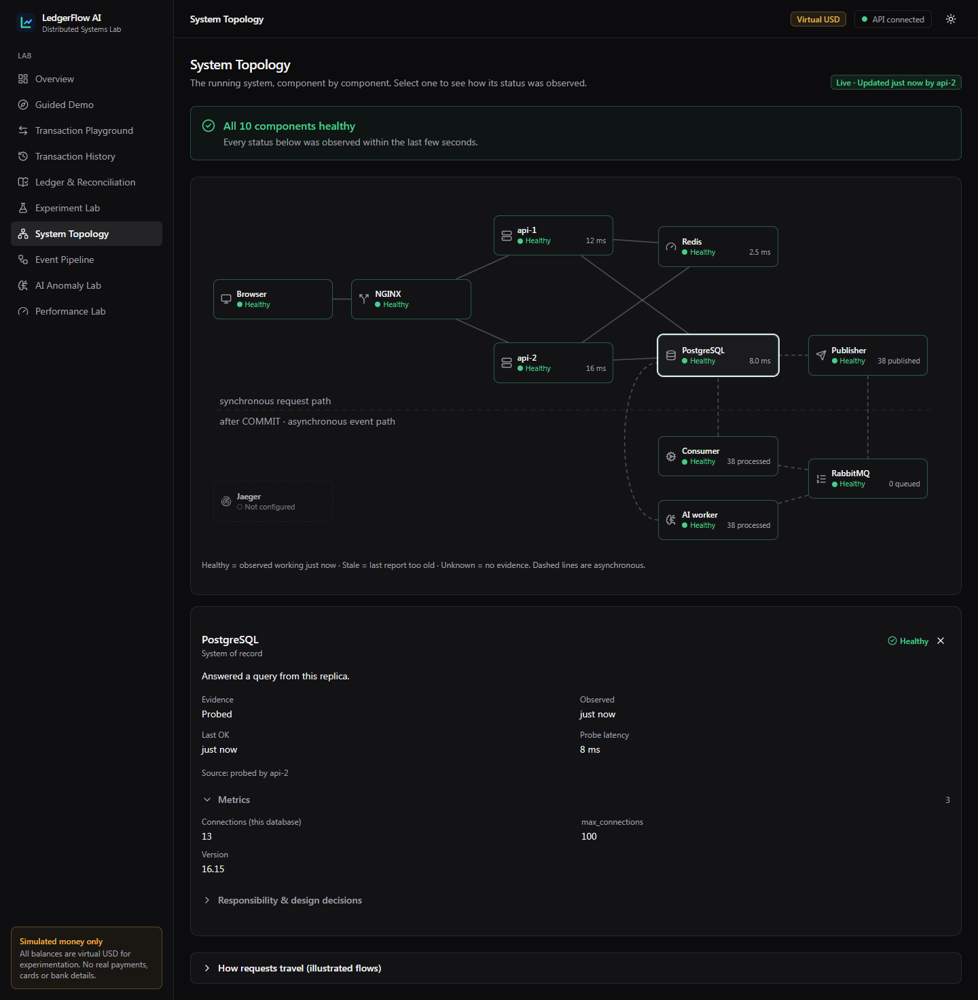

# Phase 5C: Live topology, request lifecycle and event pipeline

Phase 5C makes the running system observable from the browser. Every status shown is
backed by evidence and labelled with it, and nothing old is shown as current.



## 1. What was added

| Piece | Where | What it does |
|---|---|---|
| Worker heartbeats | `app/observability/heartbeats.py`, table `worker_heartbeats` (migration 0005) | Publisher and consumer self-report from their main loop |
| Topology probe | `app/observability/topology.py` | Parallel, time-bounded health of every component, each with its evidence |
| Event pipeline read model | `app/observability/pipeline.py` | Outbox/consumer aggregates, keyset-paginated events, per-transfer lifecycle |
| Optional tracing | `app/observability/tracing.py`, Compose profile `observability` (Jaeger 2.5) | OpenTelemetry spans across the API, publisher and consumers |
| Trace reader | `app/observability/traces.py` | Reads one trace back from Jaeger and reduces it for the UI |
| API | `app/api/routes/observability.py` | Six read-only `GET` routes under `/api/v1/observability` |
| UI | `/topology`, `/events`, the lifecycle explorer in the Playground and History drawer | Live graph, event progress, eight-stage request lifecycle |

## 2. Where each status comes from

The API never asks Docker anything and never mounts the Docker socket. Each component's
status comes from something the application can observe itself:

| Component | Evidence | How |
|---|---|---|
| NGINX | `request` | The snapshot request itself carries NGINX's `X-Request-ID`. Without it: `unknown`. |
| api-1 … api-N | `probe` | HTTP `GET /health/ready` on the internal network. 200 means healthy. 503 means degraded (the process is up but a dependency is down). No answer means unhealthy. N comes from `NGINX_UPSTREAMS`, so names are never taken from a request. |
| PostgreSQL | `probe` | `SELECT 1` latency, connections, `max_connections`. |
| Redis | `probe` | `PING` + `INFO` on the rate limiter's own pool (250 ms timeouts). |
| Publisher, consumer | `heartbeat` | Their own row in `worker_heartbeats`. |
| RabbitMQ | `derived` | The API never connects to the broker. Workers report whether their connection is up, and the consumer reports queue depths (passive declares). |
| Jaeger | `probe` | Only when tracing is on. |

**Why heartbeats, not container state.** A container can be "running" while its loop is
stuck or cut off from the database. A heartbeat row can only be written by a loop that
runs *and* reaches PostgreSQL. Each beat states its own deadline (`next_beat_before`),
which is three intervals of grace plus any back-off the worker announces. A reader
compares that deadline with the database clock. A worker that dies or hangs turns
`stale`. It never stays `healthy`.

**Bounded probes.** All probes run in parallel. A stopped replica or Jaeger costs one
0.5 s connect timeout, because their addresses are pinned in `/etc/hosts` (the same
fixed-IP workaround as Phase 3 uses for Redis and PostgreSQL). Without the pinning, a
lookup of a stopped container takes about 7 s.

**Freshness in the UI.** The page polls every 5 s. If no snapshot has succeeded for 15 s,
every status is shown as `stale` ("Last known: healthy"), never as current.

Status vocabulary: `healthy`, `degraded`, `unhealthy`, `stale`, `unknown`,
`not_configured`.

### Verified by stopping real components (local stack)

| Action | Topology reported |
|---|---|
| `docker compose stop redis` | redis `unhealthy` (TimeoutError), api-1/api-2 `degraded` ("redis unavailable") |
| `docker compose stop api-2` | api-2 `unhealthy` ("No answer within 0.5 s"), api-1 healthy |
| `docker compose stop rabbitmq` | publisher and consumer `degraded`, RabbitMQ `unhealthy` (derived, with `AMQPConnectionError`) |
| `docker compose stop event-consumer` | consumer `stale` after its deadline ("Last heartbeat 26 s ago") |
| restart | everything back to `healthy` within one heartbeat |

## 3. Tracing and correlation

```
browser ─► NGINX (X-Request-ID) ─► api-N  [server span]
                                     ├─ rate_limit.check ── EVALSHA (Redis)
                                     └─ transfer.create
                                          ├─ idempotency.claim ── INSERT …
                                          └─ ledger.post ── SELECT … FOR UPDATE, UPDATE, INSERT
                                               └─ outbox.write   ← traceparent stored on the row
                         ── COMMIT ── response (X-Trace-Id) ─────────── async boundary
outbox-publisher  outbox.publish (PRODUCER, parent = stored traceparent) → AMQP header traceparent
event-consumer    event.consume ledger-audit (CONSUMER, parent = header) ── INSERT receipt, effect
```

- **Two ids, two jobs.** The *correlation id* is NGINX's `X-Request-ID`. It is stored on
  the outbox row and copied into the AMQP message and the audit row, and it always exists.
  The *trace id* exists only when tracing is on. It is returned as `X-Trace-Id` and stored
  as `outbox_events.trace_parent`.
- **The context crosses the asynchronous boundary twice.** The request's context is
  persisted in the same COMMIT as the event, so the publisher can continue the trace even
  after a restart. The publisher then injects `traceparent` into the AMQP headers for the
  consumers.
- **Off by default.** With `OTEL_ENABLED=false` the OpenTelemetry API is a no-op: no
  exporter, no headers, `trace_parent` stays NULL. Health and polling endpoints are
  excluded from tracing. If Jaeger is down, spans are dropped in the background exporter
  and requests are unaffected.
- **Financial behaviour is unchanged.** Spans only observe. `test_tracing.py` repeats the
  transfer, replay and insufficient-funds flow with tracing on and checks balances,
  replays and reconciliation.

Enable it:

```powershell
$env:OTEL_ENABLED="true"; docker compose --profile observability up -d --wait
# Jaeger UI: http://127.0.0.1:16686   (loopback only, in-memory storage)
```

A real traced transfer produced 28 spans from three services. The async boundary (COMMIT
to `outbox.publish`) was about 230 ms, which is the publisher's poll interval.

## 4. Request lifecycle explorer

One reusable component (`LifecycleExplorer`) shows eight stages: request received,
replica selected, rate-limit decision, idempotency evaluation, database transaction,
response, publication and consumer processing. It combines three sources and never mixes
them up:

1. **What the browser received**: status, `X-Served-By`, `X-RateLimit-*`,
   `Idempotent-Replayed` and the measured round trip. This exists only in the Playground,
   for the transfer the page itself sent.
2. **Persisted state**: the transfer row, the outbox row (`attempts`, `last_error`,
   `published_at`) and the consumer receipts. Stage durations come from those timestamps.
3. **Trace spans**, when present: per-stage durations and the replica.

Each stage is `observed`, `derived` (necessarily true, e.g. a committed transfer was
admitted by the rate limiter), `pending`, `failed` (the publish attempt failed and will
be retried), `unknown` or `not applicable`. A timing appears only where one of the
sources measured it. For a History item, "replica selected" is `unknown`, because which
replica served a request is not stored, and the response is `derived`.

The explorer polls persisted state every 1.5 s until nothing is pending (at most 2
minutes). A dashed separator marks where the response was sent and the asynchronous
part begins.

## 5. Event pipeline page

- **Default view:** a one-line verdict ("Events are flowing", "N failed to publish and
  will be retried", "N messages in a dead-letter queue") and four stage tiles: outbox
  waiting, published, queued in RabbitMQ (plus DLQ), consumed.
- **On demand:** publish lag p50/p95, events needing more than one publish attempt, the
  last publisher error, and per consumer: receipts, effects applied on a redelivery,
  counts since start, queue depths.
- **Events:** a newest-first keyset-paginated table (at most 100 per page) with filters
  Recent, Waiting, Retrying and Published. Selecting an event opens the lifecycle
  explorer with its event id, correlation id and trace id. Payloads are not returned; only
  the amount and the transfer id are.
- **Live updates** use TanStack Query polling (summary every 3 s, first page every 5 s).
  SSE was not added: polling is adequate at this scale and needs nothing special from
  NGINX.

## 6. Safety

- All observability routes are `GET` (enforced by a test over the OpenAPI document).
  They are mounted only with `ENABLE_DEV_ENDPOINTS=true`, because they reveal internal
  topology and error messages.
- Pages are bounded (`limit ≤ 100`), cursors are validated (422 `INVALID_CURSOR`), and
  trace ids must be 32 hex characters before they are put into a URL.

## 7. Limitations

- **Single-replica view per snapshot.** Probes run from whichever replica NGINX picked
  (shown as "Updated by api-N"). "Last OK" for probed components is that replica's memory
  since it started.
- **RabbitMQ health is second-hand.** It is derived from worker connections. If every
  worker is down, the broker is `unknown`, not `unhealthy`. The management API is not
  used, because that would give the API broker credentials.
- **NGINX emits no spans.** The stock image has no OpenTelemetry module. Its evidence is
  the request id, and the server span starts in the replica.
- **Which replica served a historical transfer is not stored.** Only the Playground
  (response header) or a trace can show it.
- **Timestamps are PostgreSQL `now()`**, i.e. transaction start. "Published" measures
  outbox creation → broker confirm recorded, including the publisher's poll interval.
- **Jaeger uses in-memory storage**, so traces disappear when it restarts. With tracing
  off, the UI says so and uses persisted state only.
- Polling, not push. The topology can lag reality by up to one poll interval plus one
  heartbeat interval.
