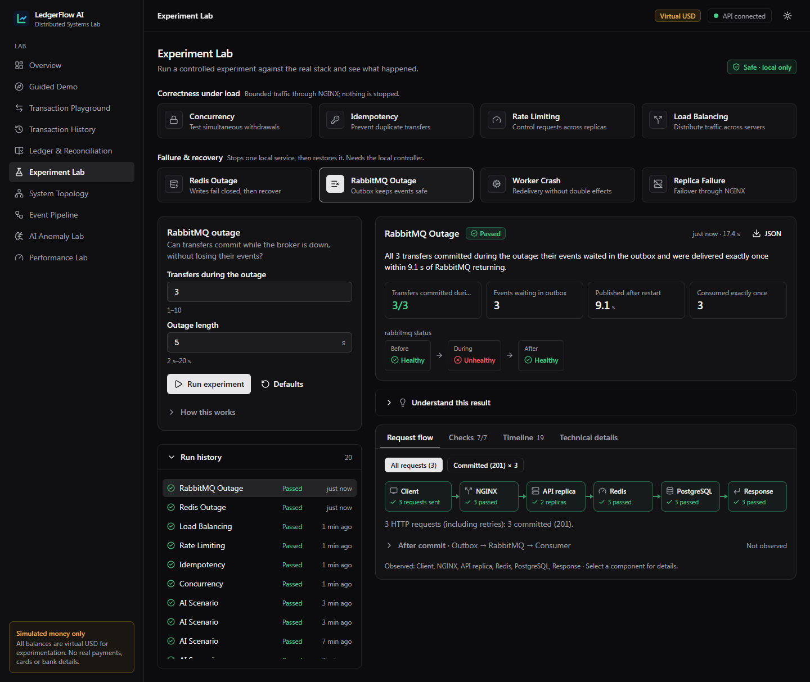

# Phase 5D: Controlled failure and recovery lab

Four experiments really stop a local service, measure what clients and the event pipeline
observe, restore the service and verify the recovery. These were the CLI demos; they now
run from the browser too, without giving the API any power over infrastructure.



## 1. The safety architecture

```
browser ──/api/*──────────► Vite proxy ─► NGINX ─► api-1/api-2   (can NOT stop anything)
        ──/controller/*───► Vite proxy ─► labctl on 127.0.0.1:8090
                            (adds token)    │  allow-list: redis, rabbitmq, event-consumer, api-2
                                            │  fixed `docker compose stop|start|up` argument lists
                                            ▼
                                     docker compose (this machine)
both write/read the same lab_runs tables in PostgreSQL ─► the UI follows any run through the API
```

| Requirement | How it is met |
|---|---|
| No infrastructure control in the API | The API image contains only `app/`. The controller lives in `labctl/` and is never copied into it. The API's run-creation schema rejects the four failure ids (422), and a unit test asserts this. |
| No Docker socket in internet-facing containers | Nothing mounts it. The controller runs on the host and uses the local Docker CLI. |
| Disabled by default | `python -m labctl` alone serves status only. Failures need `--enable-failures`. The controller refuses to start with `APP_ENV=production` or a non-local PostgreSQL. |
| Loopback only | Binds `127.0.0.1` (not configurable). Requests need a loopback `Host` (DNS-rebinding defence) and, if an `Origin` is sent, a local one. |
| Not usable by other web pages | Every request needs a random per-start token. The Vite dev server reads it from `.ledgerflow/controller-token` and adds it server-side, so the browser never sees it. CORS preflights are always refused, and no CORS headers are ever sent. |
| Strict allow-list | Four experiment ids, bounded integer parameters (`extra="forbid"`) and `confirm: true`. Infra actions come from a fixed map (`labctl/infra.py`). Container names, commands and queue names never come from a request. The only environment the controller can set is the two development-only consumer fault hooks, and only to a UUID. |
| One at a time | An in-process lock, plus the existing partial unique index on active `lab_runs`. A running API experiment blocks the controller and vice versa. |
| Bounded | Bounded parameters, per-wait timeouts, a 300 s run limit and a 180 s limit per docker command. |
| Cleanup and recovery | Each disruptive action is written to a journal before it happens. `guarded()` always restores the journaled services, even on error, timeout or cancellation, then checks they are running. |
| Interrupted runs | On startup a leftover journal is restored and its run is marked `error` ("restored on restart"). |
| Honest failure | If restoration fails, the run ends as `error: RECOVERY FAILED … docker compose up -d --wait`, and the journal is kept for the next attempt. |

## 2. Experiments

Each experiment first checks its preconditions. If the stack is not healthy, it aborts
without stopping anything. It reuses the Experiment Lab machinery: isolated `lab-…`
accounts, signed lab traffic through NGINX, recorder, timeline and invariant checks.

| Experiment | Disturbs | Verifies |
|---|---|---|
| Redis outage | `stop redis` → probe writes → `start redis` | 503 `RATE_LIMITER_UNAVAILABLE` for every write, fast; no transfer, balance or ledger change; reads still 200 (fail open); every replica ready again; retrying a failed key commits exactly once |
| RabbitMQ outage | `stop rabbitmq` → N transfers → `start rabbitmq` | transfers commit (201) while the broker is down; their outbox rows stay unpublished (not lost); all are published afterwards; each is consumed exactly once (1 receipt, 1 effect) |
| Worker crash | stop consumer → transfer → recreate consumer with `CONSUMER_CRASH_{AFTER,BEFORE}_COMMIT_EVENT=<event id>` | the process really exits (log line plus Docker restart count); after-commit crash → redelivery recognised by its receipt; before-commit crash → rollback, then real processing; one effect each; queue drained (acked) |
| Replica failure | `stop api-2` → reads + a transfer and its retry → `start api-2` | before: both replicas serve; during: every successful read from api-1, and transient 502/504s are counted, not hidden; one transfer for the retried key; after: both serve again |

The worker-crash hooks are the existing development-only settings (`Settings` refuses
them in production). They fire only on an event's first delivery, so redelivery shows
the recovery path.

### Results on this machine (real containers, 2026-11-20)

All four passed both through the controller API and from the browser (Playwright,
`E2E_FAILURES=1`):

| Experiment | Observed |
|---|---|
| Redis outage | 3/3 writes refused with 503 RATE_LIMITER_UNAVAILABLE, slowest 259 ms; read during outage 200; every replica ready 0.2 s after `start`; the retried key committed once |
| RabbitMQ outage | 3/3 transfers committed during a 5 s outage; 3 events unpublished meanwhile; published 11.1 s after restart (publisher back-off) and consumed exactly once (1/1 each) |
| Worker crash | 2 real crashes (restart count 1 each); effects 1 / 1; duplicate recognised after the after-commit crash, none after the before-commit crash; queue (0, 0); slowest recovery 7.5 s |
| Replica failure | 12/12 reads answered by api-1 while api-2 was stopped, 0 transient errors; committed → replayed → replayed, 1 transfer; api-2 serving again 2.8 s after `start` |

Global reconciliation passed after every run.

## 3. UI

The Experiment Lab shows two groups: *Correctness under load* (API) and *Failure &
recovery* (controller). A failure experiment explains exactly why it cannot run (no
controller, or `--enable-failures` missing), opens a confirmation dialog saying what will
be stopped, and then shows the same run panel as the other experiments. The result leads
with one sentence, four numbers and the disturbed component's status before → during →
after. The details tab adds per-event outbox state (RabbitMQ), per-scenario crash
evidence (worker) and replica sequences per phase.

## 4. Running it

```powershell
python -m labctl --enable-failures         # terminal 1 (127.0.0.1:8090)
cd frontend; npm run dev                   # terminal 2, then open /experiments
# or headless:  E2E_FAILURES=1 npx playwright test e2e/failure-lab.spec.ts
```

## 5. Tests

- `tests/integration/test_lab_controller.py` (fake Docker runner, real lab tables):
  missing or wrong token, foreign Origin and Host, CORS preflight, disabled controller,
  production and non-local refusal, invalid ids, parameters, confirmation and extra
  fields, the allow-list (services, environment, queues), cleanup after success and
  after failure, timeout, recovery failure reporting, exclusivity (also against an API
  run) and interrupted-run recovery.
- `tests/unit/test_lab.py`: the API never accepts a failure experiment.
- Vitest: gating messages, confirmation before any request, start via `/controller`
  (never `/api/v1/lab/runs`) and the result strip.
- Playwright: all four, from the browser, against real containers (opt-in).

## 6. Limitations

- **Local Compose only.** The controller drives `docker compose` in this repository. It
  is a lab tool, not a production chaos platform.
- **Recreating the consumer uses the controller's environment.** If the stack was started
  with `OTEL_ENABLED=true` but the controller was not, the recreated consumer runs without
  tracing.
- **The request-flow tab shows only what the HTTP responses saw.** The asynchronous
  recovery evidence (outbox rows, receipts) is in the result and details views.
- **The token protects against other web pages, not other local users.** Anyone who can
  read files in the repository can use the controller, as they could use `docker` itself.
- Only `api-2` is ever stopped, so the stack always keeps one replica serving.
