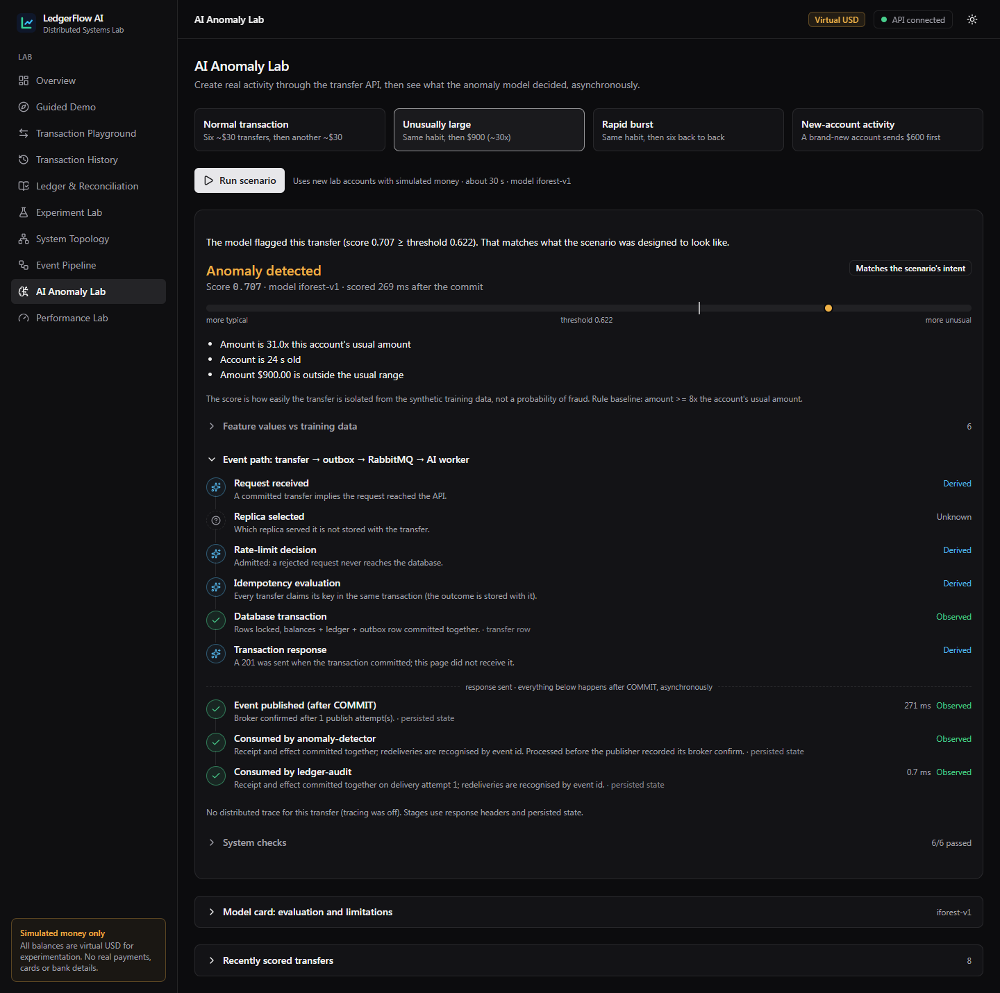
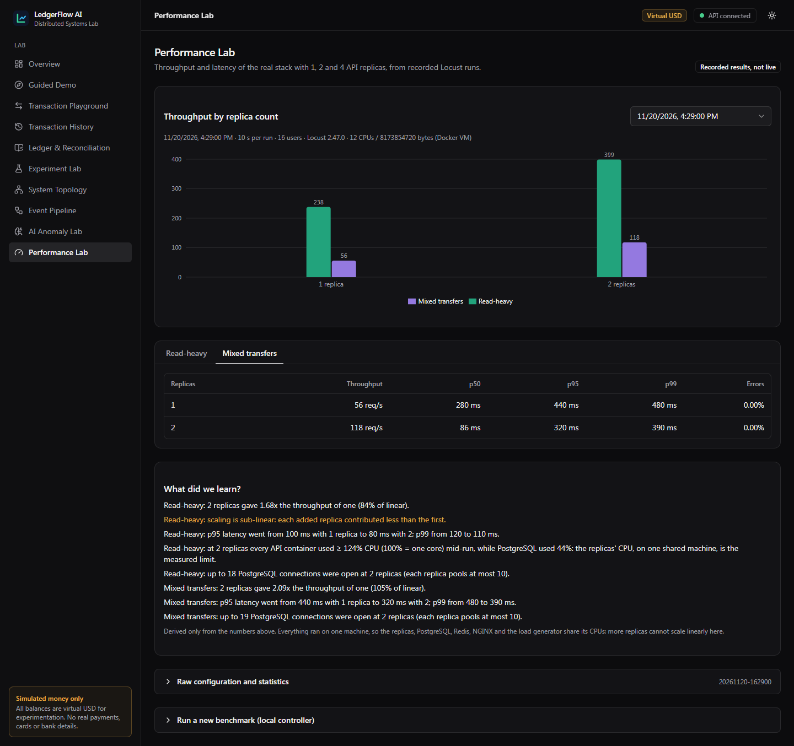

# Phase 5E: AI Anomaly Lab and Performance Lab

## Part 1: AI anomaly detection



### 1.1 What existed before

Nothing. The repository had the event pipeline (outbox, RabbitMQ, an idempotent
consumer) but no model, no anomaly storage and no anomaly API. The UI page was a
labelled placeholder. Everything below is new and deliberately minimal: an unsupervised
model on top of the existing pipeline. There is no generative AI.

### 1.2 Pipeline

```
transfer API ─ COMMIT (transfer + ledger + outbox row) ─ 201 to the client
                    │ (async, after commit)
outbox-publisher ─► RabbitMQ topic exchange ─► ledgerflow.ledger-audit    (audit consumer)
                                           └─► ledgerflow.anomaly-detector (ai-worker)
ai-worker, ONE transaction per delivery:
  INSERT processed_events(event_id,'anomaly-detector') ON CONFLICT DO NOTHING
    duplicate → ack, nothing else
    new       → features from the account's EARLIER transfers (SQL aggregates)
              → IsolationForest score → INSERT anomaly_results → COMMIT → ack
```

- **The AI worker is another `EventConsumer`.** It gets manual acks, bounded retries, a
  DLQ, heartbeats and trace propagation from the existing consumer code, plus its own
  queue and receipts. `account.funded` events get a receipt and no result.
- **Exactly once per event.** `anomaly_results.event_id` is the primary key and
  `transfer_id` is unique, written in the same transaction as the receipt. A redelivery
  finds the receipt and is acknowledged without scoring again (tested).
- **Transfers never wait.** The API image has no scikit-learn; a test checks that
  `create_app()` imports neither `sklearn` nor `joblib`. Live runs measured the 201 in
  20–66 ms and the stored result 80–533 ms after the commit. The "response did not wait"
  check verifies that no result exists when the 201 arrives.
- **Separate image.** Dockerfile target `ai` adds `requirements-ai.lock`
  (scikit-learn 1.9.1, numpy 2.5.5, scipy 1.18.1, joblib 1.6.0): 688 MB, against 335 MB
  for the API image, which does not carry them. The pins equal the training environment,
  because the artifact is a pickle.

### 1.3 Features, and why they cannot see the future

`app/ai/features.py::compute_features` is the only feature function. Its inputs are the
transfer and `PriorStats`, facts about the source account strictly before the
transfer's timestamp:

| Feature | Meaning |
|---|---|
| `log_amount` | log1p(amount in $) |
| `amount_vs_baseline` | log(amount / median of the account's last ≤200 earlier transfers); 0 without history |
| `log_prior_transfers` | log1p(number of earlier transfers) |
| `burst_60s` | earlier transfers in the preceding 60 s |
| `log_secs_since_prev` | log(0.1 + seconds since the previous transfer); without one, the account's age |
| `log_account_age` | log1p(seconds since the account was created) |

The training replay (`prior_from_history`) and the worker (`prior_stats`, SQL) compute
the same `PriorStats`. Tests check that appending future events never changes an earlier
row, and that the SQL and in-memory statistics are identical at several cut points.

**A bug this parity test now guards against.** The first live run reported "8880
earlier transfers" for a 6-transfer account. `max(Transfer.created_at)` had referenced
the base table instead of the subquery, which made a cartesian product. The verdict
happened to look right. The fix aggregates only the subquery's columns, and the parity
test fails on the old code.

### 1.4 Data, training and evaluation (`python -m app.ai.train`)

- **Synthetic and deterministic** (seed 20261120): 1,200 normal accounts + 48
  new-account anomalies, 128,076 transfers on a compressed clock (seconds stand in for
  hours or days, so lab scenarios can reproduce patterns live). The injected anomalies
  are `large` (8–40× the account's usual amount), `burst` (5–9 transfers 0.05–0.6 s
  apart, labelled from the 3rd on) and `new_account` (first transfer 0.2–4 s after
  creation, 10–40× the population's typical amount).
- **Split 60/20/20 by account**, so no account's history appears in two splits.
- **Isolation Forest** (200 trees, 256 samples, `random_state` = seed) fitted on the
  training rows without labels. The threshold maximises F1 on the validation split. All
  metrics below come from the held-out test accounts. Retraining reproduces the artifact
  byte for byte (same MD5).

| Held-out test (17,817 normal, 228 large, 50 burst, 12 new-account) | Isolation Forest | Rule baseline |
|---|---|---|
| Precision | 0.766 | 0.972 |
| Recall | 0.689 | 0.982 |
| F1 | 0.725 | 0.977 |
| False-positive rate | 0.33 % | 0.04 % |
| Recall: large / burst / new-account | 0.778 / **0.000** / 1.000 | 0.985 / 1.000 / 0.833 |
| Single-row inference, CPU | p50 19 ms (Windows host), 8–10 ms in the container | — |

**How to read this.** The rule baseline (≥8× usual amount, <1 s after a previous
transfer, a first transfer above $500) restates how the generator creates anomalies, so
on this data it is close to an upper bound, not a fair proxy for the real world. The
forest learns without labels and finds large amounts and odd new accounts, but it misses
the bursts. A burst is unusual in a single feature, which is a known weakness of
Isolation Forests, and the threshold is dominated by the more numerous large-amount
anomalies. Bursts do score above normal (median 0.54 vs 0.43); they just fall below
the threshold.

**Two corrections made during development, both disclosed here:**

1. `log1p(seconds since previous)` compressed sub-second gaps and was replaced by
   `log(0.1 + s)`.
2. The first synthetic world made every live lab account (seconds old) look anomalous by
   age alone. Normal accounts now start transacting 1–120 s after creation. This was
   checked offline against the lab scenarios' timings, not tuned on the test split.

### 1.5 AI Lab (`/anomalies`)

The user picks one of four scenarios. The run is an allow-listed lab experiment
(`anomaly_scenario`, traffic only) that builds real activity through NGINX, sends the
final "probe" transfer and waits for its stored result. The verdict comes first:
anomaly or not, the score against the threshold on one line, up to three plain-language
deviation notes, the model version, and whether it agrees with the scenario's intent.
Collapsed below: feature values against the training range, the event path (lifecycle
explorer, including `Consumed by anomaly-detector`), system checks, the model card and
recent results.

**Pass/fail covers the system only:** committed, the response did not wait, scored,
exactly one result and one receipt, ledger reconciled. The verdict is never a check, and
the UI says "matches/differs from the scenario's intent", never "correct".

Live results (2026-11-20):

| Scenario | Score (threshold 0.622) | Model | Rule baseline | Agreement |
|---|---|---|---|---|
| Normal | 0.549 | not flagged | — | matches |
| Unusually large ($900 vs ~$30 habit) | 0.707 | flagged | amount ≥8× | matches |
| Rapid burst | 0.621 | not flagged | <1 s after previous | **differs** |
| New-account $600 first transfer | 0.709 | flagged | first transfer >$500 | matches |

### 1.6 APIs (read-only, development surface)

`GET /api/v1/ai/model` (model card), `GET /api/v1/ai/results` (newest first, `limit ≤ 100`,
`anomalies_only`, `account_id`), `GET /api/v1/ai/results/{transfer_id}` (404
`AI_RESULT_NOT_FOUND` until scored).

### 1.7 Limitations

Synthetic data only, with no claim about real fraud. The compressed clock is a
simulation device. Only the source account's own history is used (no counterparties,
devices or geography). The score is relative unusualness, not a probability. The
explanations describe feature deviation from the training data, not the model's
internal attribution. Bursts go undetected by the model. There is no retraining, drift
monitoring or feedback loop.

## Part 2: Performance Lab



### 2.1 Data

The page shows the JSON files the existing Locust harness writes
(`benchmarks/results/<timestamp>.json`). Compose mounts that directory read-only into
the replicas, and `GET /api/v1/performance/benchmarks` returns the newest 30 files
(bounded size, malformed files reported as such). Nothing is measured by the page,
nothing is hardcoded, and the header says "Recorded results, not live". Each run is
labelled with its date, duration, users, Locust version and host.

Phase 3 recording `20261111-130734` (30 s per run, 64 users, 12-CPU Docker VM, Locust in a
container on the same host):

| Replicas | Read-heavy req/s | Mixed req/s | Mixed p50 / p95 / p99 ms | Errors |
|---|---|---|---|---|
| 1 | 307 | 100 | 620 / 940 / 1100 | 0 % |
| 2 | 492 | 168 | 370 / 660 / 910 | 0 % |
| 4 | 837 | 297 | 210 / 510 / 710 | 0 % |

The "What did we learn?" bullets are derived only from these numbers: 4 replicas gave
2.73× (read-heavy) and 2.98× (mixed) the throughput of one, i.e. 68 % and 75 % of linear,
reported as sub-linear. Every API container used ≥ 93 % CPU at 4 replicas on a shared
machine. Up to 39 PostgreSQL connections were open.

### 2.2 New runs

`python -m labctl --enable-benchmarks`, then "Run a new benchmark" in the UI. The
controller runs the unchanged harness with fixed arguments (`--duration 10–60`,
`--users 8–64`, `--replicas` ⊆ {1, 2, 4}, `--source controller`, `--skip-quota-run`
unless requested) after an explicit confirmation. The harness always uses the separate
`ledgerflow_bench` database and restores the default stack in `finally`. The controller
adds:

- a time limit, after which it kills the run and restores the stack itself (a killed
  process never reaches its own `finally`)
- exclusivity with failure experiments and API lab runs
- the output tail in the UI

While a run is in progress, the stack serves the benchmark database. The page says so.

**Verified from the browser** (2026-11-20, `20261120-162900`, 10 s per run, 16 users,
1 and 2 replicas, `source: controller`): read-heavy went from 238 to 399 req/s and mixed
from 56 to 118 req/s. Two caveats:

- **Short windows are noisy.** An identical earlier verification run measured 133 req/s
  for the same read-heavy configuration. Only the last of three identical verification
  runs was kept. Use 30 s or more to compare configurations.
- **These runs are not comparable to Phase 3.** The stack now also runs the AI worker,
  which used 84–94 % CPU during the mixed workload on the same machine (it scores every
  transfer).

### 2.3 Limitations

Single machine: the load generator, the replicas and the dependencies share CPUs, so
scaling numbers say nothing about a real deployment. CPU is one `docker stats` sample
mid-run. If the controller dies mid-benchmark, the harness keeps running and restores the
stack itself.
